# The player's journey through the build

[designed: T176] This is the route a player actually walks, in order, on the route the portable
build gives them (`python3 -m goal2.desktop` with no flags). Every image is a grab of that run.
The original's own journey, for comparison, is [docs/original-game/flow.md](../original-game/flow.md)
and the playthrough [T156-R1](../original-game/playthrough.md).

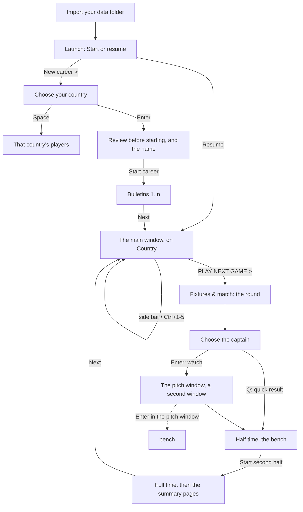

## 1. First start: the data folder

goal2 ships with no original file, so the first start asks for the folder that has them
(`goal2/desktop/data_setup.py`, T153). A folder it cannot take is named, and the dialog stays open.

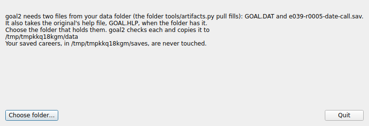

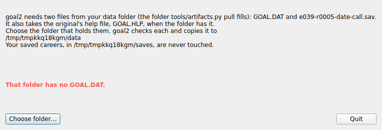

## 2. Launch: start or resume

One window with two panels: the saved career on the left, the new game on the right. With no save
the left panel says so and *Resume* is disabled.

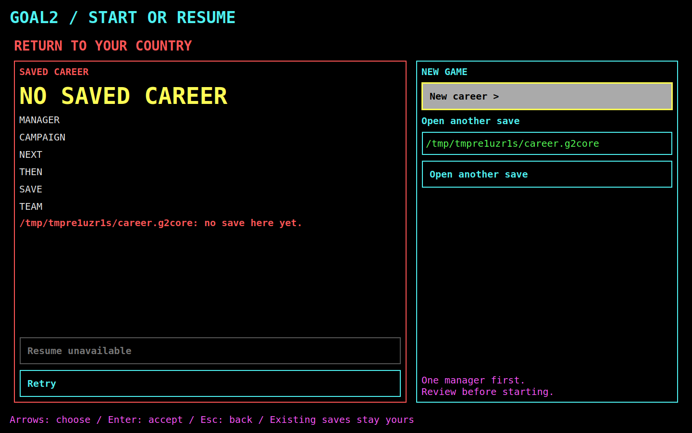

## 3. Choose your country

The 128 countries with world and continent rank on the left, the chosen country's card on the
right: team, rankings, formation with its role codes, strips, team tactics, player defaults, team
skills, performance and characteristics. *Start year* is a drop-down of 1990 or 1992. What the
build has not decoded says so in place ("not decoded yet (G05)").

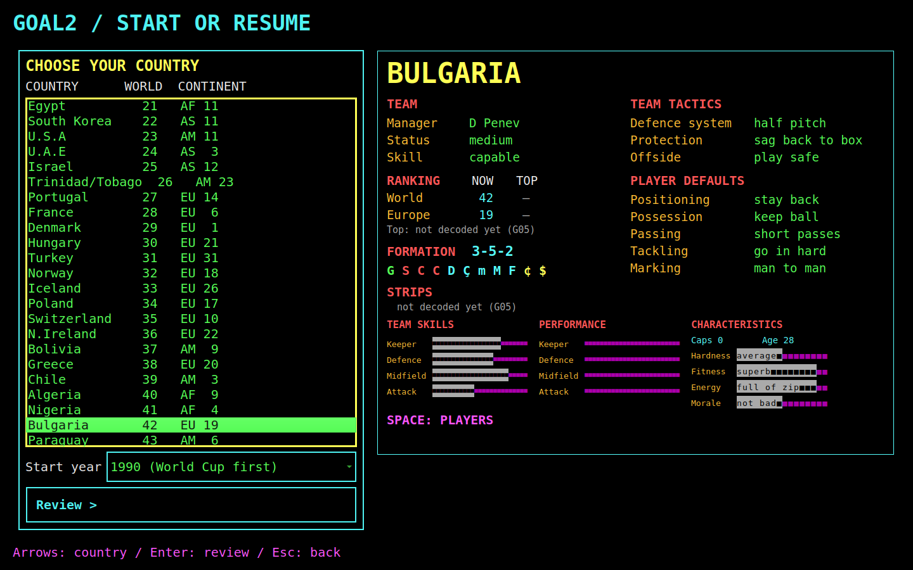

## 4. Review, and the manager's name

The choice is restated, the name is typed on this page (initial and surname, 14 characters), and
*Start career* runs the original's own new game.

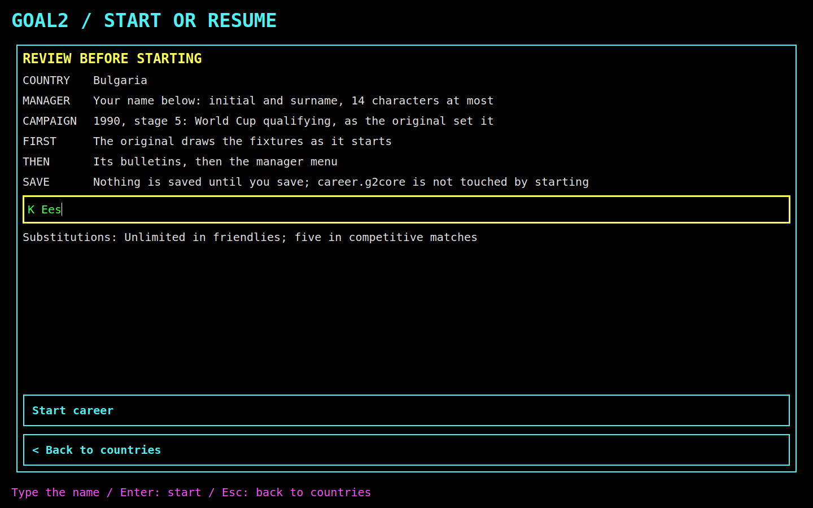

## 5. The bulletins

The original's three stories, read from its page buffer, one page at a time.

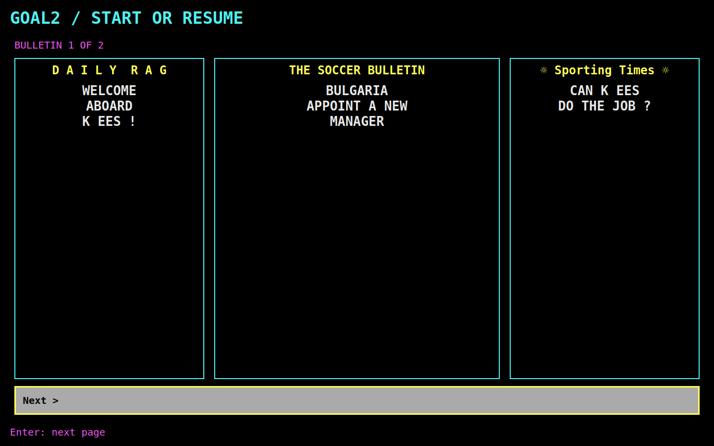

## 6. The main window: Country

The landing destination. The top bar carries the country, the manager, the campaign and the next
fixture; the side bar the five destinations and *SHOW MATCH (F8)*; the page the manager's panels,
the original's six routes and the squad strip. *PLAY NEXT GAME >* is the yellow action.

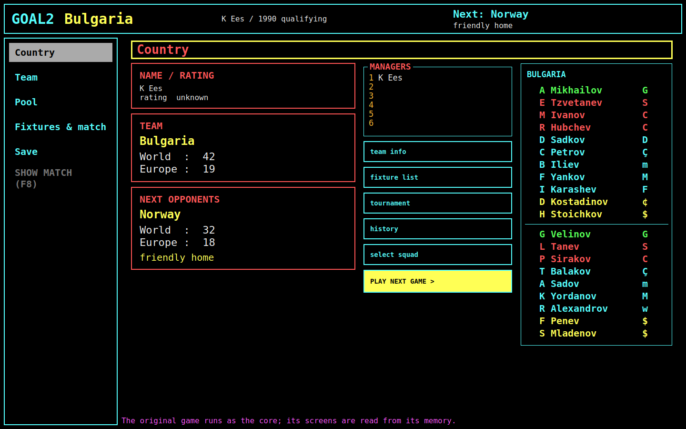

## 7. Team, Pool, Fixtures, Save

Each is one destination of the side bar, `Ctrl+1`–`Ctrl+5`. They are in
[the screen inventory](screen-inventory.md); the squad card, the team tactics, the fixture list and
the tournament table are the four a player meets every round.

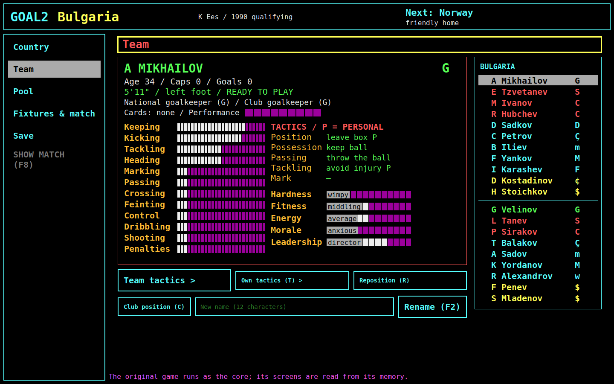

## 8. The round

*PLAY NEXT GAME >* hands the window to the round. It shows the pages the original shows, stops
where the original stops, and comes back to Country when the round is over. The match itself is
[its own chapter](match.md).

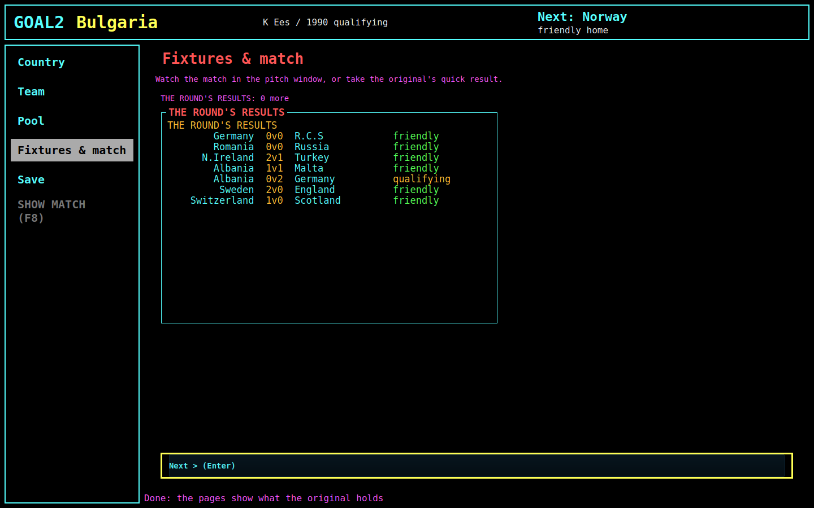

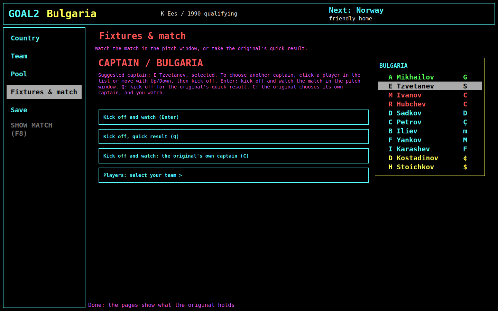

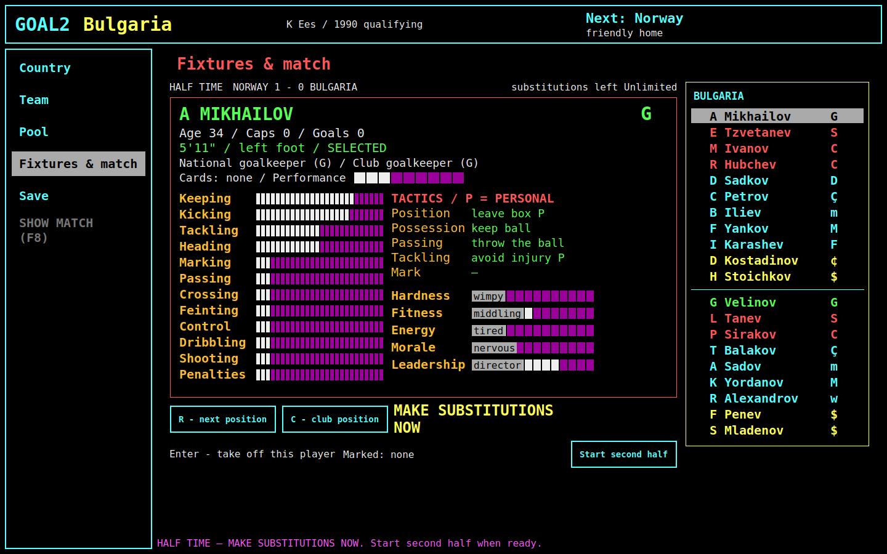

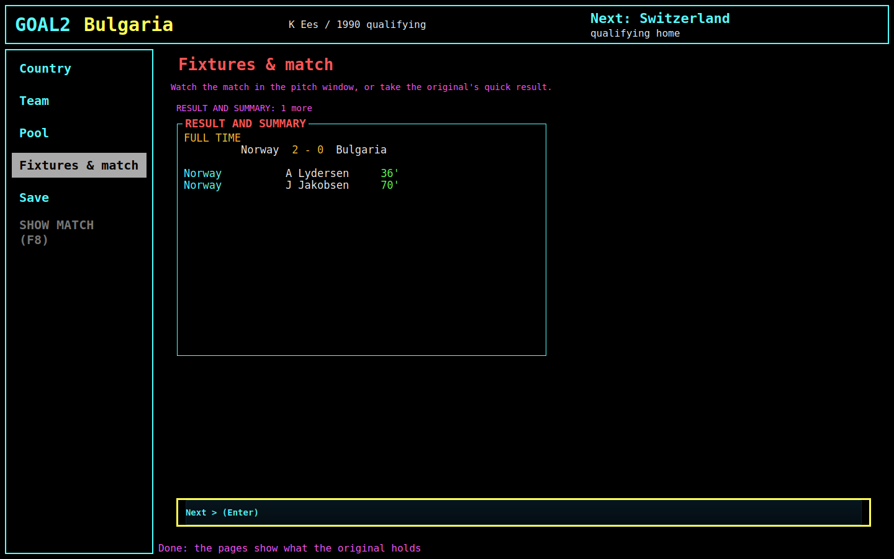

And then the window is back on Country, with the next opponent in the panel and the top bar.

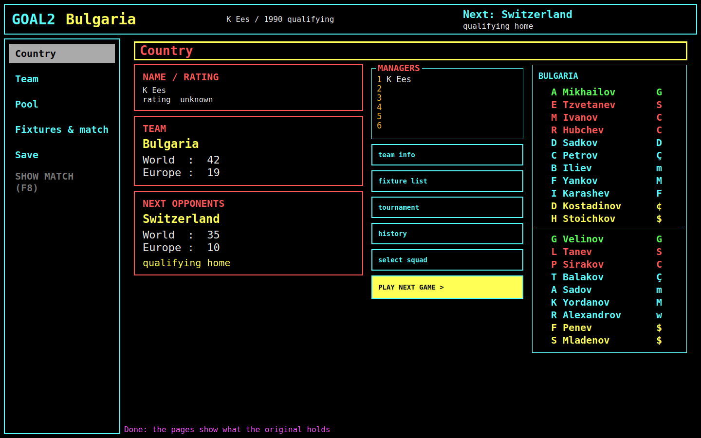

## Where this differs from the original's journey

These are differences of **route**, not of look; the look is in
[the screen inventory](screen-inventory.md).

| In the original (T156-R1) | In the build today |
| --- | --- |
| The title asks *load a saved game?* (Y/N), then for a file name | Launch shows the one save's summary with *Resume*, and a path field for another |
| 1–6 managers, each choosing a country in turn | One manager; the *Managers* board shows 1 filled and 2–6 empty |
| The country card, then the name typed over the card | The card on the browse page, the name on a separate review page |
| The hub lists six routes and the cursor starts on *team info* | The five destinations are a side bar; the six routes are buttons on the Country page |
| The whole round is screens of the one window | The round is views of the *Fixtures & match* destination |
| The match is the same screen as everything else | The match is a **second window**, and the main window shows two lines of text while it runs |
| Esc returns from every screen | Esc returns within a destination; the side bar is how a destination is left |
