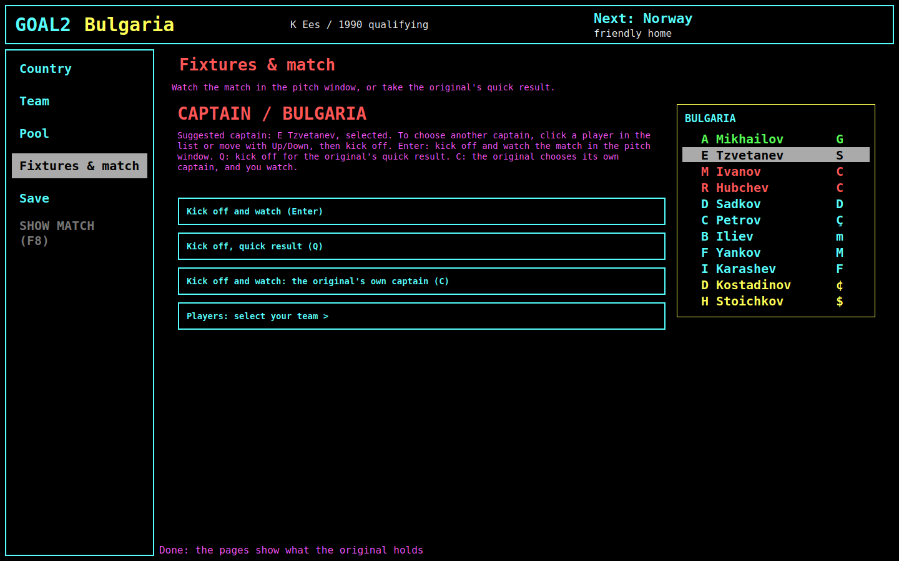
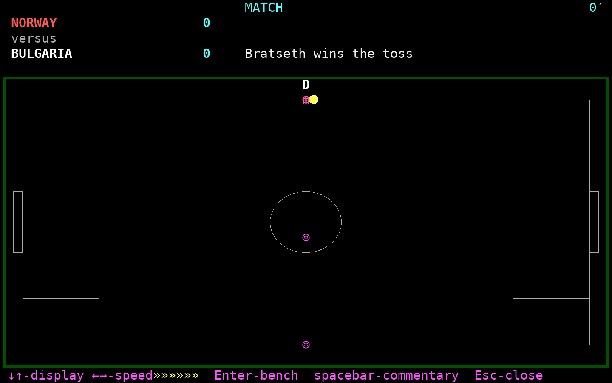
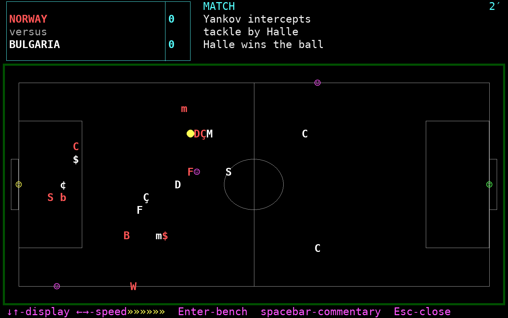
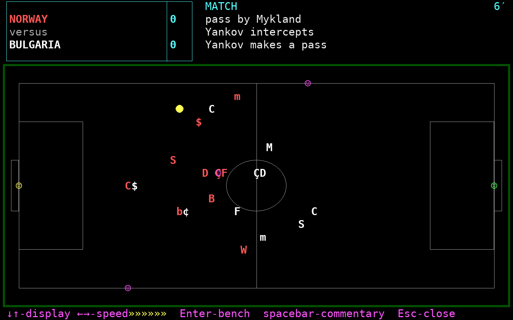
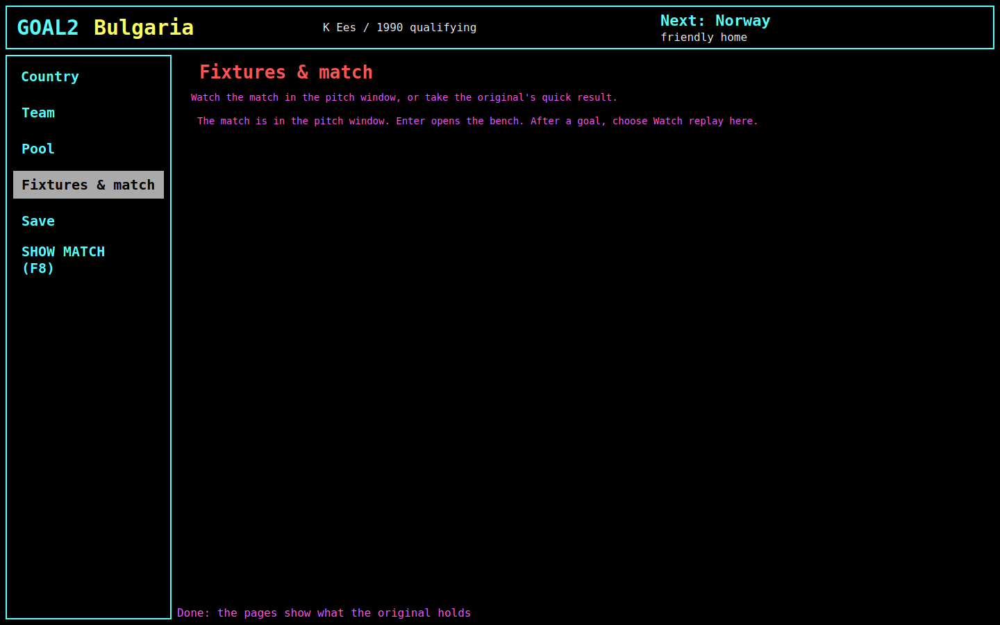
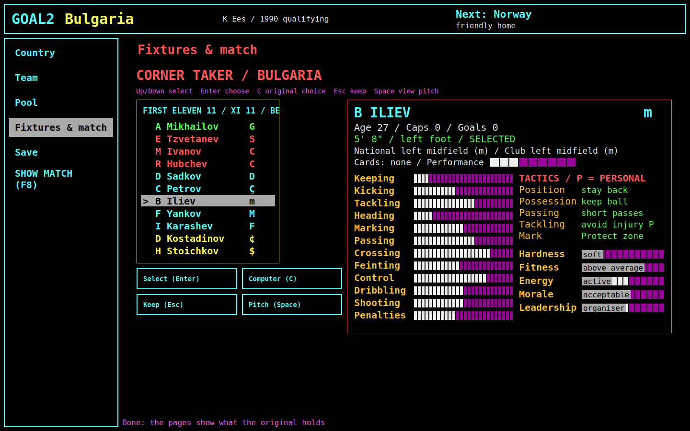
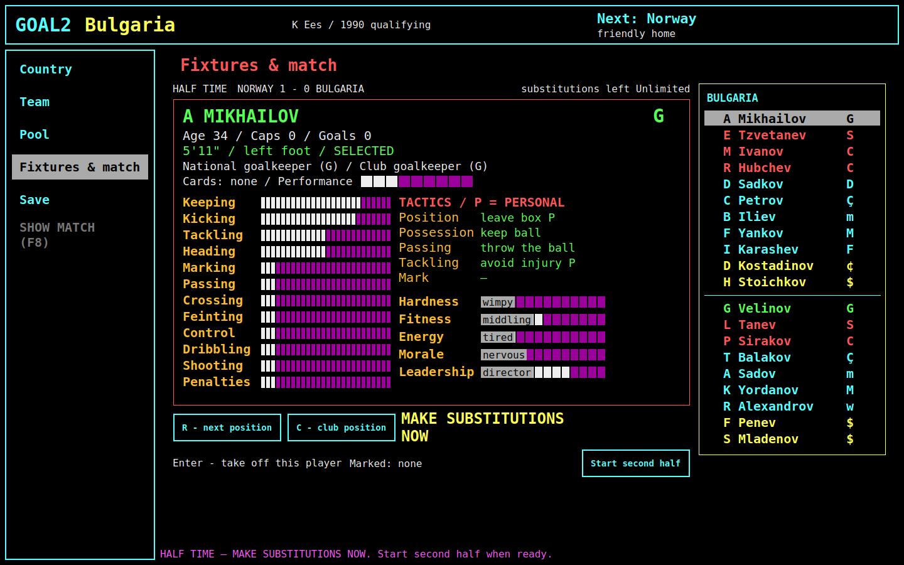
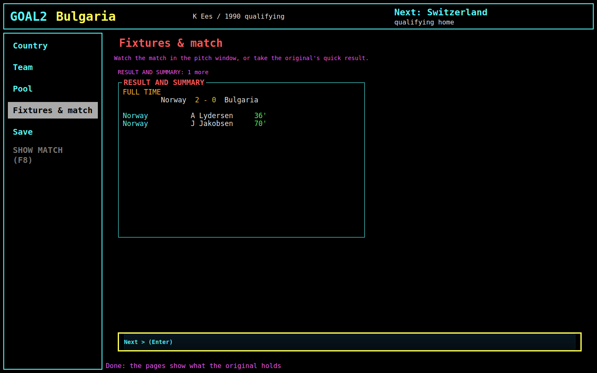
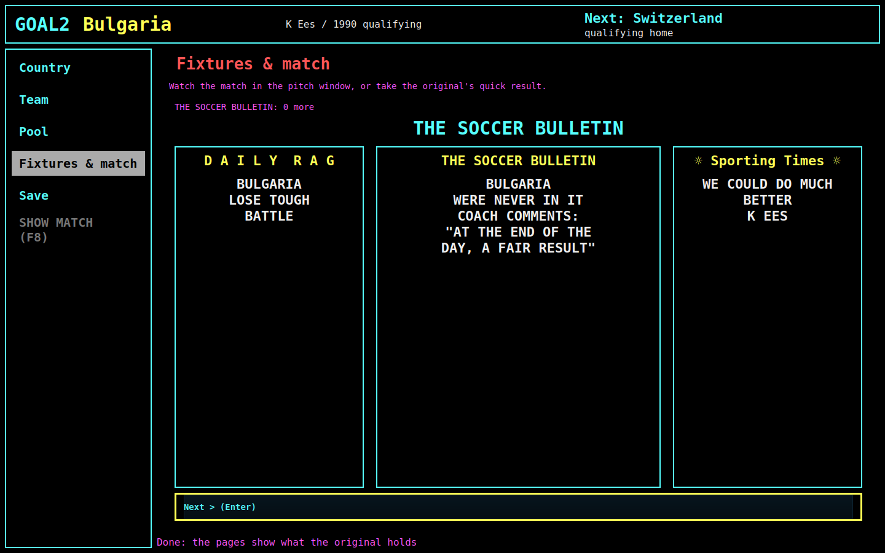

# The match, as the build plays it

[designed: T204] The match is the one part of goal2 that is **not** in the main window. *Kick off
and watch* opens a second window, drawn with pygame (`goal2/desktop/pygame_viewer.py`), while the
main window waits. The original's match is the same screen as everything else
([the original's match chapter](../original-game/match-and-results.md)).

## Choosing how the match is played

The captain screen carries the choice, which the original makes earlier and elsewhere (T155, #523):

- **Enter** — kick off with the selected captain and watch, in the pitch window.
- **Q** — kick off and take the original's quick result: no pitch, the match resolves at once.
- **C** — the original's own captain, watched.
- *Players: select your team >* — the bench before kick-off.

## The pitch window

1440×900, its own window, with the score panel and the commentary above the pitch and the key
legend along the bottom. These three are its own frames, 1´, 2´ and 6´ into a friendly:

What it draws:

| Part | Today |
| --- | --- |
| Score panel | a cyan-bordered box: `NORWAY` in light red over `versus` over `BULGARIA` in white, each score in its own cell |
| Event text | the kind of match in cyan (`MATCH`, `FRIENDLY`) and the last three commentary lines in white |
| Clock | the minute in small cyan text at the top right (`6´`) |
| Pitch | a white rectangle with the two penalty areas, the goals outside the touchline, a **centre circle**, and a green border around the whole field |
| Players | one role-code letter each, light red for the home side and white for the away side |
| Ball | a filled yellow circle |
| Marks | `☺` beside a player, and at both goals and the halfway line, when the display mode asks for them (↑↓) |
| Key legend | `↓↑-display ←→-speed»»»»»»»» Enter-bench spacebar-commentary Esc-close`, in magenta |

Measured against the original's `match-live` capture:

Both rectangles were measured from the images themselves (`magick … txt:` over
`docs/original-game/images/match-live.png` and `images/match-pitch-play.png`):

| | Original (640×400 capture) | Build today |
| --- | --- | --- |
| Pitch rectangle | 593 × 256 px, **2.32 : 1** | 1334 × 576 px, **2.32 : 1** — the same shape |
| Penalty area depth | 96 px, **16.2 %** of the length | 179 px, **13.4 %** — shallower |
| Centre circle | **none**; a plain centre line | drawn |
| Ball | a small white square | a filled yellow circle (`#ffff55`) |
| Goalkeepers | a role-code letter like every other player | `☺` |
| Home side | `#ff5555` | `#ff5555` — the same |
| Away side | `#ffffff` | `#ffffff`/`#eeeeee` |
| Surround | a green band, `#00aa00` | a green border, `#005000` — darker |
| Clock | large blocky digits in the top-right corner | small bright-cyan text (`#55ffff`) |
| Corner flags | magenta squares at the corners | magenta `☺` at the goals and the halfway line |
| Type | the VGA 8×16 bitmap glyphs | an anti-aliased modern mono face |
| Keys printed | `↓↑-display ←→-speed»»»»» R-result spacebar-commentary F9-♫ Esc,◄┘-bench` | the same line without `R-result` and `F9` |

## What the main window shows meanwhile

Nothing but two lines:

## The stops the match makes

The original asks the manager a handful of questions during a match; the build routes them to the
main window as views of *Fixtures & match*, not to the pitch window.

### A taker

`CORNER TAKER / BULGARIA`, the eleven, and the chosen player's whole card. Its keys are the
original's: **Up/Down** select, **Enter** choose, **C** the original's choice, **Esc** keep,
**Space** view the pitch. The roster heading is clipped at this width
(`FIRST ELEVEN 11 / XI 11 / BE`).

### Half time

`HALF TIME NORWAY 1 - 0 BULGARIA`, the substitutions left, the selected player's card, **R** next
position, **C** club position, **Enter** take this player off, and *Start second half*. The
original reaches its bench from the half-time match menu, which also keeps the score and the other
match actions in view.

### Full time

`FULL TIME`, the score and the scorers with their minutes, then *Next*. The original's full-time
board also carries corners, free kicks, penalties, shots, shots on target, saves, fouls, bookings,
red cards, possession, territory and MAN OF THE MATCH
([`match-summary`](../original-game/images/match-summary.png)); those are not on this page.

Then the round's bulletin, and the window returns to Country.

## Not seen in this capture

The captured friendly had no goal while the pitch was being sampled, no injury, no card, no replay
offer, no shoot-out and no extra time. The build has code for each of them
(`goal2/desktop/fixtures_page.py`'s round stops: `replay`, `replay-save`, `taker`, `taker-pitch`,
`shootout-announcement`, `shootout-order`, `extra-time-start`, `extra-time-half`, `stoppage`), and
this manual does not show them.
