# The technology for the rebuilt UI (November 2026)

This is the technology choice of the design phase (#524, task T158, issue #527), made from prototypes and
measurements. It absorbs T154 (#516): the engine boundary is its section 3. The screens it must draw are the
approved design, [docs/design/ui-2026-11](../ui-2026-11/README.md). It ends with one recommendation, its costs,
and the decisions that are the owner's. [designed: owner, 2026-11-02, #524: "a solid design phase, both for the
ui, screens and also for the technology to use"]

Pins: goal2 `aef2290e` (T157 merged), goal2rust `aa58c19` (T20), the vendored kit goal2-archaeology `b519d999`.
Every figure was measured on the owner's PC (32 logical CPUs; Windows 11 and its WSL2 Ubuntu share them), with the
load recorded beside each run (WSL's load average and Windows' CPU %), one measurement at a time.

Contents:
1. [The UI toolkit](#1-the-ui-toolkit)
2. [Which route becomes the game](#2-which-route-becomes-the-game)
3. [The engine boundary](#3-the-engine-boundary)
4. [Packaging](#4-packaging)
5. [Recommendation and its costs](#5-recommendation-and-its-costs)
6. [The owner's decisions](#6-the-owners-decisions)
7. [Measurements](#7-measurements): every table, computed from `measurements/T158/*.json`

## 1. The UI toolkit

### 1.1 The candidates and their prototypes

Each candidate has a prototype of the same screens of the approved design, in its look (the original's palette from
the design's table, the vendored PxPlus IBM VGA 8x16 font): **S06 the manager's desk**, *play next game*, **S16
choose your captain**, and the **kick-off** of S17 with the pitch in the window and the commentary beside it (the ball
circles the centre to show the frame rate). Keys and mouse work as the design says; the commands are in
[tools/tech_probe/README.md](../../../tools/tech_probe/README.md). [designed: T158]

| Candidate | What it is | Prototype |
| --- | --- | --- |
| **PySide6** (today's toolkit) | native Qt widgets styled by one style sheet; the pitch one painted widget | `tools/tech_probe/qt_probe.py` |
| **Web page, in the browser** | one HTML page and its script, drawn with the design's own stylesheet (`docs/design/ui-2026-11/mockups/style.css`, served unchanged); a standard-library HTTP server in Python; Edge's app window on Windows (`msedge --app`), Chrome or Chromium elsewhere | `tools/tech_probe/web_probe.py --shell browser`, `tools/tech_probe/web/` |
| **Web page, in a desktop shell** | the same page in pywebview's own window: Edge WebView2 on Windows, Qt WebEngine (or GTK WebKit) on Linux | `tools/tech_probe/web_probe.py --shell webview` |
| **pygame-ce** (today's pitch viewer) | everything painted on one 1440×900 surface, scaled by the window; also runs under PyPy | `tools/tech_probe/pygame_probe.py` |

Others were left out: tkinter (Tk 8.6) cannot load a font from a file, only fonts installed on the system, nor scale a page, and it would add a
fourth way of drawing; Electron or Tauri would bring Node or Rust into the UI build for what pywebview gives with the
WebView2 every Windows 10/11 has. [designed: T158]

PySide6, the desk and the captain (Linux, offscreen; `qt_probe.py --screenshot`):

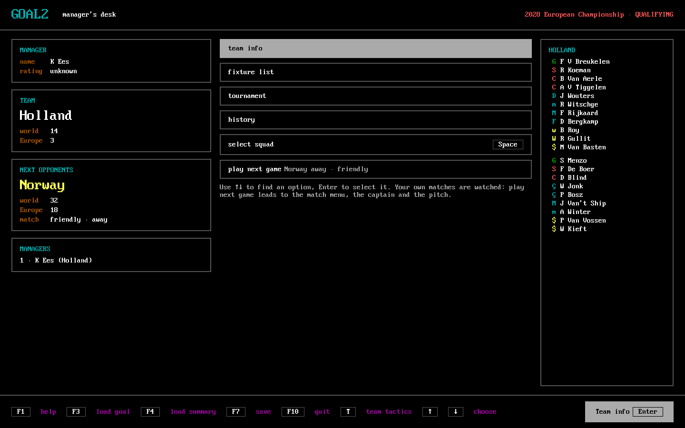
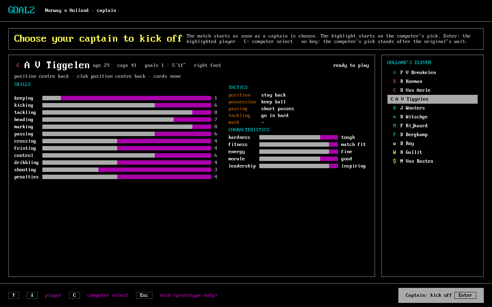

pygame-ce (Linux; `pygame_probe.py --screenshot`):

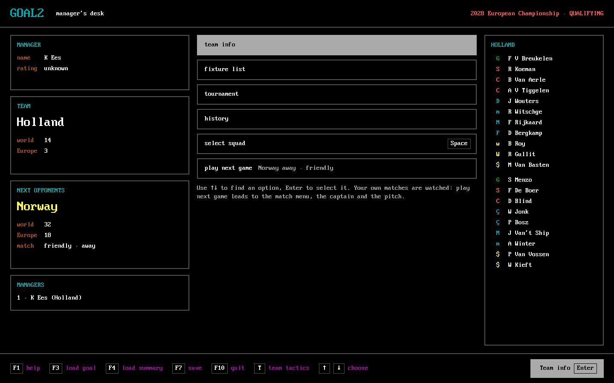
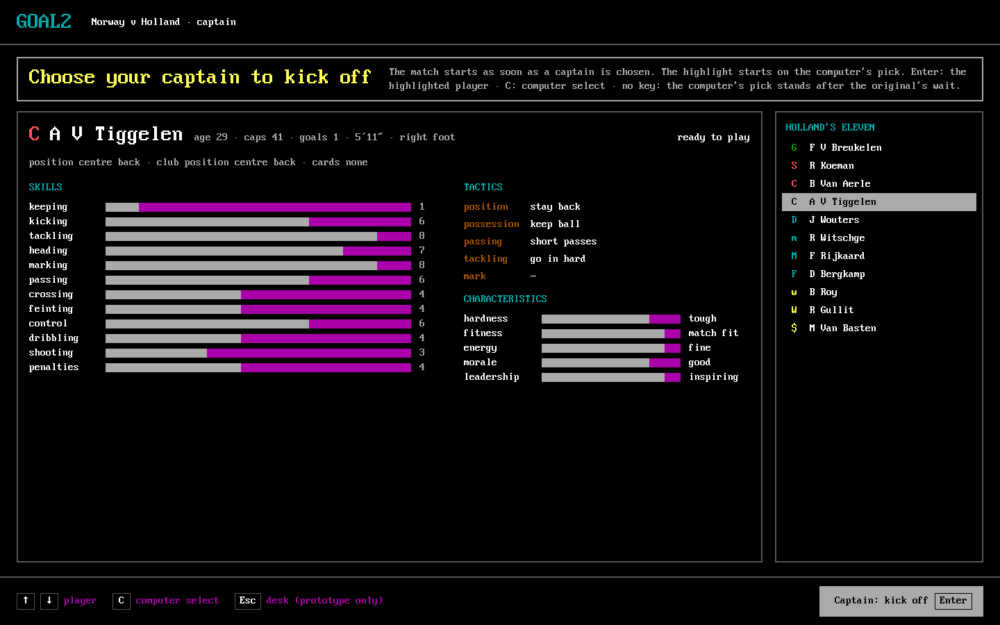

The web page (Linux, headless Chromium, `?screen=` opens a screen directly):

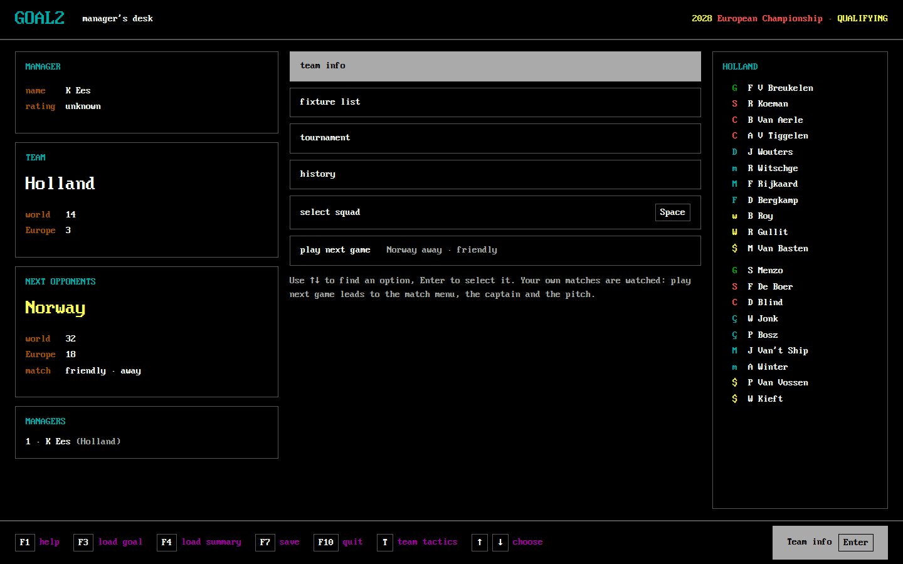
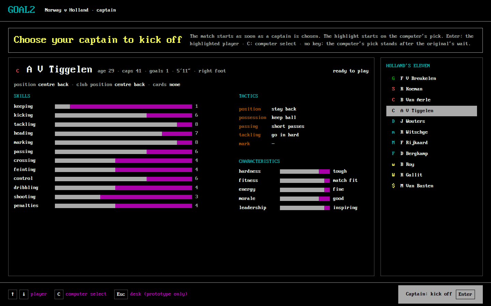

The kick-off in each (PySide6, pygame-ce, web):

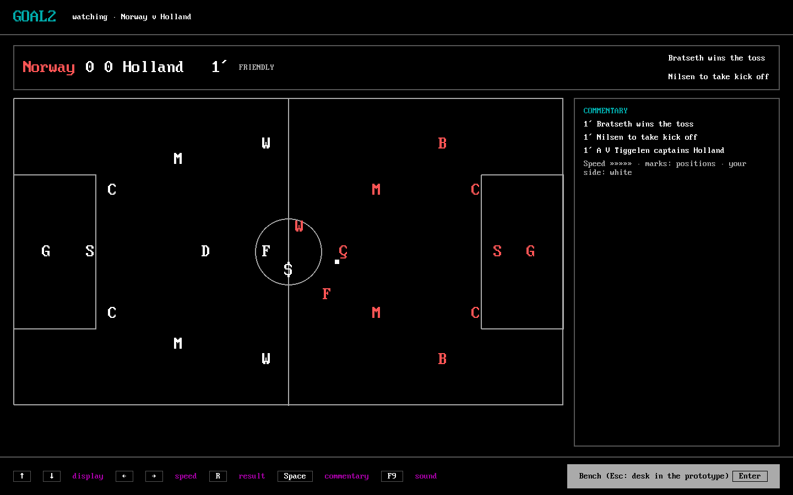
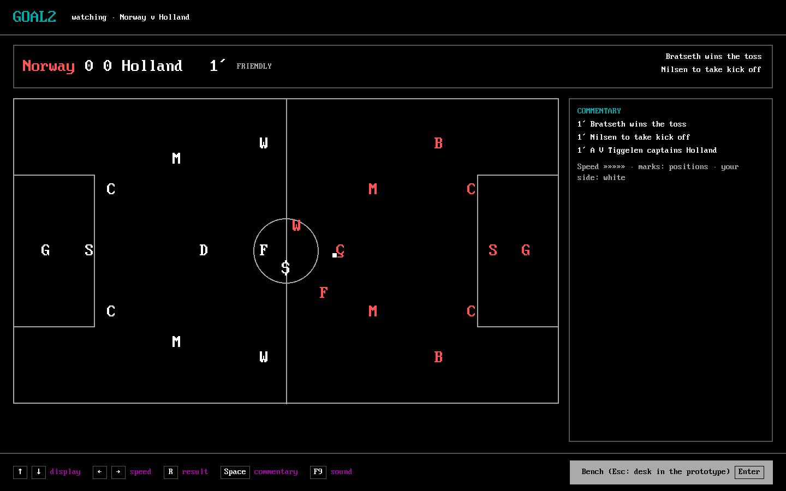
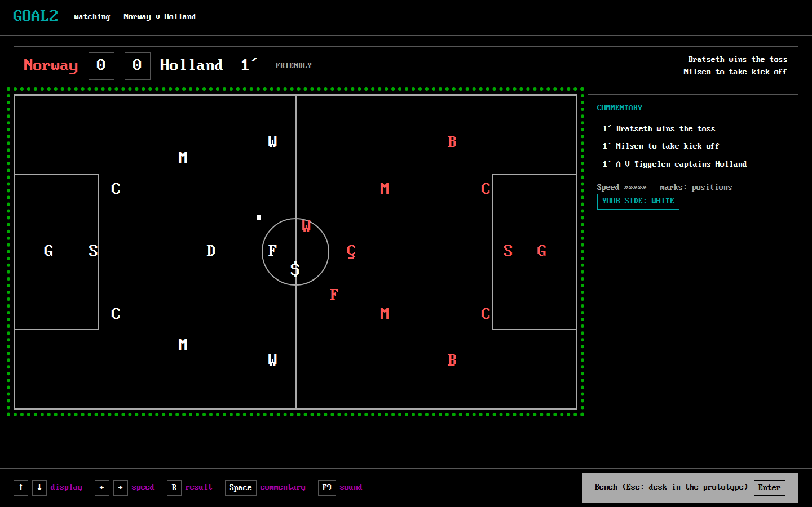

On Windows, the web page in pywebview's window (WebView2; `measure.py capture`, the window only, at the PC's 150%
display scale). Edge's app window shows the same page; its picture caught another window over it and is left out.

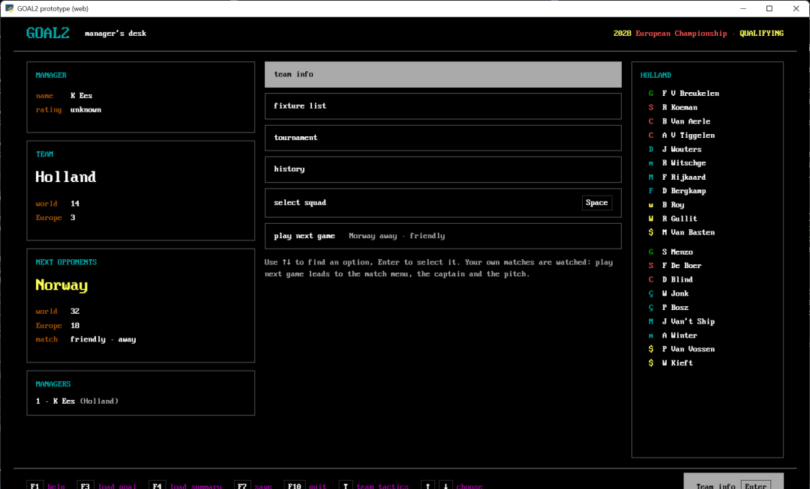

And PySide6 and pygame-ce on Windows, in their own windows:

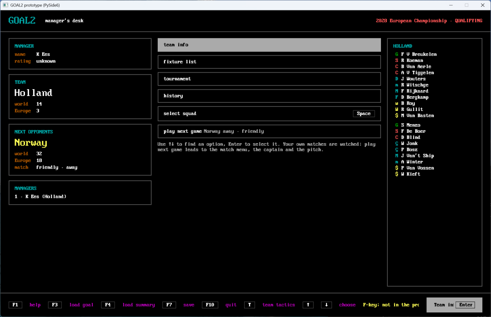
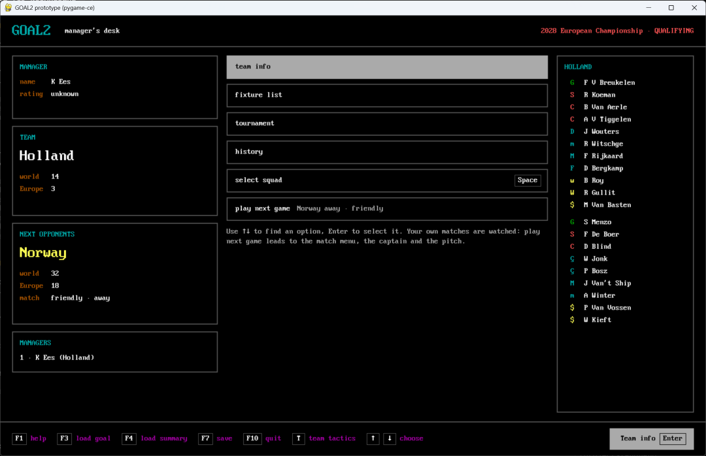

### 1.2 Judged on the task's five points

Figures are section 7's tables (Windows unless said; the portable build is Windows). [confirmed: measurements/T158]

| | PySide6 | Web page (browser or shell) | pygame-ce |
| --- | --- | --- | --- |
| **Drawing T157's screens and the pitch** | every screen by hand-built widgets and one style sheet; the font and palette fit (the screenshots); scaling the whole 1440×900 page needs goal2's FixedPage machinery, which multiplies every length (T101, `goal2/desktop/fixed_page.py`); at Windows' 150% display scale the fixed 1440×900 window became about 2160×1350 pixels, nearly the whole screen (the Windows pictures); the pitch is one QPainter widget at 60 Hz | the closest: the design's mockups *are* HTML and CSS, and the prototype serves the design's stylesheet unchanged; one CSS transform scales the page; the pitch is plain elements (or a canvas) | everything drawn by hand, including what widgets give for free (text fields for names, lists that scroll, wrapping); the window scales the page for free (SCALED) |
| **Keyboard-first play** | every key reaches the window (`keyPressEvent`), the F-keys included | the original's F1, F3, F7 and F10 are also browser shortcuts in Edge and Chrome (help, find, caret browsing, menu); the page must cancel each, and whether every shell lets it was not measured here (an automated SendKeys test proved unreliable and is not reported); WebView2 can switch its browser accelerators off [designed: T158, from the browsers' documented shortcuts] | every key is an event; no conflict |
| **Mouse** | native: hover, click, focus | native | hit rectangles kept by hand |
| **Start, first frame on screen** | 0.27 s (0.26–0.68) | Edge app window 0.37 s with a kept profile, 0.52 s with a new one, 16.5 s on the first start of the session (Edge's cold start); pywebview 0.72 s | 0.43 s; under PyPy 0.40 s |
| **Memory of everything it starts** | 76 MB resident, 35 MB private, one process | Edge 492 MB resident, 190 MB private, 9 processes; pywebview 476 / 188 MB, 7 processes | 162 / 125 MB; under PyPy 199 / 149 MB |
| **Windows portable size** | today's PySide6 is every module (WebEngine, Addons, Pdf: 162 MB of the ZIP); the widgets need only Essentials: the ZIP goes from 315 to 127 MB | the toolkit adds nothing (Edge is on every Windows 10/11) or 1.1 MB (pywebview with pythonnet): a ZIP of about 50 MB | pygame-ce 10 MB: a ZIP of about 60 MB |
| **Accessibility** | native widgets carry names and roles to Windows' accessibility tree (`setAccessibleName`, already used by goal2's pages) | the best of the three: HTML semantics and ARIA, the browser's zoom and screen readers | none: one painted surface, nothing a screen reader can read |
| **Running the engine beside it** | must stay on CPython (PySide6 has no PyPy build), so the engine is another process (section 3) or the hybrid | the Python side is only a standard-library server, so it runs on PyPy as well (measured: 0.42 s first frame with a PyPy server) and the engine can share its process; a match never blocks the page, which runs in the browser's processes | runs on PyPy too (pygame-ce has PyPy 3.11 wheels for Windows and Linux); a match on a thread of the same process made the 16 ms frame tick 21 ms late at p95 on Windows (`thread (PyPy, plain port)`), so the engine would still want its own process |
| **What goal2 has today** | 8,800 lines in `goal2/desktop/`, 59 test files that use Qt; the owner chose a desktop application with PySide6 on 2026-10-16 (#148) because "a browser game is not the best fit" | `goal2/web/` (T35–T38, 1,150 lines) was left at that pivot; a local page is not a hosted browser game, but it brings back a client and server split, a second language (JavaScript) and browser-driven tests (`tools/browser-ui/acceptance.mjs`) | the pitch viewer (`goal2/desktop/pygame_viewer.py`) |

The Linux figures (offscreen Qt, SDL's dummy video, headless Chromium, so no real window) are in section 7 for
completeness: there pygame-ce starts first (0.06 s), PySide6 next (0.10 s), the web shells last (0.34–0.42 s).

## 2. Which route becomes the game

goal2 has two routes today [confirmed: #509's re-plan, #507's correction; docs/desktop-management.md]:

- the **Core route**, the portable ZIP's default: the original's whole game runs under Unicorn inside the window's
  process (`goal2/desktop/core_model.py:351-405`), its matches included; it needs the recorded boot state, which
  holds GOAL.EXE (docs/packaging.md);
- the **Python route** (`--template`): goal2's own state, new game and campaign through qualifying, every match on the
  sealed port (`goal2/game/watched_match.py:232-235`); its `--template` savestate and the tournament's next step
  still need GOAL.EXE's memory (`goal2/game/watched_match.py:158-162`, goal2-archaeology #427).

m3 is "GOAL.EXE out entirely" [designed: owner, 2026-11-02, #509]. #509's question 1 asks which route gets there.
What each costs, in the draft m3 tasks of #509's re-plan (numbered there T155–T166; they are renumbered when written):

| | (a) Bridge the port into the Core, retire the Core screen by screen | (b) Grow the Python route, the Core a test oracle |
| --- | --- | --- |
| Bridge tasks | the port inside the Core route; the Core match worker, its views and an in-match save (2 tasks, replacing T125–T131) | none: the Python route already plays every match on the port |
| Upstream waits | #427 must come back **supported**: the live-Core entry frame, the write-set, a return boundary between `F1F6` and `B7FA` (the manager-confidence terms and `000E:4E0E` post-match news run there, #427's 2026-10-27 audit note), registers and stack, and a proof recipe. Open since 2026-10-25, `triage:needed`; an "unsupported" answer blocks (a) outright | #427's **write-set** part only (which writes and RNG words a match owns, the post-match news and confidence terms as rules to port); no live frame, ABI or return boundary, because the original's caller never runs again |
| Then, either way | port and prove route_fixture, simulate_fixture and post-match news (upstream); the native tournament continuation and world turn (T52–T55); new game, title and date code and the management rules (upstream); a native new career and management; the year change, ageing, retirement, sacking and rollover (T56–T58); a native save format; full-cycle equivalence (T59, T132, T133); Unicorn, the boot state and the template out of run time: 8 tasks | the same 8 tasks |
| The new UI (T157's design) | built over the Core's pages first (they read the original's memory), then moved to goal2's state as each Core part is retired: the screens are built twice | built once, over goal2's own state |
| Total | about 10 goal2 tasks plus the UI twice, after #427 | about 8 goal2 tasks plus the UI once; nothing waits on #427's bridge |

The Core keeps its value either way: under (b) it is the oracle every native part is proven against (CLAUDE.md
rule 15), as the m3 plan already says ("the Core a test-only oracle", #509 step 12). [derived: #509's re-plan and
the table above]

## 3. The engine boundary

T154's evaluation (#516), absorbed here. A match has to run off the window's thread whatever the toolkit.
The question is how clean the boundary is.

### 3.1 Inventory: every boundary and every message

At `aef2290e`. [confirmed: each file and line named, read at that commit]

| | Boundary | Started at | Interpreter | Transport | Route |
| --- | --- | --- | --- | --- | --- |
| B1 | watched and competitive engine worker (`goal2.game.watched_worker`, `goal2.desktop.competitive_worker`) | `goal2/game/watched_jobs.py:205` (`_PreparingProcess.poll`, after a thread wrote the input, :178-184; command :321-325) | PyPy 3.11 (`engine_python()`, `goal2/game/engine_python.py:51-63`) | five files in a private temporary folder; the window polls every 30 ms (`goal2/desktop/window.py:33-34`), 64 KiB and 32 packets a poll; the child waits 2 ms a turn (`watched_jobs.py:110-116`) | Python |
| B2 | quick friendly worker (`goal2.desktop.worker`, the Python stand-in) | `goal2/desktop/jobs.py:38` | CPython (`sys.executable`, :37) | whole JSON files; the window polls every 30 ms (`window.py:35`), the child every 20 ms (`worker.py:56`) | Python |
| B3 | pygame pitch viewer (`goal2.desktop.pygame_viewer`) | `goal2/desktop/watched.py:154`; `goal2/desktop/core_viewer.py:82-84` | CPython (`sys.executable`) | a newline-JSON journal one way and a status file rewritten by rename the other; 30 ms polls (Python route), 2 ms (Core route, `fixtures_page.py:683`) | both |
| — | the Core's engine (the original under Unicorn) | `goal2/desktop/core_model.py:360` (a one-thread pool), polled at 30 ms or 1 ms (`core_window.py:148`, `:247`) | CPython, in the window's process | no process boundary | Core |

Messages:

| Boundary | Window to child | Child to window |
| --- | --- | --- |
| B1 | `input` (the encoded game, `watched_jobs.py:180`); `request.json` {token, fixture, frames, bench, options} (:312-314); the `commands` journal, length-prefixed JSON [token, seq, kind, value] (`_command`, :509-521): `ack` (:507), `pause` (:538), `answer` {decision, substitutions} (:549), read by `CommandReader` (:84-108) | the `events` journal (`_write`, :47-59): `event`, `answered`, `pause_dropped`, `complete` (the outcome, memory zlib+base64), `error` (`watched_worker.py:76`, :53, :50, :78, :80; `competitive_worker.py:29-32`), read by `WatchedJobs.poll` (:333-404); the `frames` journal (`watched_pitch.py:112-118`, read :446-496); `errors` (stderr) and the exit code (:386-400) |
| B2 | arguments; `input.g2save`; `continue.json` (the substitution pairs, `jobs.py:104`) | `halftime.json` (`worker.py:55`), `output.g2save` (:62), `error.txt` and the exit code (`jobs.py:47`, :60-61) |
| B3 | the `display` journal: `start`, `pitch`, `event`, `frame`, `complete` (`watched.py:149-267`); `core-speed`, `focus` (`core_viewer.py:80-118`) | the `status` file {token, kind ready/closed/error, sequence, digest, frame acks, Enter requests, controls, focus} (`pygame_viewer.py:111-126`, :427-440); on the Python route the viewer's acks and Enter go on to B1 (`watched.py:235-241`): viewer to window to PyPy, three processes |

Cancel and clean-up: B1 terminates, kills, joins and removes its folder with a 40 × 50 ms retry on `PermissionError`
(`watched_jobs.py:150-162`, :556-612; `cancel_and_reap` up to 30 s); B2 and B3 the same with 0.5 s retries
(`jobs.py:107-131`, `watched.py:295-352`). No child watches whether its window is still alive.

### 3.2 The bugs these channels caused

| Issue / PR | What | Channel | State |
| --- | --- | --- | --- |
| [#233](https://github.com/diegoami/goal2/issues/233), [PR #231](https://github.com/diegoami/goal2/pull/231) | Windows: a cancelled friendly's folder cannot be deleted while the worker still holds `error.txt` (WinError 32) | B2 | fixed by a retry |
| [#236](https://github.com/diegoami/goal2/issues/236), [PR #238](https://github.com/diegoami/goal2/pull/238) | Windows: the viewer's `status` rename denied (WinError 5), the window's open refused (errno 13) | B3 | fixed by retries |
| [#254](https://github.com/diegoami/goal2/issues/254), [PR #255](https://github.com/diegoami/goal2/pull/255) | Windows: a watched match aborts on the status rename; native share flags and a POSIX rename; the input's encoding moved to a thread (`_PreparingProcess`) | B3, B1 | fixed |
| [#257](https://github.com/diegoami/goal2/issues/257) | a cancel that times out while the input is still being written reports a misleading IPC error | B1 | open |
| [PR #309](https://github.com/diegoami/goal2/pull/309), [PR #311](https://github.com/diegoami/goal2/pull/311) | a cancel at start meets a folder Windows still holds; the 0.5 s cancel times out under load, "the third failure of this family" (`cancel_and_reap`) | B1 | fixed for watched matches; the competitive bridge still cancels plainly (`competitive.py:87-89`, `window.py:374`) |
| [#316](https://github.com/diegoami/goal2/issues/316), [PR #318](https://github.com/diegoami/goal2/pull/318) | a load-sensitive cancel test; a pause the child dropped left the window's flag stuck, which needed a new record (`pause_dropped`) | B1 | fixed |
| [#377](https://github.com/diegoami/goal2/issues/377), [PR #407](https://github.com/diegoami/goal2/pull/407) | Windows: a failed test set-up left four journals open, `commands` could not be deleted | B1 | fixed |
| [#389](https://github.com/diegoami/goal2/issues/389) | Windows: cancelling a stale job times out waiting for the input writer | B1 | open |
| [#417](https://github.com/diegoami/goal2/issues/417) | a worker waiting for the bench outlives its window and spins every 2 ms forever: a file journal has no end-of-file when the window dies | B1 | open |
| [#474](https://github.com/diegoami/goal2/issues/474), [#492](https://github.com/diegoami/goal2/issues/492), [PR #490](https://github.com/diegoami/goal2/pull/490) | "watched job is stale" flakes: the race between the threaded input writer, the launch and the stale check | B1 (tests) | #492 fixed; #474 open |
| [#496](https://github.com/diegoami/goal2/issues/496), [PR #497](https://github.com/diegoami/goal2/pull/497), [PR #513](https://github.com/diegoami/goal2/pull/513) | each match re-chose its interpreter and fell back to CPython silently (a 10,900 s run); a test coupled to that choice | B1 | fixed |
| [#503](https://github.com/diegoami/goal2/issues/503), [PR #504](https://github.com/diegoami/goal2/pull/504) | Windows refuses to read `halftime.json` just renamed into place; the match was cancelled | B2 | fixed |
| [PR #510](https://github.com/diegoami/goal2/pull/510) (T147) | every match opens a console window in the portable build: the worker is `pypy.exe` started from `pythonw.exe` | B1 | open, untracked |
| [#520](https://github.com/diegoami/goal2/issues/520), [PR #517](https://github.com/diegoami/goal2/pull/517) | the viewer process closes under its window; a native replay stalls in Windows CI | B3 | #517 fixed, #520 open |
| [#352](https://github.com/diegoami/goal2/issues/352) | the 1 ms and 2 ms polls of the Core route may compete for the lock; close is seen only after the current step | B3 | open |

Fifteen rows, nine of them Windows-only, seven still open (one untracked). [confirmed: the issues and PRs
linked] The tests that exercise these channels: B1 7 files, 93 tests (`test_watched_jobs`, `test_watched_pitch_jobs`,
`test_watched_startup`, `test_watched_completion`, `test_desktop_competitive_jobs`, `test_watched_bench_t102`,
`test_pypy_worker_t152`); B2 2 files, 23 tests (`test_desktop_quick_jobs`, `test_campaign_substitutions`); B3 12
files, 117 tests (`test_desktop_watched_sharing`, `test_pygame_match_view`, `test_pygame_pitch_view`, the core pitch
tests T94–T142); three window tests go through the poll loops (`test_match_result_t97`, `test_reordered_squad_280`,
`test_match_prep_t95`). [confirmed: `grep` of goal2/tests at `aef2290e`]

The approved design puts the pitch in the main window [designed: owner decision 2, #526]: **B3 goes whatever the
toolkit**, with its status file, its rename workarounds and its 117 tests' transport half (the `match_view`
protocol tests can stay as the pitch's model).

### 3.3 Measurements: file channel, pipe, hybrid

Section 7's "Engine channels", "Engine speed" and "Engine outcome equality" tables; each channel run streams the
first 300 events of the packaged smoke's reference match (Fixture(7, 19, 21), seed 257, delay 0) to a 16 ms window
tick. [confirmed: measurements/T158/engine-*.json]

- **Process start** (to the engine imported): today's worker 0.60 s on Windows (2.08 s on the first run), 0.33 s
  on Linux; the pipe's process 0.11 s, once for the window's life.
- **Time to the first event of a match**: today 1.79 s on Windows, 1.22 s on Linux, every match (spawn, write the
  26.7 MB game to a file, read it back); the pipe 1.28 s for its first match and 0.71 s (Linux 0.48 s) for every
  later one; the hybrid on a thread 0.41 s.
- **Event to window**: today 17 ms median, 33 ms at p95: the 30 ms poll. The pipe reaches its reader thread in
  well under 1 ms; through a 16 ms tick it is 12 ms median on Windows, and with a Qt signal it would be immediate.
- **Round trip** (the window asks, the engine answers; the bench's Enter in play travels this way): today 30.4 ms,
  the pipe 0.33 ms.
- **The window's responsiveness**: with the engine in another process the 16 ms tick ran at most 0.7 ms late at
  p95. With the hybrid on a thread of the window's process it ran 15 ms late at p95 on Windows (5.5 ms on Linux):
  the remaining Python holds the lock; under PyPy with the plain port on a thread, 21 ms. **A match on the
  window's thread costs about a frame in three on Windows.**
- **Match speed** (a whole match, CPU seconds): PyPy 61.5 s on Windows, 43.5 s on Linux; plain CPython 3.67× and
  3.51× that; **goal2rust's hybrid under CPython 0.64× and 0.66× PyPy's time**, today, with 18% of the guest
  entries still in Python. One of the 15 whole-match PyPy runs on Windows exited with an error and no message after 38 s (the record keeps it; two
  reruns finished).
- **Equality**: the hybrid's outcome, events and result digests equal PyPy's plain port on all 30 matches (20
  seeds on Linux, 10 on Windows, 9 and 6 distinct scores) and on the reference match under plain CPython.

### 3.4 Option 3: one engine process over one pipe

The prototype is `tools/tech_probe/pipe_child.py`. [designed: T158] The protocol it suggests for goal2:

- **One process for the window's life**, started with the window under PyPy (or, after option 4, not at all). Both
  directions are length-prefixed JSON on the child's stdin and stdout; a binary payload follows its header (the
  encoded game is 26.7 MB today, `open_bytes` in the channel records, sent once per match in 0.15–0.2 s).
- **Requests**: `open` (the game), `match` {fixture, options, frames, bench}, `ack` {sample}, `pause`, `answer`
  {decision, substitutions}, `cancel`, `quit`. **Replies**: `ready`, `event`, `frame`, `decision`, `answered`,
  `pause_dropped`, `complete` {outcome}, `cancelled`, `error` {text}. The same kinds as B1's journals, without
  tokens and sequence checks on files: one pipe is ordered and private.
- **Cancellation**: `cancel` is read where the worker already reads commands (each pitch sample and each decision,
  `watched_worker.py:26-46`); the process stays up for the next match. A match that ignores it is ended by
  killing the process, as today.
- **Crashes**: end of stdout (and the exit code) is the engine's death; the window says so and starts a new process
  for the next match. End of stdin is the window's death; the engine exits (fixes #417 without a watchdog).
- **Reading on the window's side**: a reader thread turns packets into Qt signals (or a `QSocketNotifier`), so an
  event reaches the window at once instead of at the next 30 ms poll.
- **It replaces** `watched_jobs.py`'s journals, `_PreparingProcess`, `_remove_folder` and the Windows sharing
  workarounds (B1), and the quick friendly's files (B2: its stand-in would run in the same process). B3 goes with the
  pitch moving into the window (3.2).
- **Tests that change**: B1's 93 and B2's 23 (3.2) become tests of one protocol: framing, bounds, order, cancel,
  crash, window death. The engine-side tests (outcomes, the bench's rules, pacing) keep their assertions.
- **Cost**: about 3 tasks: the engine process and its protocol with their tests; the watched and competitive
  matches moved onto it; the quick friendly moved and the old bridges deleted. [designed: T158 estimate]

### 3.5 Option 4: goal2rust's hybrid as a CPython module

[confirmed: goal2rust `aa58c19` README and engine/README.md; built and run here] goal2rust is a PyO3 extension
(`goal2rust_engine`, pyo3 0.30.1, maturin 1.15.0) plus a small Python package that replaces the kit's port machine
and runner (`goal2rust.install()`). Built with `maturin build --release --locked` in about 20 s on Linux (CPython
3.14) and on Windows (CPython 3.13, MSVC); the wheels are 0.45 MB (`goal2rust_engine-0.1.0-cp314-…-linux`) and 0.33 MB (
`…-cp313-…-win_amd64`). 51 of 422 routine bodies are native; they carry 81.9% of the guest entries on the
reference fixture (goal2rust T20).

What goal2 needs from it, from running it here:

- **The kit's name.** goal2rust imports the kit as the top-level package `original_match`; goal2 vendors it as
  `goal2.engine.original_match`. The probe aliases every vendored module under the kit's name before
  installing (`tools/tech_probe/common.py:install_rust`); a module imported later under the other name is a second
  copy and the machine refuses its frames (`PortError: … a port yields mem.call(...) only`, the first attempt
  here). goal2 would either vendor goal2rust's Python package with that alias, or goal2rust would accept the kit
  as a parameter. The port files at goal2's pin equal goal2rust's oracle `2cbeb36f` (only `fileopts` moved).
- **One backend per process** (goal2rust's engine/README.md): `install()` cannot be undone, so a process plays
  either the plain port or the hybrid, never both; goal2's fidelity tests would compare them in separate processes.
- **Threading.** On a thread of the window's process the hybrid's remaining Python (18% of the entries) holds the
  interpreter lock: a 16 ms window tick ran 5–6 ms late at p95 while a match streamed (the channel table,
  `thread-hybrid`). Python's switch interval (5 ms) is the cause; the native parts would have to release the lock
  (`py.allow_threads`) to make it vanish, or the hybrid runs in the engine process of option 3 instead.
- **The build.** A Rust toolchain and maturin in the package workflow (Windows runner: MSVC is there), one wheel
  per CPython version; `tools/portable/requirements-win64.txt` takes its hash like any other wheel.
- **Equality.** The repository stays on the Python port under PyPy until goal2rust is equal (CLAUDE.md, owner
  2026-10-29). The equality table (section 7) is this task's check over many matches; goal2rust's own gates
  (whole engine, application) are still open on its roadmap.

## 4. Packaging

What the portable ZIP becomes (section 7, "Portable sizes": every part of the unpacked T147 folder, deflated file
by file as a ZIP stores it; the sum for today's folder, 314.5 MB, is within 5% of the real ZIP's 330 MB
[confirmed: measurements/T147/run-41363968877-v1.json]):

| Choice | ZIP | Notes |
| --- | --- | --- |
| today | 315 MB | every PySide6 module, pygame-ce, Unicorn, PyPy |
| PySide6 widgets (Essentials), pitch in the window, PyPy | 127 MB | drops QtWebEngine, Addons and Pdf (162 MB), pygame-ce (the pitch moves into the window, B3 goes), Unicorn (m3) |
| the same with goal2rust's hybrid instead of PyPy | 93 MB | when goal2rust is equal; one CPython, no second interpreter, no worker console window |
| web page in Edge or WebView2, PyPy | 49–50 MB | Edge and WebView2 come with Windows 10/11; pywebview adds 1.1 MB |
| web page, goal2rust's hybrid | 16 MB | |
| pygame-ce, PyPy | 60 MB | |

In every choice the launcher stays `goal2.cmd`; the checks of docs/packaging.md (original files, pinned hashes) are
unchanged. The engine process of option 3 is the bundled PyPy started with `pypyw.exe`, which also ends the
console window of PR #510's finding. With the hybrid, the package workflow builds goal2rust's wheel (Rust and
maturin on the Windows runner) and pins it like the others. [designed: T158]

## 5. Recommendation and its costs

**Keep PySide6, trimmed to its widgets; grow the Python route; move the engine to one long-lived process over a
pipe now, and put goal2rust's hybrid inside that process when goal2rust is equal.** [designed: T158]

Why:
- **PySide6** starts fastest on Windows (0.27 s), uses about a sixth of a browser's memory, gets every one of the
  original's keys without a fight, has native accessibility, and keeps the owner's 2026-10-16 decision (#148) and
  goal2's 8,800 lines and 59 Qt test files. The web page draws the design most easily and makes the smallest ZIP,
  but it reverses that decision, adds JavaScript and a client and server split, shares the original's F-keys with
  the browser, and its smallest-ZIP advantage shrinks to 127 against 50 MB once PySide6 is trimmed. pygame-ce has
  the retro look for free but no widgets and no accessibility.
- **Route (b)**: about 8 tasks instead of 10, the new UI built once, and no wait on #427's live-Core bridge, which
  may come back "unsupported" (section 2).
- **Option 3** removes the file journals whose 15 issues fill section 3.2 (seven still open), cuts the first event
  of every later match from 1.8 s to 0.7 s and the round trip from 30 ms to 0.3 ms on Windows, and gives the
  engine an end-of-file when the window dies (#417). The approved design's pitch in the window removes the third
  process (B3) anyway.
- **Option 4 later, in the engine process, not on the window's thread**: the hybrid already plays a match in 0.64×
  PyPy's time under CPython with identical results over 30 matches, but on the window's thread it costs a frame in
  three. Inside the engine process it replaces PyPy (the ZIP 127 → 93 MB) without touching the window.

Costs:

| Work | Tasks | Waits on |
| --- | --- | --- |
| Trim the portable build to PySide6 Essentials; drop pygame-ce with the pitch's move; `pypyw.exe` for the engine | 1 (with the pitch task below) | nothing |
| The pitch (S17) as a widget of the main window, the viewer process and its file channel deleted | 1 | nothing |
| Option 3: the engine process and its protocol; watched and competitive matches on it; the quick friendly on it and the old bridges deleted | about 3 | nothing |
| T157's screens on PySide6, over the Python route's state (the UI build of m3) | as the UI's own tasks, built once | nothing |
| Route (b)'s native game (section 2) | about 8 | goal2-archaeology's ports (route_fixture, simulate_fixture, post-match news; new game and management rules; the year change), #427's write-set only |
| Option 4: the hybrid in the engine process, PyPy out of the ZIP | 1 | goal2rust equal to the port (CLAUDE.md), and its kit name made a parameter or aliased (section 3.5) |

What it does not buy: the smallest ZIP (a web page would be 50 MB against 127 MB, 16 against 93 MB with the
hybrid) and the design's stylesheet reused as it is.

## 6. The owner's decisions

1. **The toolkit**: PySide6, trimmed to Essentials (recommended); or a web page in Edge's app window or in
   pywebview (WebView2), which reverses #148's desktop decision; or pygame-ce.
2. **The route** (#509 question 1): (b) grow the Python route with the Core as the test oracle (recommended), or
   (a) bridge the port into the Core. With (b), #509's question 2 (the Core keeping the original engine if #427 is
   "unsupported") no longer blocks anything.
3. **The engine boundary** (#516): option 3, one PyPy engine process over a pipe, scheduled with m3's UI work
   (recommended); option 4 when goal2rust is equal, inside that process rather than on the window's thread.
4. **The portable build**: drop QtWebEngine, Addons, Pdf and pygame-ce from the ZIP as the pitch moves into the
   window (315 → 127 MB), and Unicorn when m3 removes it.
5. **What to ask of goal2rust**: accept goal2's vendored kit without the top-level `original_match` name, and
   release the interpreter lock in its native parts, or confirm it is meant to run only in an engine process.

After the decision, `tools/tech_probe/` is deleted (the task's hazard); `measurements/T158/` and this document
stay.

## 7. Measurements

Every table here is the output of

```text
python3 tools/tech_probe/summarize.py
```

run on `measurements/T158/*.json` (the raw records: every run with its load). How each was taken is in
[tools/tech_probe/README.md](../../../tools/tech_probe/README.md); the Linux and Windows commands that produced them
are `engine_probe.py` and `measure.py` with the arguments recorded in each file's records (`command`) and section 3.3.
Medians over the runs, the range in brackets; "Windows CPU %" and "WSL load" are the range of the load recorded
before each run.

### 7.1 Toolkit candidates: start and memory

| Candidate | Platform | Runs | First frame, s (median, range) | Memory of the tree, MB: resident / private | Processes | Windows CPU % | WSL load (1 min) |
| --- | --- | --- | --- | --- | --- | --- | --- |
| PySide6 (CPython, offscreen) | Linux | 5/5 | 0.10 (0.09–0.13) | 67.8 / 56.0 | 1 | 0–20 | 1.10–1.33 |
| pygame-ce (CPython, dummy video) | Linux | 5/5 | 0.06 (0.05–0.07) | 45.5 / 35.6 | 1 | 1–17 | 1.03–1.16 |
| pygame-ce (PyPy, dummy video) | Linux | 5/5 | 0.10 (0.10–0.16) | 143.1 / 138.4 | 1 | 1–20 | 1.02–1.03 |
| web in headless Chromium, new profile (CPython server) | Linux | 5/5 | 0.37 (0.36–0.49) | 1034.9 / 191.2 | 11 | 0–17 | 1.06–1.09 |
| web in headless Chromium, new profile (PyPy server) | Linux | 5/5 | 0.42 (0.40–0.44) | 1103.3 / 268.3 | 11 | 2–18 | 1.05–1.93 |
| web in pywebview / Qt WebEngine (CPython, offscreen) | Linux | 5/5 | 0.34 (0.32–0.36) | 549.7 / 288.2 | 5 | 4–20 | 1.63–1.75 |
| PySide6 (CPython) | Windows | 5/5 | 0.27 (0.26–0.68) | 75.9 / 34.7 | 1 | 7–15 | 1.91–2.01 |
| pygame-ce (CPython) | Windows | 5/5 | 0.43 (0.40–1.25) | 162.2 / 124.7 | 1 | 0–16 | 1.56–1.85 |
| web in Edge, new profile (CPython server) | Windows | 5/5 | 0.52 (0.51–16.52) | 861.7 / 308.9 | 16 | 8–17 | 1.42–1.60 |
| web in Edge, kept profile (CPython server) | Windows | 5/5 | 0.37 (0.36–0.52) | 491.7 / 189.5 | 9 | 4–29 | 1.31–1.43 |
| web in Edge, kept profile (PyPy server) | Windows | 5/5 | 0.42 (0.38–0.86) | 502.2 / 195.2 | 9 | 7–20 | 1.16–1.26 |
| web in pywebview / WebView2 (CPython) | Windows | 5/5 | 0.72 (0.72–1.43) | 475.7 / 188.3 | 7 | 4–24 | 0.83–1.35 |
| pygame-ce (PyPy) | Windows | 5/5 | 0.40 (0.37–1.39) | 198.9 / 149.0 | 1 | 2–16 | 0.69–1.05 |

### 7.2 Portable sizes

| Part | Files | On disk, MB | In the ZIP, MB |
| --- | --- | --- | --- |
| pyside6_webengine | 126 | 332.5 | 122.2 |
| pyside6_essentials | 2492 | 205.7 | 75.7 |
| pypy | 4344 | 119.9 | 34.1 |
| pyside6_addons | 1216 | 98.9 | 37.4 |
| unicorn | 63 | 57.4 | 15.3 |
| pygame_ce | 659 | 24.8 | 10.2 |
| cpython | 34 | 21.6 | 10.9 |
| goal2 | 618 | 11.4 | 4.2 |
| pyside6_pdf | 19 | 5.6 | 2.8 |
| pyside6 | 76 | 4.8 | 0.6 |
| pywebview | 175 | 3.5 | 1.1 |
| shiboken6 | 78 | 3.0 | 1.2 |
| goal2rust | 8 | 0.8 | 0.3 |
| launcher | 3 | 0.7 | 0.1 |
| site-packages-other | 0 | 0.0 | 0.0 |

| Choice | On disk, MB | ZIP, MB | ZIP against today, MB |
| --- | --- | --- | --- |
| today (T147): every PySide6 module, pygame-ce, Unicorn, PyPy | 886.2 | 314.5 | +0.0 |
| PySide6 widgets only (Essentials), pitch in the window, PyPy | 367.1 | 126.7 | -187.9 |
| PySide6 with QtWebEngine as the web shell, PyPy | 804.0 | 289.0 | -25.5 |
| web page in the player's browser (Edge), PyPy | 153.5 | 49.3 | -265.3 |
| web page in pywebview (Edge WebView2), PyPy | 157.0 | 50.3 | -264.2 |
| pygame-ce, PyPy | 178.4 | 59.5 | -255.1 |
| web page in the player's browser, goal2rust hybrid instead of PyPy | 34.4 | 15.5 | -299.1 |
| PySide6 Essentials, goal2rust hybrid instead of PyPy | 247.9 | 92.9 | -221.7 |

### 7.3 Engine speed

| Platform | Arm | Matches | Match CPU, s (median, range) | Against PyPy | Windows CPU % | WSL load (1 min) |
| --- | --- | --- | --- | --- | --- | --- |
| Linux | pypy | 3/3 | 43.5 (42.8–47.6) | 1.00× | 1–22 | 1.12–2.81 |
| Linux | cpython | 3/3 | 152.9 (147.6–154.4) | 3.51× | 6–9 | 1.23–1.92 |
| Linux | hybrid | 3/3 | 28.6 (27.3–29.6) | 0.66× | 5–10 | 1.39–4.93 |
| Windows | pypy | 4/5 | 61.5 (54.7–62.5) | 1.00× | 0–10 | 0.10–1.07 |
| Windows | cpython | 3/3 | 225.3 (218.2–232.2) | 3.67× | 2–2 | 0.20–0.81 |
| Windows | hybrid | 3/3 | 39.4 (37.8–39.6) | 0.64× | 7–17 | 0.19–1.67 |

### 7.4 Engine outcome equality

| File | Platform | Seeds | Arms | Seeds with equal outcome, events and result digests | Score digests |
| --- | --- | --- | --- | --- | --- |
| engine-equal-linux-v1.json | Linux | 20 | hybrid, pypy | 20/20 | 9 distinct scores |
| engine-equal-windows-v1.json | Windows | 10 | hybrid, pypy | 10/10 | 6 distinct scores |
| engine-speed-linux-v1.json | Linux | 1 | cpython, hybrid, pypy | 1/1 | 1 distinct scores |
| engine-speed-windows-v1.json | Windows | 1 | cpython, hybrid, pypy | 1/1 | 1 distinct scores |

### 7.5 Engine channels

| Platform | Channel | Runs | Process start, s | First event, s (cold) | First event, s (warm) | Event to window, ms p50 / p95 | Round trip, ms p50 | Late UI tick, ms p95 / max | Windows CPU % |
| --- | --- | --- | --- | --- | --- | --- | --- | --- | --- |
| Linux | file | 5/5 | 0.326 (0.323–0.332) | 1.22 (1.16–1.25) | – | 16.3 / 30.5 | 30.23 | 0.4 / 33.5 | 0–19 |
| Linux | pipe | 5/5 | 0.074 (0.071–0.075) | 0.96 (0.95–1.00) | 0.48 (0.47–0.49) | 8.0 / 15.4 | 0.26 | 0.3 / 1.0 | 0–11 |
| Linux | thread-hybrid | 5/5 | 0.000 (0.000–0.008) | 0.34 (0.34–0.34) | 0.30 (0.29–0.32) | 10.8 / 20.2 | 0.04 | 5.5 / 6.8 | 2–29 |
| Linux | thread (PyPy, plain port) | 3/3 | 0.000 (0.000–0.000) | 0.78 (0.78–0.78) | 0.44 (0.42–0.46) | 9.5 / 18.3 | 0.05 | 5.0 / 43.9 | 1–5 |
| Windows | file | 5/5 | 0.602 (0.480–2.079) | 1.79 (1.68–3.94) | – | 16.9 / 33.1 | 30.42 | 0.7 / 78.9 | 2–26 |
| Windows | pipe | 5/5 | 0.114 (0.111–0.120) | 1.28 (1.24–1.39) | 0.71 (0.68–0.87) | 12.4 / 16.7 | 0.33 | 0.7 / 1.7 | 1–8 |
| Windows | thread-hybrid | 5/5 | 0.003 (0.001–0.225) | 0.41 (0.41–0.41) | 0.48 (0.44–0.56) | 13.6 / 29.2 | 0.01 | 15.3 / 26.5 | 4–28 |
| Windows | thread (PyPy, plain port) | 3/3 | 0.000 (0.000–0.000) | 1.05 (1.05–1.05) | 0.70 (0.66–0.88) | 14.9 / 30.9 | 0.05 | 21.2 / 165.0 | 13–26 |
