# goal2's screens and flow, from the original (November 2026)

This is the design of goal2's interface, made before anything is rebuilt (design phase #524, task T157, issue
#526). It starts from the original: its flow screen by screen, as one uninterrupted sitting shows it
([playthrough](../../original-game/playthrough.md), run `T156-R1`), and the other chapters of
[docs/original-game](../../original-game/README.md). Today's window is used only in [section 4](#4-what-todays-window-keeps-changes-and-drops),
to say what it keeps, changes and drops. [designed: owner, 2026-11-02, #523, #524]

The design keeps the original's **decisions, information and keys**, in the same order. It changes the
**presentation**: readable type, one clear primary action on each screen, and every stop that waits for the
player says what it waits for. It chooses no toolkit and no technology; that is T158. [designed: T157]

Contents:
1. [The player's journey](#1-the-players-journey)
2. [Every screen](#2-every-screen), S01 to S22, each with its mockup
3. [Rules for the whole UI](#3-rules-for-the-whole-ui)
4. [What today's window keeps, changes and drops](#4-what-todays-window-keeps-changes-and-drops)
5. [The mapping of every original screen](#5-the-mapping-of-every-original-screen)
6. [Questions for the owner](#6-questions-for-the-owner)

**The mockups** are static pages at desktop size (1440×900), written by
[mockups/build.py](mockups/build.py) into `mockups/*.html` with [mockups/style.css](mockups/style.css), and
rendered to `images/`. They are pictures of the design, not app code. Their names, scores and fixtures are those
of run T156-R1 so that each can be read beside the capture it replaces; skill values and a few figures are
illustrative. Regenerate with `python3 docs/design/ui-2026-11/mockups/build.py --render <chrome binary>`.
[designed: T157]

**The mapping check.** [check_mapping.py](check_mapping.py) reads every classified screen of the
[screen inventory](../../original-game/screen-inventory.md) and every original image embedded in the chapters
(the playthrough's included), and checks that the table in [section 5](#5-the-mapping-of-every-original-screen)
maps each to a new screen or drops it with a reason. It also checks that every new screen has its section here
and an embedded mockup. `python3 docs/design/ui-2026-11/check_mapping.py` exits 0 only when nothing is missing.
[designed: T157]

Evidence notation is the original-game chapters' own: `T156-R1 step N` is a step of the uninterrupted run,
`E031 Cnn` a claim of the observed-claims register, `E015-r… state S` and `M244-… step S` other captures.
[designed] marks a choice of this design. [confirmed: docs/original-game/README.md]

## 1. The player's journey

From the first start to a played season, the player meets these screens in this order. Each step names the
original screen it replaces, from T156-R1 unless said otherwise. [designed: T157]

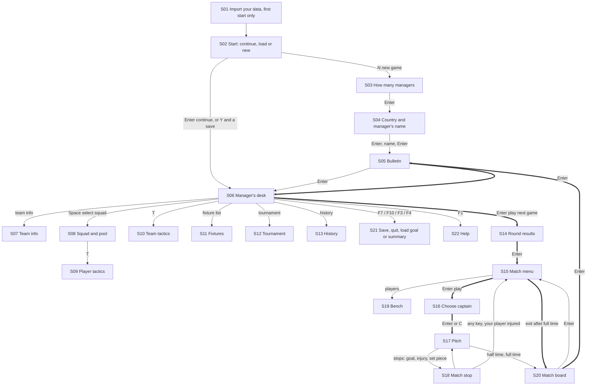

The thick arrows are the match day: from the desk, `Enter` five or six times reaches kick-off, and each screen on
the way names the next step on its primary button. [designed: T157]

| # | Original screen (capture) | Decision in the original | goal2 screen | Same decision? |
| --- | --- | --- | --- | --- |
| 0 | — | — | S01 Import | **goal2 adds it**: the data files are imported once, on the first start, because no original file ships with goal2 (CLAUDE.md rule 14; T153). |
| 1 | Title, load a saved game? (step 0) | Y load / N new | S02 Start | Same Y and N; **goal2 adds** *Continue* (Enter) for the last save, and lists the saves instead of asking for a name. |
| 2 | Load name (step 243) / file not found | which save; retry | S02 Start | Same, as a list; a save that fails says why, with Y try again / N back. |
| 3 | How many players (step 1), HANG ON A TICK (step 2) | 1–6 managers | S03 New game | Same. |
| 4 | Country browser (steps 3–5) | which country | S04 Country | Same, with the card and the list together. |
| 5 | Name entry (steps 6–10) | manager's name | S04 Country | Same, on the same screen, as in the original (an overlay of the browser). |
| 6 | Bulletins (steps 11–12) | read the news | S05 Bulletin | Same. |
| 7 | Hub (step 13) | what to do next | S06 Desk | Same six options and F-keys; **changed**: *play next game* is the primary action and is highlighted first. |
| 8 | Squad and pool (steps 14–29) | who is in the twenty | S08 Squad | Same keys and the same two-Enter exchange. |
| 9 | Player tactics (step 30) | one player's tactics | S09 Player tactics | Same. |
| 10 | Team tactics (steps 33–34) | the team's tactics | S10 Team tactics | Same. |
| 11 | Round results so far (step 41) | — (read) | S14 Round | Same. |
| 12 | Match menu (step 42) | inspect, change, play | S15 Match menu | Same; *play* names what follows ("choose your captain"). |
| 13 | Captain card (steps 43–45) | the captain | S16 Captain | Same keys; **changed**: the screen says that kick-off waits for this choice (#523). |
| 14 | Pitch (steps 45–118) | speed, display, result, bench | S17 Pitch | Same keys; the pitch is in the main window. |
| 15 | Taker cards (steps 46, 56) | taker, or C | S16 (same stop, other title) | Same, including the timeout. |
| 16 | Substitution opportunity (step 67) | go to the bench | S18 Match stop | Same. |
| 17 | Bench (steps 74–81, 124–132) | substitutions | S19 Bench | Same keys; the bench says its mode (request or make now) and the step of the exchange. |
| 18 | Half-time / full-time board (steps 119, 192) | — (read) | S20 Board | Same. |
| 19 | Replay and save-goal questions (steps 175–178) | replay? save? name | S18 Match stop | Same three questions, in one box. |
| 20 | Full-time menu, exit (steps 193–198) | stats; exit | S15 Match menu | Same. |
| 21 | Save the summary? name (steps 198–199) | save? name | S20 Board, S21 name box | Same. |
| 22 | Bulletin (step 200), hub (step 201) | — | S05, S06 | Same. |
| 23 | Fixture list, tournament (steps 224–231) | which matches to watch; standings | S11, S12 | Same. |
| 24 | F7 save, F10 quit (steps 233–241) | name; quit? save? | S21 | Same. |
| 25 | Reload (steps 242–244) | which save | S02 | Same, as in rows 1–2. |
| 26 | F3 saved goal (steps 245–256) | which goal | S21 name box, S15, S17 | Same. |
| 27 | Round two: results, menu, captain C, R quick result (steps 262–313) | quick result | S14, S15, S16, S17, S20 | Same; R on the pitch, as in the original. |
| 28 | Group table, bulletin, hub (steps 316–318) | — | S12, S05, S06 | Same. |
| 29 | — | — | Desk: *autopilot* | **goal2 adds it**, later: the bot plays the country for idle play (CLAUDE.md; plan G-M5). It makes the computer's choices (C) at every stop and stops on any key. |

A season goes on like rows 7–28: the desk, the round, the match, the news, the desk. At the year's end the
original shows the remaining results, winners and a new stage on the desk (E031 C54–C56, M244-G1E-06 steps
14–19): goal2 shows them on S14, S12 and S05 in the same order. [confirmed: T156-R1 steps 0–321; E031 C54–C56;
M244-G1E-06 steps 14–19]

**Multi-manager play.** With more than one manager, S04 repeats for each, and the desk gains *next player*,
which hands the desk to the next manager. [confirmed: E031 C16–C16b] The design keeps it; whether the first
release offers it is [question 5](#6-questions-for-the-owner).

## 2. Every screen

Each screen lists its purpose, what it shows, its actions and keys, and the original screens it replaces (all of
them are in [section 5](#5-the-mapping-of-every-original-screen)). A key in **bold** is the original's own; a key
marked *(goal2)* is added. Enter always does the highlighted choice; the primary button shows what that is.

### S01 Import your data

- **Purpose**: on the first start only, take the player's data files into goal2's data folder. **goal2 adds
  it** [designed: owner, 2026-11-02, T153].
- **Shows**: the files needed, what each is for, and for each the result of its check (found and verified,
  missing, wrong). What is wrong is said in plain words.
- **Actions**: *Choose folder…* (Enter, primary), *Quit* (Esc).
- **Replaces**: no original screen. The DOS prompt before the game (`dos-shell`) is not a game screen and is
  dropped.

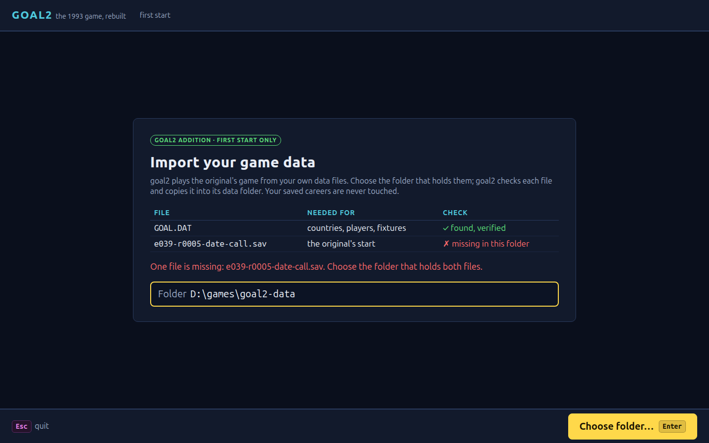

### S02 Start

- **Purpose**: the title's question, *load a saved game?*, with the obvious answer first.
- **Shows**: *Continue* with the last save's country, manager, next match and time saved; the title's choices;
  the list of saved games with country, year and stage, next match and time.
- **Actions**: *Continue* (Enter, primary; goal2); **Y** load the highlighted save; **N** new game; ↑↓ choose a
  save; Esc quit. A save that cannot be opened says why on this screen, with **Y** try again and **N** back.
- **Replaces**: `title-load-prompt`, the load name (`m244-load-name`, `t156-243-load-name`) and
  `file-not-found-prompt`. [confirmed: T156-R1 steps 0, 242–244; E031 C11–C12; E015-r0008 state 10]
- **Changes** [designed: T157]: the title asks Y/N and then for a file name, pre-filled with the one save
  (step 243); goal2 lists the saves instead, because it can read them. With no save, the screen offers only
  *New game*.

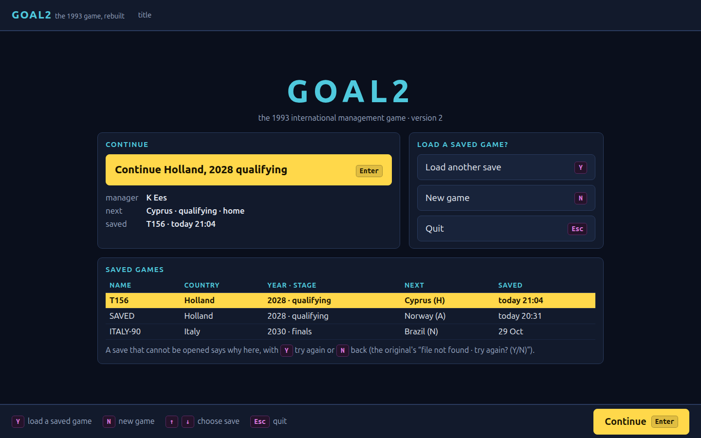

### S03 New game: how many managers

- **Purpose**: the number of local managers, 1 to 6.
- **Shows**: the six numbers, the highlighted one chosen; then a busy line while the game is prepared.
- **Actions**: **←→** number, **Enter** accept (primary), Esc back to S02.
- **Replaces**: `title-player-count`, `t156-002-hang-on-a-tick`. [confirmed: T156-R1 steps 1–3; E031 C12]

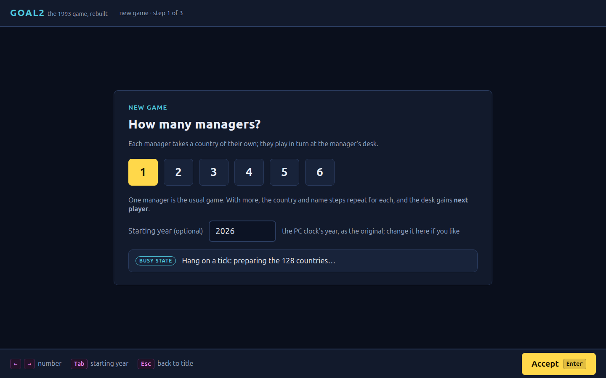

### S04 Country and manager's name

- **Purpose**: choose the country, then type the manager's name.
- **Shows**: the country card as in the original: status, manager, world and continental ranking now and top,
  formation, skill, the level of difficulty, the team's skills and performance bars, team tactics and player
  defaults, characteristics with their words, average caps and age; the country list in groups of 16; the
  name line (14 characters at most) once a country is chosen.
- **Actions**: **↑↓** country, **←→** next group of 16, **Ins** world or continental ranking, **Space** the
  country's players (the S08 card, read only), **Enter** choose (primary) then **Enter** accept the name,
  **Esc** abort the name / back.
- **Replaces**: `country-select`, `country-select-name-entry`, `t156-005-country-holland`,
  `t156-006-name-entry`, `t156-010-name-typed`. [confirmed: T156-R1 steps 3–11; E031 C13–C15b]

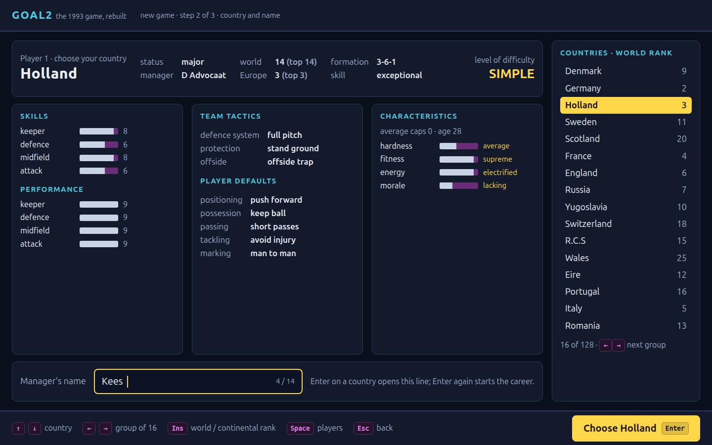

### S05 Bulletin

- **Purpose**: the news: a new manager, the groups, after each round, at the end of a stage.
- **Shows**: the Soccer Bulletin's three panels, page *n of m*.
- **Actions**: **Enter** (any key) next page (primary); Esc skips the remaining pages *(goal2)*.
- **Replaces**: `bulletin`, `t156-011-bulletin-welcome`, `t156-012-bulletin-groups`,
  `t156-200-bulletin-after-match`, `t156-317-bulletin-round2`, `m244-elimination-bulletin`.
  [confirmed: T156-R1 steps 11–12, 200, 317; M244-G1E-06 step 18]

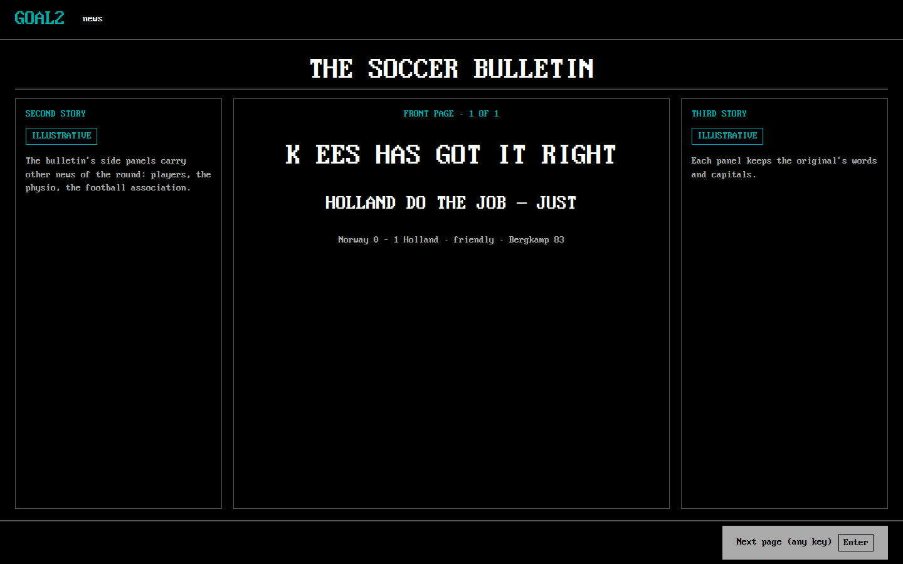

### S06 Manager's desk

- **Purpose**: the hub. Everything starts and ends here.
- **Shows**: the manager (name, rating); the team and its rankings; the next opponents, their rankings and the
  kind of match (friendly away, qualifying home…); the managers; the six options; the twenty players with
  role codes, the eleven above the bench. **goal2 adds** a short *before the match* line: who is not ready,
  and that the captain is chosen at kick-off.
- **Actions**: **↑↓** option, **Enter** open it; **Space** select squad; **T** team tactics; **F1** help,
  **F3** load a saved goal, **F4** load a saved summary, **F7** save, **F10** quit; *next player* with more
  than one manager; *autopilot* (A, goal2, later).
- **Primary**: *play next game*, with the opponent and the kind of match on the button. [designed: T157,
  #523: the owner could not find how to play the next match]
- **Replaces**: `manager-menu`, `t156-013-hub`, `t156-201-hub-after-round1`, `t156-244-loaded-hub`,
  `t156-318-hub-round2`, `m244-holland-menu`, `m244-finals-stage-hub`. [confirmed: T156-R1 steps 13, 201,
  244, 318; M244-G1A-02 steps 2–11; E031 C17–C26]
- **Dropped**: F5 print screen, which the system's own screenshot replaces.

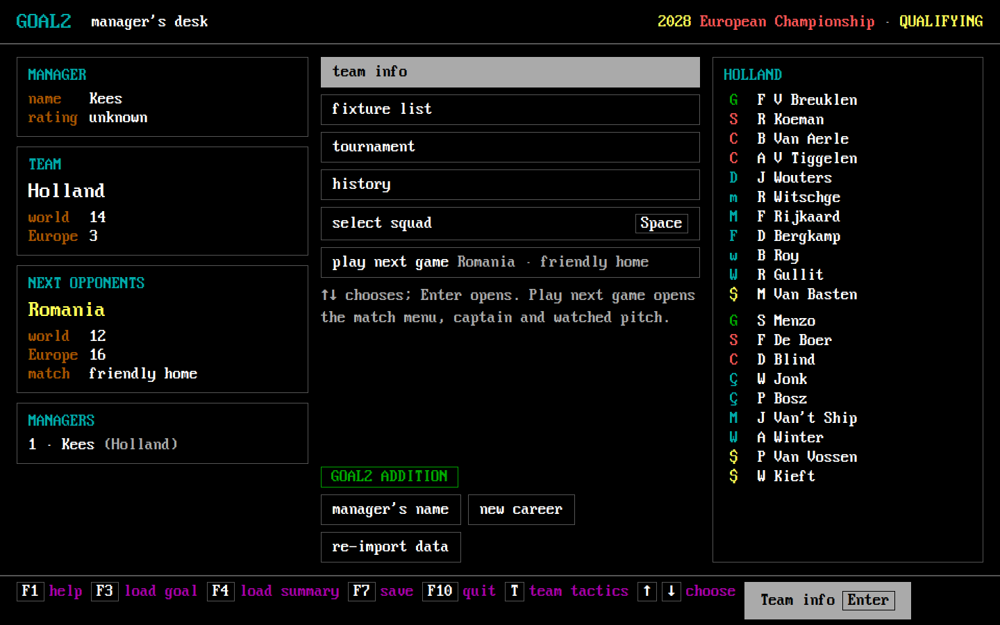

### S07 Team info

- **Purpose**: check out all the competitors.
- **Shows**: any country's card (the S04 card) and the country list, the next opponent marked.
- **Actions**: **arrows** country, **Ins** ranking, **Space** that country's players (the S08 card, read
  only), **T** its tactics, **Enter** its fixtures (primary), **Esc** desk.
- **Replaces**: `m244-team-info-2030`, `m244-team-info-players-2030`. [confirmed: M244-G4C-05 steps 2–6]

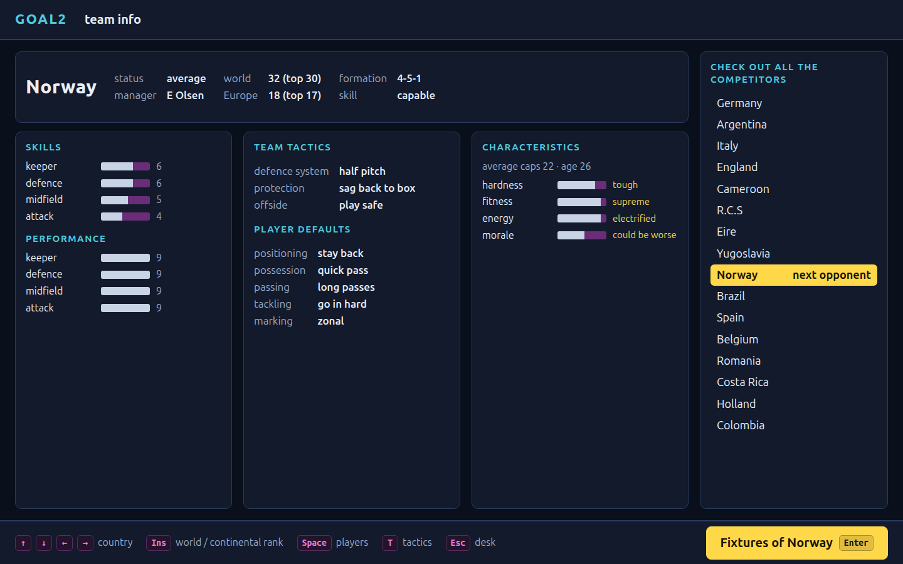

### S08 Squad and pool

- **Purpose**: who is in the twenty, in what position.
- **Shows**: the player card (name, age, caps, goals, height, foot, performance, position and club position,
  cards, readiness; twelve skills, his tactics, five characteristics with their words); the twenty or the
  pool on the right; while an exchange is under way, the two players it will swap.
- **Actions**: **↑↓** player, **←→** squad / pool, **Enter** move player (primary: Enter on a pool player,
  ← back, Enter on the player he replaces), **Ins** the assistant's recommended 20, **R** next position
  (Shift+R back), **C** club position, **T** his tactics, **F2** new name, **Esc** desk.
- **Replaces**: `m244-squad`, `m244-squad-next`, `m244-pool`, `m244-pool-next`, `m244-position-next`,
  `m244-position-club`, `t156-014-squad`, `t156-016-pool`, `t156-017-pool-put-here`, `t156-029-pool-pick-done`,
  `t156-202-card-recovered`, `t156-320-card-recovered-round2`. [confirmed: T156-R1 steps 14–29, 202, 320;
  M244-G1A-02 steps 3–9; M244-G1A-04 steps 4–6; E031 C27–C31; Shift+R: designed, owner, #423]

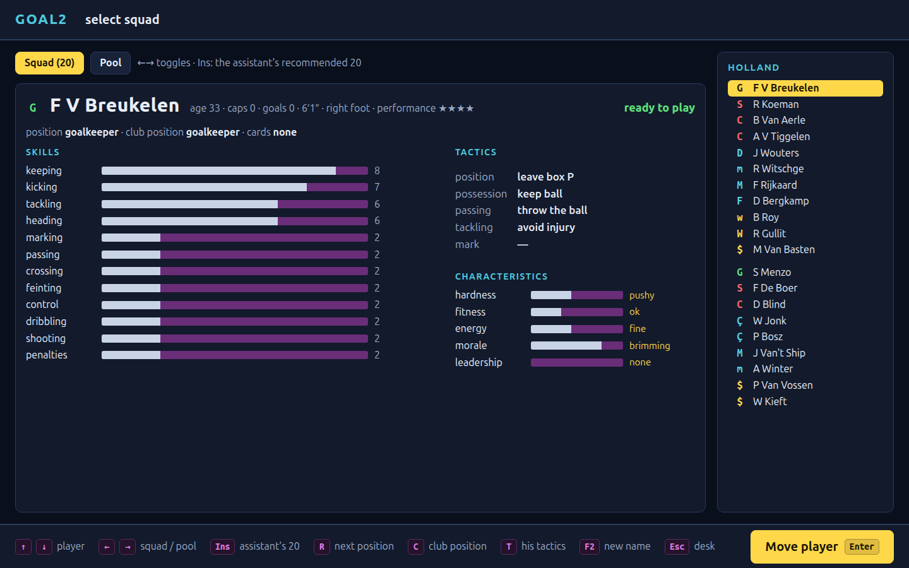

### S09 Player tactics

- **Purpose**: one player's own tactics: position, possession, passing, tackling, mark.
- **Shows**: the five lines and their values, **P** on a line set for this player; his skills and
  characteristics beside them.
- **Actions**: **arrows** line, **Enter** alter (primary), **Esc** back to the card. Reached by **T** from
  S08 and from the bench S19.
- **Replaces**: `m244-individual-tactics`, `m244-position-tactic-toggle`, `mark-protect-zone`,
  `mark-named-opponent`, `squad-substitution-tactic`, `t156-030-player-tactics`. [confirmed: T156-R1 step 30;
  M244-G1A-04 steps 7–12; E015-r0007 states 150, 165–166; E031 C33–C33d]

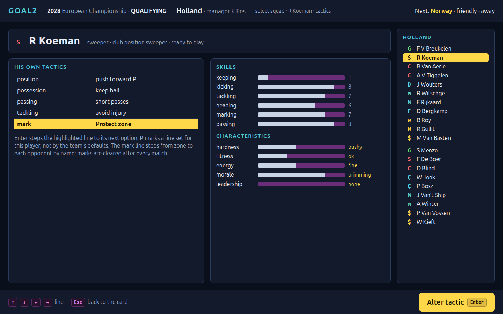

### S10 Team tactics

- **Purpose**: the team's eight lines: defence system, protection, offside, then the player defaults.
- **Shows**: each line, its value now and the other option; the formation; the characteristics.
- **Actions**: **↑↓** line, **Enter** change (primary), **Esc** desk.
- **Replaces**: `team-tactics`, `m244-team-tactics`, `t156-033-team-tactics`, `t156-034-team-tactic-changed`.
  [confirmed: T156-R1 steps 33–35; M244-G1A-02 step 11; E031 C07]

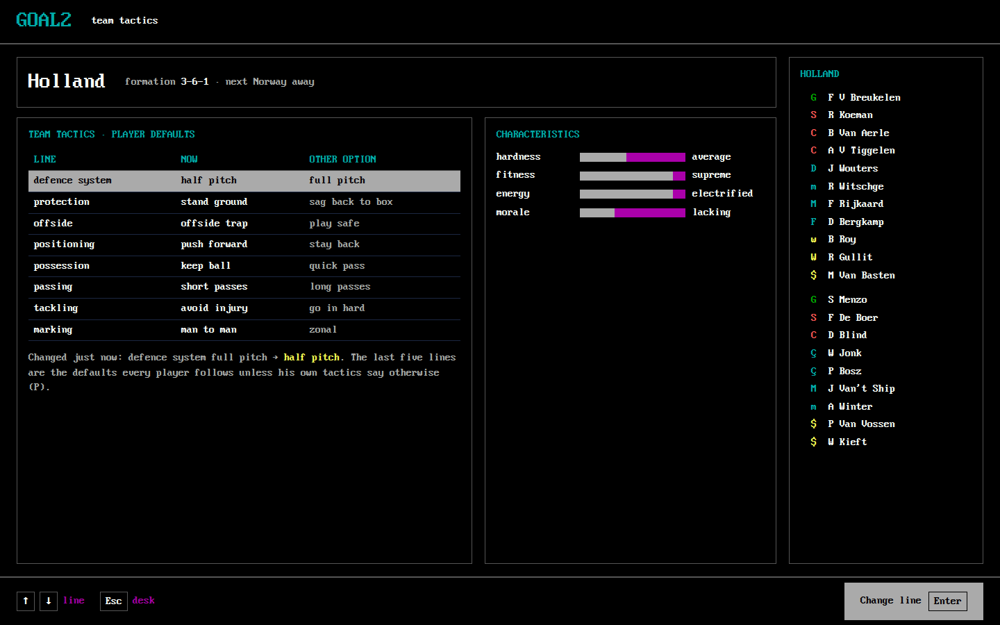

### S11 Fixtures

- **Purpose**: the coming round, and which other matches to watch.
- **Shows**: each fixture with its kind, **✓** on the matches to watch, and for the highlighted row what Enter
  will do (watch match, auto result; cancel or rearrange on your own friendly).
- **Actions**: **↑↓** scroll, **Enter** the named action (primary), **Esc** desk.
- **Replaces**: `fixtures-watch`, `fixtures-auto`, `m244-fixtures`, `m244-fixtures-watch`,
  `t156-224-fixture-list`. [confirmed: T156-R1 step 224; M244-G1A-03 steps 4–5; E031 C17–C18]

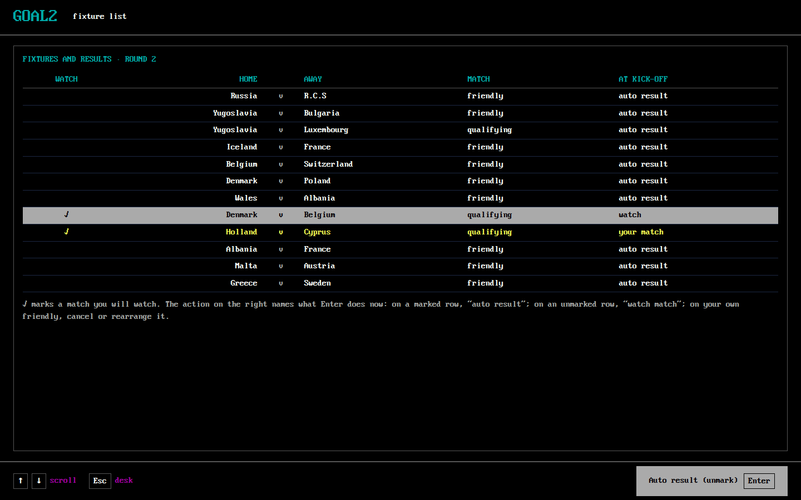

### S12 Tournament

- **Purpose**: the groups, their tables and matches, the finals and the bracket.
- **Shows**: the display (Qualifying, Finals, Championship) and the continent, as tabs; the group table
  (P W D L F A T) beside the group's matches; on Finals the top scorers; on Championship the bracket.
- **Actions**: **↑↓** group, **Space** continent, **←→** display, **Ins** Championship results (where the
  original prints it), **Esc** desk. No primary action: it is read only.
- **Replaces**: `m244-tournament-group-f`, `m244-tournament-group-g`, `m244-world-finals-bracket`,
  `m244-world-qualifying-a`, `m244-world-qualifying-b`, `m244-final-qualifying-table`,
  `t156-227-tournament-europe`, `t156-228-tournament-americas`, `t156-229-tournament-finals`,
  `t156-230-tournament-championship`, `t156-316-group-table`. [confirmed: T156-R1 steps 227–231, 316;
  M244-G1A-03 steps 8–9; M244-G4C-05 steps 9–11; M244-G1E-06 step 14]

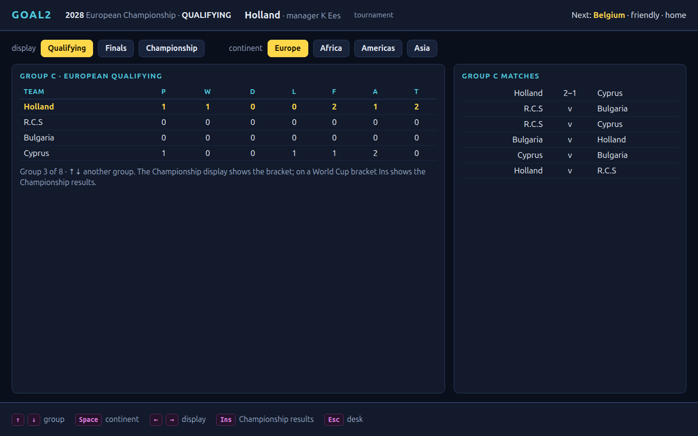

### S13 History

- **Purpose**: how the country has done over the seasons.
- **Shows**: runs of wins and defeats home, away and all, now and top; successes; results by season with
  the best place; top scorers and caps; the biggest wins and defeats.
- **Actions**: **Esc** desk. Read only.
- **Replaces**: `m244-history`. [confirmed: M244-G1A-03 step 12]

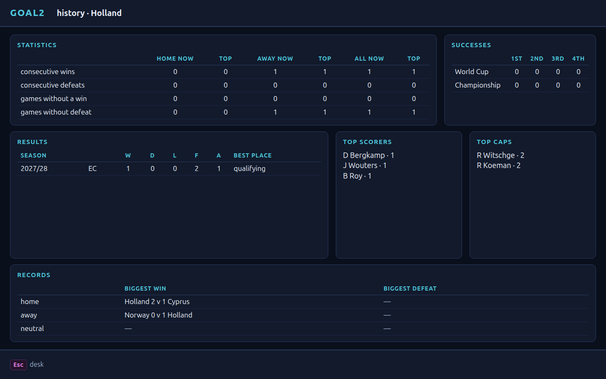

### S14 Round results

- **Purpose**: the round's other results, arriving one by one, before and after your match.
- **Shows**: each result with its kind; your match, still to play, at the end.
- **Actions**: **Space** pause, **←→** speed, **Enter** (hit any key) to your match (primary).
- **Replaces**: `round-playing`, `round-results`, `t156-041-round1-results`,
  `t156-262-round2-results-rolling`, `t156-263-round2-results`. [confirmed: T156-R1 steps 41, 262–263;
  E015-r0007 states 27, 52]

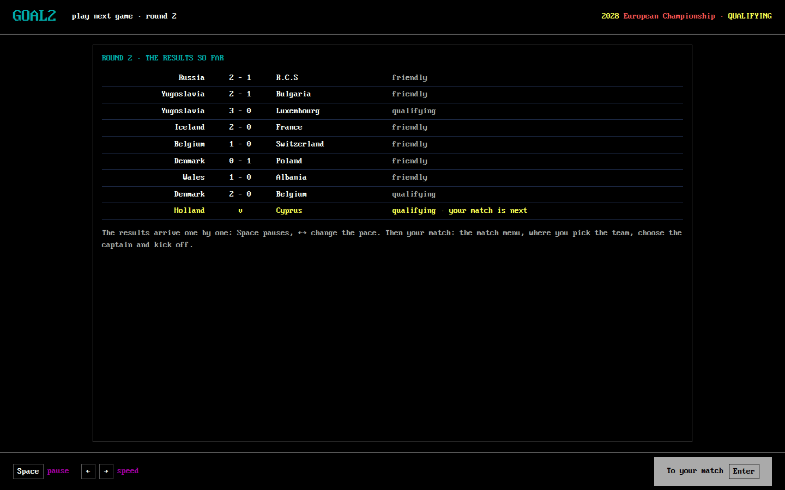

### S15 Match menu

- **Purpose**: before kick-off, at half time, at full time and before extra time: compare the sides, change
  yours, then play.
- **Shows**: the score, the kind of match, the location, the time (HALF TIME, FULL TIME, EXTRA TIME); both
  formations and elevens; the actions: each side's team tactics and players, tournament, match stats, and
  **play** (before and during) or **exit** (after the final whistle); automatic action replay ON/OFF.
- **Actions**: **arrows** choose, **Enter** open; **Ins** action replay on/off; *play* (primary) names what
  follows: "choose your captain, then kick-off" before the match, "second half" at half time.
- **The watch question.** When the original asks *watch this match? (Y/N)* (some fixtures; it never came for
  Holland's two matches in T156-R1), goal2 asks it over this menu with the same **Y**/**N**.
  [confirmed: E031 C35–C37; E015-r0007 state 28; T156-R1 steps 42, 264]
- **Replaces**: `match-menu`, `match-menu-halftime`, `match-menu-fulltime`, `match-watch-prompt`,
  `t156-042-match-menu`, `t156-048-menu-after-taker`, `t156-193-fulltime-menu`, `t156-264-round2-match-menu`,
  `t156-246-goal-replay-menu`, `m244-knockout-halftime`, `m244-extra-time-menu`, `m244-extra-time-halftime`.
  [confirmed: T156-R1 steps 42, 47–49, 193–198, 246, 264; M244-G4C-07 steps 40–50]

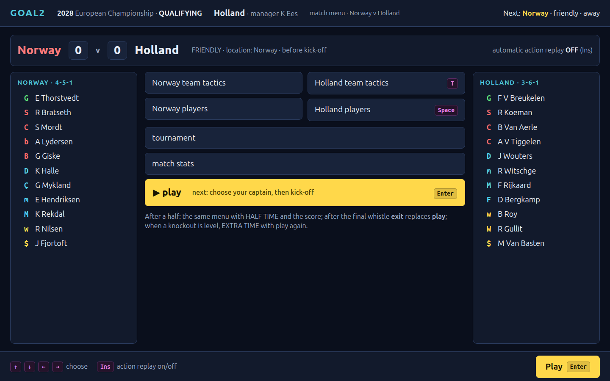

### S16 Choose a player: captain, taker, penalty order

- **Purpose**: the stops where the original waits for one of your players: the captain before kick-off, the
  corner or goal-kick taker during play, the penalty order before a shoot-out.
- **Shows**: a headline that says what the match waits for ("Choose your captain to kick off"); the
  highlighted player's card; the eleven, with the computer's pick marked.
- **Actions**: **↑↓** player, **Enter** choose (primary: "Captain: kick off"), **C** computer select; no key:
  the computer's pick stands after the original's wait (6–12 s for a taker in T156-R1). For the penalty
  order, **Esc** undoes a pick.
- **Why the headline**: the owner's playtest could not start the match because a captain was needed and
  nothing said so (#523). [designed: T157]
- **Replaces**: `captain-select`, `t156-043-captain`, `t156-044-captain-chosen`, `t156-265-round2-captain`,
  `t156-046-goal-kick-taker`, `t156-056-corner-taker`, `m244-shootout-order`, `m244-shootout-five-chosen`.
  [confirmed: T156-R1 steps 43–47, 56–58, 151–152, 265–266; M244-G4C-07 step 56; M244-G4C-08 step 5;
  E031 C38–C38b; reviewed F030]

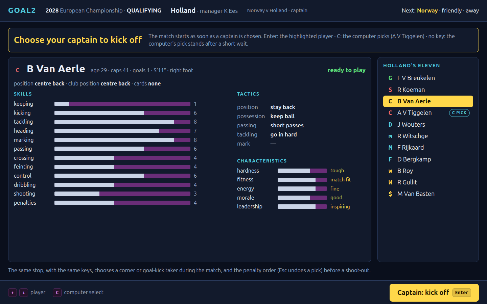

### S17 Pitch

- **Purpose**: watch the match and intervene.
- **Shows**: the score, the minute, the kind of match and the last two events; the pitch with each player's
  role code (home red, away white, as the original draws them) and the ball; the commentary beside it.
- **Actions**: **↑↓** display (marks), **←→** speed, **R** result (quick result; it still stops at half time,
  injuries, extra time and the shoot-out), **Space** commentary (enlarges it), **F9** sound, **Esc** / **Enter**
  bench (primary). A replay shows *REPLAY* where *R result* is.
- **Replaces**: `match-live`, `match-commentary`, `injury-event`, `t156-045-kick-off`,
  `t156-058-taker-timed-out`, `t156-066-injury-and-booking`, `t156-178-replay-playing`, `t156-247-goal-replay`,
  `t156-254-goal-replay-goal`, `t156-267-quick-hang-on`, `m244-shootout-first-goal`.
  [confirmed: T156-R1 steps 45–192, 247–255, 267; E031 C39–C40, C08; M244-G4C-08 step 19]
- **Changes** [designed: T157]: the commentary is always beside the pitch rather than only after Space; the
  pitch is part of the window, not a second window.

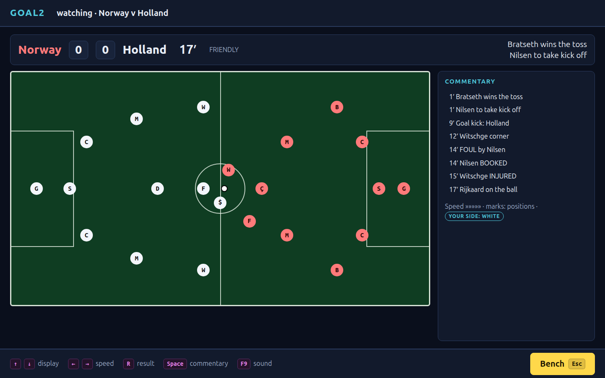

### S18 Match stop

- **Purpose**: the questions and notices that stop the match: a goal (*action replay?*, *save this goal?*,
  its file name), *SUBSTITUTION OPPORTUNITY* when your player is injured, the other side's substitution, the
  penalty shoot-out.
- **Shows**: a box over the pitch with the event, the score and minute, the question and its answers.
- **Actions**: **Y** / **N** for a question; any key for a notice (the substitution opportunity's key opens
  the match menu, as in the original); the file name as in S21.
- **Replaces**: `t156-067-substitution-opportunity`, `t156-149-opponent-substitution`,
  `t156-175-replay-prompt`, `t156-176-save-goal-prompt`, `t156-177-goal-file-name`,
  `t156-274-quick-substitution-opportunity`, `e031-shootout-start`, `m244-shootout-prompt`.
  [confirmed: T156-R1 steps 67–68, 149–150, 175–178, 274–275; E031 g1 step 3874; M244-G4C-07 step 55]

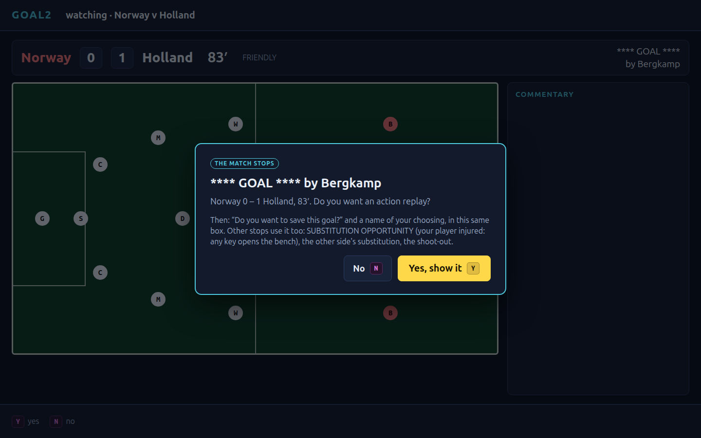

### S19 Bench

- **Purpose**: substitutions, during a match and at its breaks.
- **Shows**: the card of the highlighted player; the mode, as the original names it ("make substitutions
  now", or "substitution requested" during play); substitutions left; the eleven and the bench; while an
  exchange is under way, who comes off and who goes on.
- **Actions**: **↑↓** player, **Enter** take off / put on (in either order; primary names which), or
  request / cancel a substitution in request mode; **R**, **C** positions; **T** his tactics (S09); **Esc**
  match menu. A refused substitution says why and waits for a key.
- **Replaces**: `squad-substitution-take-off`, `squad-substitution-put-on`, `squad-substitution-illegal`,
  `t156-074-bench-requested`, `t156-080-bench-request-cancelled`, `t156-124-halftime-bench`,
  `t156-132-substitution-made`, `t156-279-quick-bench`, `t156-301-quick-substitution-made`.
  [confirmed: T156-R1 steps 74–81, 124–133, 279–301; E031 C41–C41k; E015-r0007 states 76, 82, 176]

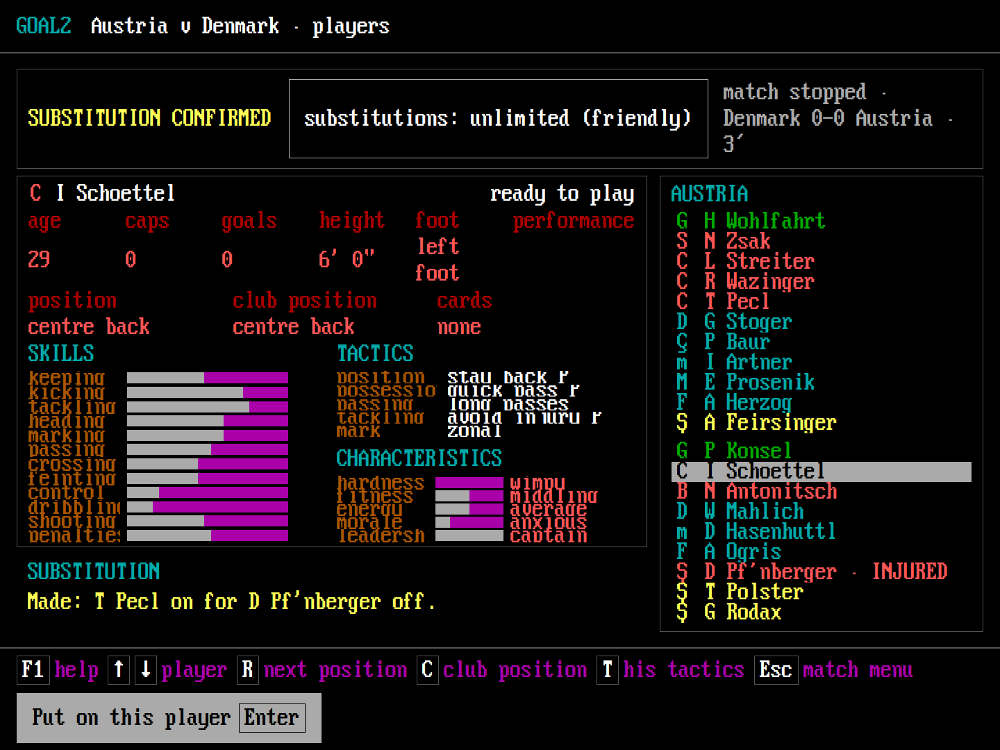

### S20 Match board

- **Purpose**: the statistics at half time and full time, and a saved match summary.
- **Shows**: the score and half-time score, scorers and minutes, man of the match; corners, free kicks,
  penalties, shots, on target, saves, fouls, bookings, red cards, possession, territory. After a quick result
  a QUICK RESULT banner stands in place of the statistics, as in the original.
- **Actions**: **Enter** (hit any key) continue (primary), **Esc** bench. After a watched match, *exit* asks
  *save the match summary?* (**Y**/**N**) and its name (S21's box).
- **Replaces**: `t156-119-halftime-board`, `t156-192-fulltime-board`, `t156-270-quick-halftime`,
  `t156-310-quick-fulltime`, `match-summary-save-prompt`, `match-summary`, `t156-198-summary-prompt`,
  `t156-199-summary-file-name`. [confirmed: T156-R1 steps 118–119, 191–199, 270, 310–313; E015-r0007 states
  51, 207; E031 C24–C24b, C51]

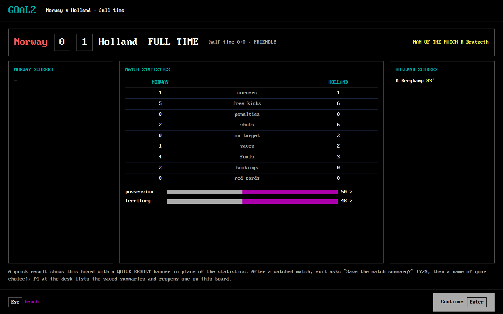

### S21 Save, quit, load a goal or a summary

- **Purpose**: the name box and the yes/no questions of saving and quitting.
- **Shows**: over the current screen, the question and the proposed name (the last name used; SAVED at first).
- **Actions**: **F7** save: type or accept the name, **Enter** save, **Esc** cancel. **F10** quit: *Are you
  sure you want to quit?* **Y**/**N**, then *Do you want to save this game?* **Y**/**N**. **F3** / **F4**: the
  name of a saved goal or summary, **Enter** opens it (S15, then S17 or S20).
- **Replaces**: `save-game-name-entry`, `save-game-prompt`, `quit-confirm`, `t156-233-save-name-prompt`,
  `t156-237-save-name-typed`, `t156-239-quit-confirm`, `t156-240-quit-save-prompt`,
  `t156-245-load-goal-prompt`. [confirmed: T156-R1 steps 233–241, 245–246; E031 C23–C26b; reviewed F030]

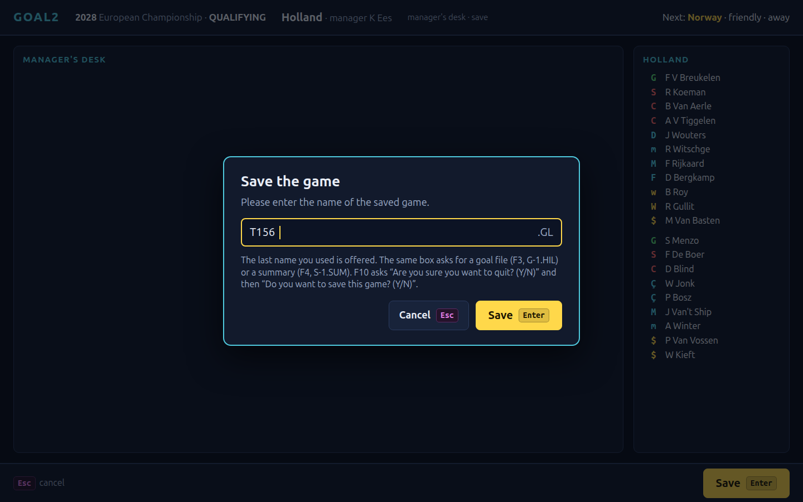

### S22 Help

- **Purpose**: what every key of the current screen does.
- **Shows**: the keys of the screen it was opened on, then the original's own help text when the player has
  it (the original's F1 opened its help viewer; no capture of it exists yet).
- **Actions**: **F1** opens it on any screen, **Esc** closes it.
- **Replaces**: no captured screen. [confirmed: E031 C04–C04c; evidence gap: help viewer capture]

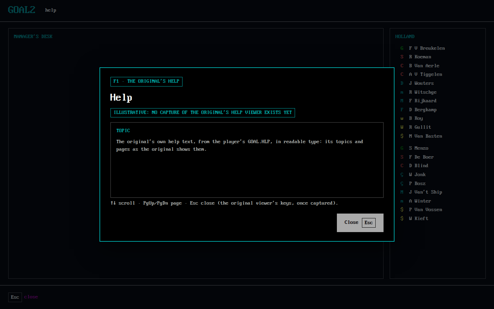

## 3. Rules for the whole UI

**Navigation.** [designed: T157]
- One screen at a time, as in the original. The manager's desk (S06) is home; every management screen
  returns to it with Esc. There is no side bar of destinations.
- The order of screens is the original's (section 1). goal2 adds screens only where section 1 says so (S01,
  the *Continue* of S02, autopilot, S22).
- A top bar on every screen after S05 keeps four facts in view: the competition and stage, the country and
  manager, where you are, and the next match.

**The primary action.** [designed: T157]
- Each screen has at most one, drawn as the one yellow button at the bottom right with its key, and the
  highlight starts on it. Read-only screens (S12, S13) have none.
- Its label says what happens next, in football words: *Play next game: Norway away*, *Play: choose your
  captain, then kick-off*, *Captain: kick off*.
- The match day from the desk to kick-off is a chain of primary actions (S06 → S14 → S15 → S16 → S17).

**Stops.** [designed: T157, #523]
- Whenever the game waits for the player, the screen says what it waits for and which key answers it. A stop
  with a timeout (taker, captain, summary) says what happens with no key.
- No stop is silent and no stop hides in another window.

**The match.** [designed: T157]
- It is watched in the main window (S17), with the commentary beside the pitch. The questions and notices
  are boxes over the pitch (S18); half time and full time are the board (S20) and then the match menu (S15).
- Watch or quick result is the original's choice: the watch question where the original asks it (S15), and
  **R** on the pitch for a quick result. [confirmed: E031 C35, C08; T156-R1 step 267]
- Speed, display and commentary keep the original's keys.

**Text size.** [designed: T157]
- Designed at 1440×900: body text 18 px, secondary text 15–16 px, headings 22–30 px; nothing below 14 px.
- At other sizes the page scales as a whole and keeps its layout, as today's fixed pages do (T101).
- Names, numbers and role codes are never abbreviated beyond the original's own forms.

**Colours.** [designed: T157] The original's hierarchy on a dark ground ([style.css](mockups/style.css)):
- cyan for frames and headings; magenta for key hints; yellow for the highlighted choice and the primary
  action;
- role codes by line: green goalkeeper, red defence, cyan midfield, yellow attack
  [confirmed: goal2-archaeology F002 R011; docs/vision-266/role-codes];
- home side red and away side white on the pitch, as in the original [confirmed: T156-R1 step 45];
- green, amber and red only for status (ready, warning, injured);
- every colour pairs with text or a symbol, so nothing depends on colour alone.

**The keyboard.** [designed: T157]
- Every original key works where the original has it: arrows, Enter, Esc, Space, Ins, Y/N, C, R, T, F1–F4,
  F7, F9, F10, Shift+R (#423).
- goal2 adds only: Enter on *Continue* (S02), Esc to skip the news (S05), A for autopilot (S06, later).
  No added key changes an original key's meaning.
- Every key of a screen is on its bottom bar; F1 explains them.
- The mouse does everything the keys do: every option, row and button can be clicked.

## 4. What today's window keeps, changes and drops

Today's window is the default route a player gets from the portable build: the import dialog, the Launch
window, then the core route's main window (`goal2/desktop/core_window.py`), with the pitch in a separate pygame
window. [confirmed: goal2/desktop/__main__.py:79–134; goal2/desktop/window.py:556–561]

| Today's screen | Keeps | Changes | Drops |
| --- | --- | --- | --- |
| Import dialog (`data_setup.py`) | the check and the copy, the plain-words errors | becomes S01, with each file's check on screen | — |
| Launch: *Return to your country* (`launch.py`) | the saved career summary, Resume, retry | becomes S02: *Continue*, the saves as a list, the title's Y/N | the path field ("Open another save") |
| Launch: *Choose your country* | the 128 countries, the card | becomes S04: groups of 16, Ins, Space players, the name on the same screen | the start-year choice ([question 9](#6-questions-for-the-owner)) |
| Launch: *Review before starting* | the manager name (14 characters) | the name moves into S04 | the review page |
| Launch: bulletins | the three-column bulletin | becomes S05 | — |
| Main window: top bar | country, manager, year and stage, next match | as in section 3 | — |
| Main window: side bar (Country, Team, Pool, Fixtures & match, Save; Ctrl+1–5) and *SHOW MATCH (F8)* | — | the desk's six options take its place | the side bar, Ctrl+1–5, F8 |
| Main window: status line | — | each screen says what it waits for itself | the status line |
| Country (the desk) | the desk's panels and its six options; history | becomes S06 with *play next game* as the primary action; history becomes S13 | — |
| Team: card, own tactics, team tactics | the card, R / Shift+R / C, T, F2 | becomes S08, S09, S10 | — |
| Pool: card, compare, suggest | the pool card; the exchange | joins S08 (←→ squad / pool), the exchange shown before it is made | *Compare* as a separate view; *Suggest* becomes Ins (the assistant's 20) |
| Fixtures & match: fixture list, tournament | the boards | become S11 and S12, reached from the desk | — |
| Round pages (*Next > (Enter)*) | the order of the pages | become S14, S20, S12, S05 | the generic page titles |
| Captain view with *Watch this match* toggle | the eleven, the suggested captain, Enter, C | becomes S16, which says the match waits for it; C bound | the Watch toggle (the watch question and R are the original's choices) |
| Pre-match team (bench, pre-match) | the swap | joins S15's *players* and S19 | — |
| Pitch window (pygame) | its keys | moves into the main window as S17 | the second window, its fixed caption |
| Substitution notice, action replay, takers, shoot-out order | the questions and their keys | become S18 and S16 | — |
| Half time / bench | substitutions left, *make substitutions now* | becomes S19 and S20 | — |
| Match summary | the board, the save question | becomes S20 with S21's name box; N bound | — |
| Save page (path, Save F7) | F7 | becomes S21's name box, with F10 quit | the path field |

## 5. The mapping of every original screen

Every classified screen of the [screen inventory](../../original-game/screen-inventory.md) and every original
image embedded in the chapters is in one row: the new screen that replaces it, or *dropped* with the reason.
`check_mapping.py` checks this table. [designed: T157]

<!-- mapping:start -->
| New screen | Original screens it replaces | Note |
| --- | --- | --- |
| S02 | `title-load-prompt`, `m244-load-name`, `t156-243-load-name`, `file-not-found-prompt` | title, load, error |
| S03 | `title-player-count`, `t156-002-hang-on-a-tick` | managers, busy |
| S04 | `country-select`, `country-select-name-entry`, `t156-005-country-holland`, `t156-006-name-entry`, `t156-010-name-typed` | country, name |
| S05 | `bulletin`, `t156-011-bulletin-welcome`, `t156-012-bulletin-groups`, `t156-200-bulletin-after-match`, `t156-317-bulletin-round2`, `m244-elimination-bulletin` | news |
| S06 | `manager-menu`, `t156-013-hub`, `t156-201-hub-after-round1`, `t156-244-loaded-hub`, `t156-318-hub-round2`, `m244-holland-menu`, `m244-finals-stage-hub` | hub |
| S07 | `m244-team-info-2030`, `m244-team-info-players-2030` | competitors |
| S08 | `m244-squad`, `m244-squad-next`, `m244-pool`, `m244-pool-next`, `m244-position-next`, `m244-position-club`, `t156-014-squad`, `t156-016-pool`, `t156-017-pool-put-here`, `t156-029-pool-pick-done`, `t156-202-card-recovered`, `t156-320-card-recovered-round2` | squad, pool |
| S09 | `m244-individual-tactics`, `m244-position-tactic-toggle`, `mark-protect-zone`, `mark-named-opponent`, `squad-substitution-tactic`, `t156-030-player-tactics` | player tactics |
| S10 | `team-tactics`, `m244-team-tactics`, `t156-033-team-tactics`, `t156-034-team-tactic-changed` | team tactics |
| S11 | `fixtures-watch`, `fixtures-auto`, `m244-fixtures`, `m244-fixtures-watch`, `t156-224-fixture-list` | fixtures |
| S12 | `m244-tournament-group-f`, `m244-tournament-group-g`, `m244-world-finals-bracket`, `m244-world-qualifying-a`, `m244-world-qualifying-b`, `m244-final-qualifying-table`, `t156-227-tournament-europe`, `t156-228-tournament-americas`, `t156-229-tournament-finals`, `t156-230-tournament-championship`, `t156-316-group-table` | tournament |
| S13 | `m244-history` | history |
| S14 | `round-playing`, `round-results`, `t156-041-round1-results`, `t156-262-round2-results-rolling`, `t156-263-round2-results` | round |
| S15 | `match-menu`, `match-menu-halftime`, `match-menu-fulltime`, `match-watch-prompt`, `t156-042-match-menu`, `t156-048-menu-after-taker`, `t156-193-fulltime-menu`, `t156-264-round2-match-menu`, `t156-246-goal-replay-menu`, `m244-knockout-halftime`, `m244-extra-time-menu`, `m244-extra-time-halftime` | match menu |
| S16 | `captain-select`, `t156-043-captain`, `t156-044-captain-chosen`, `t156-265-round2-captain`, `t156-046-goal-kick-taker`, `t156-056-corner-taker`, `m244-shootout-order`, `m244-shootout-five-chosen` | captain, takers, order |
| S17 | `match-live`, `match-commentary`, `injury-event`, `t156-045-kick-off`, `t156-058-taker-timed-out`, `t156-066-injury-and-booking`, `t156-178-replay-playing`, `t156-247-goal-replay`, `t156-254-goal-replay-goal`, `t156-267-quick-hang-on`, `m244-shootout-first-goal` | pitch |
| S18 | `t156-067-substitution-opportunity`, `t156-149-opponent-substitution`, `t156-175-replay-prompt`, `t156-176-save-goal-prompt`, `t156-177-goal-file-name`, `t156-274-quick-substitution-opportunity`, `e031-shootout-start`, `m244-shootout-prompt` | stops |
| S19 | `squad-substitution-take-off`, `squad-substitution-put-on`, `squad-substitution-illegal`, `t156-074-bench-requested`, `t156-080-bench-request-cancelled`, `t156-124-halftime-bench`, `t156-132-substitution-made`, `t156-279-quick-bench`, `t156-301-quick-substitution-made` | bench |
<!-- mapping:end -->

## 6. Questions for the owner

1. **The desk's highlight.** The original's hub starts on *team info*; this design starts on *play next game*
   and makes it the primary action, with a *before the match* line (S06). Keep the original's start instead?
2. **The match in the main window.** S17 puts the pitch inside the window, with the commentary always beside it;
   today it is a second window and the original shows the commentary after Space. Agreed?
3. **Watch or quick result.** The design keeps the original's way: the watch question where the original asks it,
   and R on the pitch. Today's *Watch this match* toggle goes. Should a match ever start as a quick result from
   the menu without passing through the pitch?
4. **The start screen.** S02 adds *Continue* (Enter) and lists the saves instead of the title's typed file name.
   Agreed?
5. **Managers.** S03 keeps 1 to 6 managers. Does the first release offer more than one, or does it skip S03?
6. **Autopilot.** The bot (G-M5) is an option on the desk (A), later. Is that its place?
7. **The look.** A dark modern page with the original's colour roles and role codes, readable type and no DOS
   font. Or closer to the DOS look (its font, its boxes)?
8. **File names.** The original proposes 8.3 names (SAVED.GL, G-1.HIL, S-1.SUM). Keep them, or let goal2 name
   saves freely?
9. **The start year.** Today's Launch offers 1990 or 1992; the original asked for no year in T156-R1
   (its career began in 2028, steps 1–13). The design has no start-year choice. Drop it?
