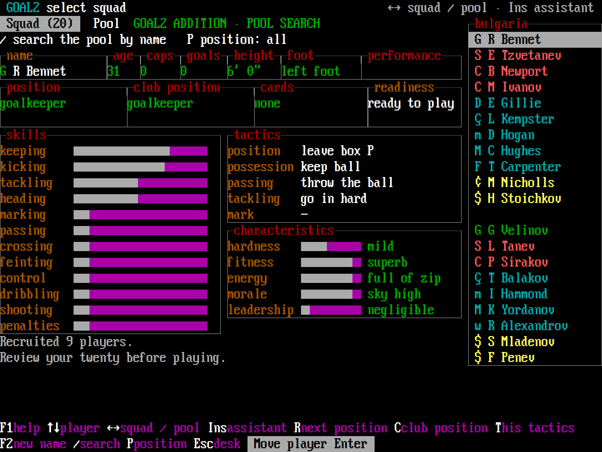
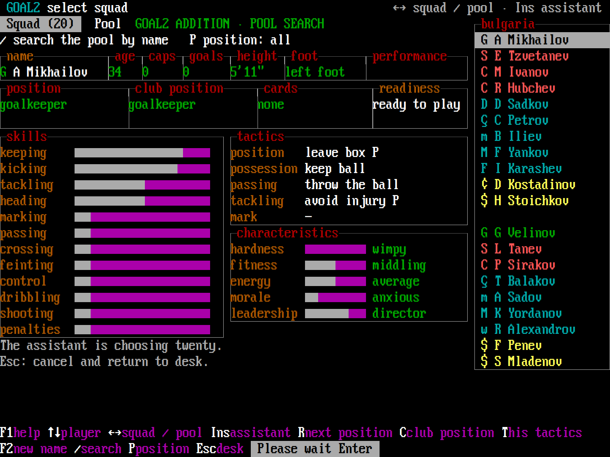

# Explicit squad assistant

[designed: T183c] Captured from application 3fec1221bdb0398199def62ea705c967c628a474 (identical application at tested 8241317d068a00084d18fb7492936fc368197dcc). Busy/unavailable are labelled UI controls; complete/no-improvement use real PyPy requests. All15 captures retain the existing1.5% management density floor and grid/fit checks.

