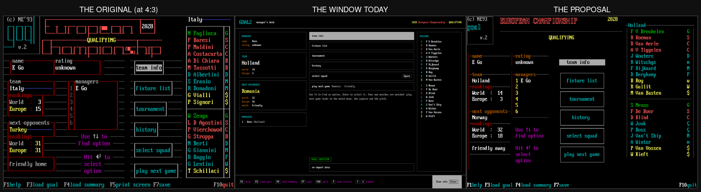
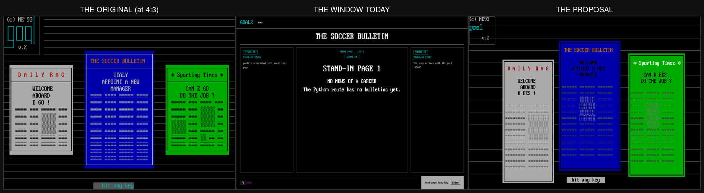
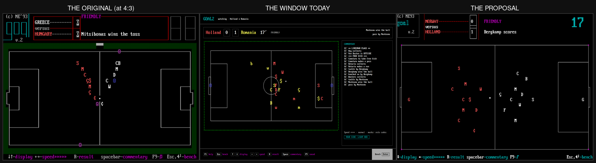

# The proposal: the same screens, drawn with the original's grammar

[designed: owner, 2026-11-08; #666] Six screens of [the approved design](../README.md), redrawn
with the grammar [the fidelity review](../fidelity-review.md) asks for, so that the change can be
judged as a picture instead of as prose. They show the **same information, the same flow and the
same keys** as the approved design; only the drawing changes.

Each is shown beside the original capture it comes from and **the window as it is built today**
(the newest render each UI task left in `../T1*-screens/`). The original is shown at 4:3, as it
was seen.

| | |
| --- | --- |
| S06 Manager's desk | [compare](images/compare-s06-hub.png) · [full size](images/s06-hub.png) |
| S08 Squad and pool | [compare](images/compare-s08-squad.png) · [full size](images/s08-squad.png) |
| S11 Fixtures | [compare](images/compare-s11-fixtures.png) · [full size](images/s11-fixtures.png) |
| S05 Bulletin | [compare](images/compare-s05-bulletin.png) · [full size](images/s05-bulletin.png) |
| S15 Match menu | [compare](images/compare-s15-match-menu.png) · [full size](images/s15-match-menu.png) |
| S17 Pitch | [compare](images/compare-s17-pitch.png) · [full size](images/s17-pitch.png) |







## What it applies

Every rule in the backlog, in one place, so the whole grammar can be seen working together:

| | |
| --- | --- |
| **The cell** (#667) | 16 × 32, twice the original's 8 × 16; text at 32 px. Today `goal2/ui/theme.py` has `CELL = 16`, `TEXT = 24`, `HEADING_SIZE = 32` (the owner's #598 raised the text from 16 to 24), so the page is about 90 × 37 lines against the original's 80 × 25. At 16 × 32 it is 90 × 28, and the original's layouts transfer almost one for one. |
| **The grid** (#668) | Every edge, gutter, row and bar is a whole number of cells. No padding, no floating card. |
| **One text size** (#669) | Every glyph on every screen is the same size. Hierarchy is colour, frame and position. |
| **The frame** (#670) | A rule with the label sitting on it, lowercase, brown or red: `-name------`, `-rankings-`, `-characteristics-`. |
| **4:3** (#671) | The page is drawn at 16 × 32 and presented with a 1.2 vertical stretch, as the original was shown. |
| **The corner** (#673) | The GOAL block, `(c) NE'93` and `v.2` on every screen; there is no title bar. |
| **Line-art titles** (#674) | "Fixtures" as outlined letters, the competition's banner as blocky letters — drawn, never type scaled up. |
| **The clock** (#675) | Large blocky digits in the top-right corner, and empty digit cells before kick-off. |
| **Dash leaders** (#676) | `------R.C.S---v---Holland------friendly`, names interrupting the rule; the strip's name carries the line colour and the role code is a right-hand column. |
| **Block bars** (#677) | A bar is a row of separate cells, grey then magenta, beside its label; a characteristic's word sits on the filled part. |
| **The organigram** (#678) | The match menu's two sides mirrored, each with its own formation, lineup and routes joined to its header, the shared routes between them, the stands at the foot. |
| **The key line** (#679) | `F1help F3load goal …` and `F10quit`: key and word joined, no box, on the last row; the hint in the body, in magenta, over two short lines. |
| **The newspaper** (#680) | Three papers with their own paper colour and masthead, greeked columns, a halftone block, page rules behind, and the `hit any key` plate. |

The ink is measured too: the four empty tiles of `s06-hub.png` and the three of `s08-squad.png`
(#672) are gone, because the content is laid out at the size the original uses.

## What this is not

- **Not app code.** It is a picture of the design. The window that draws these screens already
  exists (`goal2/ui/`, T162–T191), so this proposal is a change to something built, not a target
  for something unstarted; `grid.py` is where the primitives that change are written down.
- **Not a new design.** The screens, their information, their flow and their keys are
  [the approved design](../README.md)'s, unchanged. The owner approved them in #526 and this
  proposal does not reopen them.
- **Not complete.** Six screens of twenty-two. They were chosen because between them they exercise
  every rule above: the hub and the squad for frames, bars and the strip, the fixtures for leaders
  and a stencil title, the bulletin for the newspaper, the match menu for the organigram, the pitch
  for the clock and the field.

## The content

Names, scores and fixtures are run **T156-R1**'s, the same the mockups use, so each screen can be
read beside the mockup it replaces. Skill values and a few figures are illustrative, exactly as
[the mockups' own note](../README.md) says of theirs.

## Rebuilding them

```sh
python3 -m pip install '.[desktop]'
python3 docs/design/ui-2026-11/proposal/build.py
```

It needs no display: the renderer is offscreen QPainter with the vendored font
([mockups/fonts](../mockups/fonts/PROVENANCE.md), PxPlus IBM VGA 8x16 by VileR, CC BY-SA 4.0 — not
the original game's font, and no byte of it comes from GOAL.EXE). The comparison strips are built
from the three PNG sets with ImageMagick; the command is in [`build.py`](build.py).

- [`grid.py`](grid.py) — the character canvas: the cell, the palette by role, rules with labels,
  dash leaders, block bars, the highlight bar, line-art, the key line, and the 4:3 presentation.
- [`screens.py`](screens.py) — the six screens: `grid.py` plus their content.
- [`build.py`](build.py) — renders them into `images/`.
