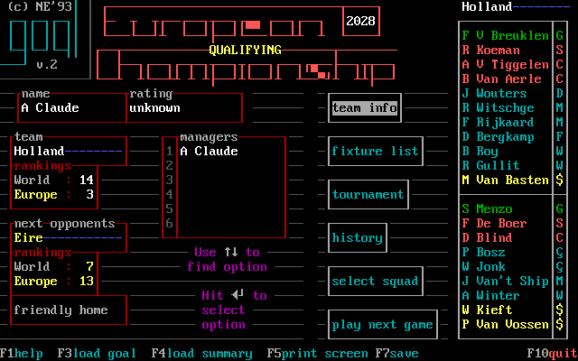
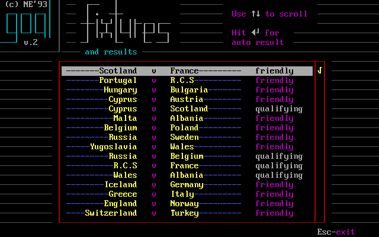
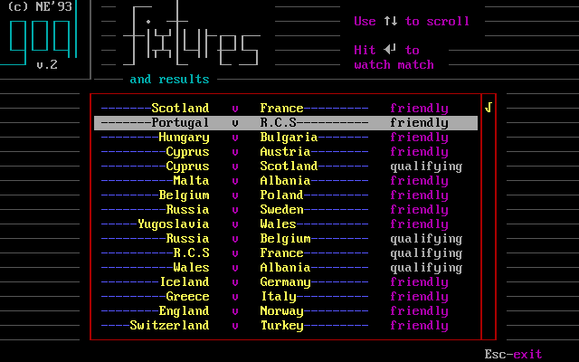
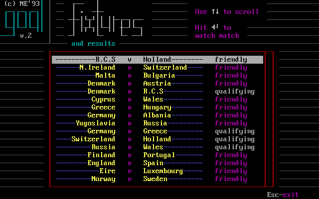
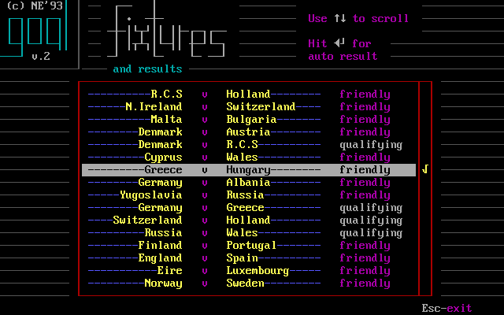
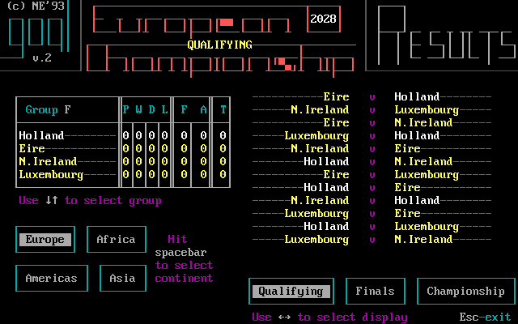
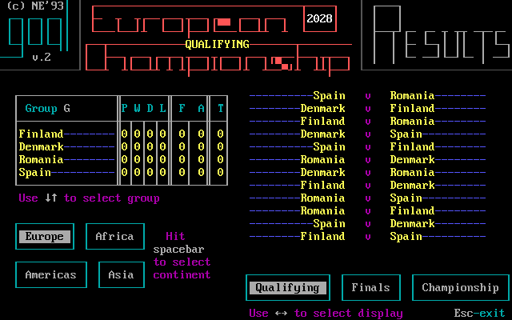
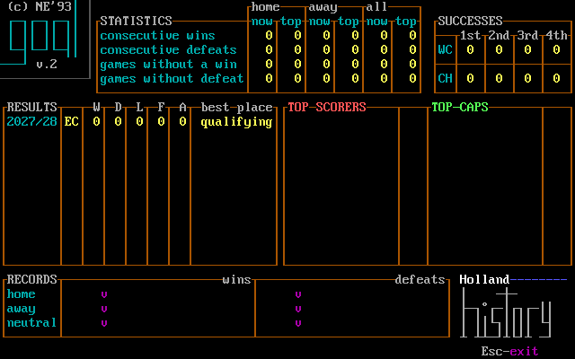
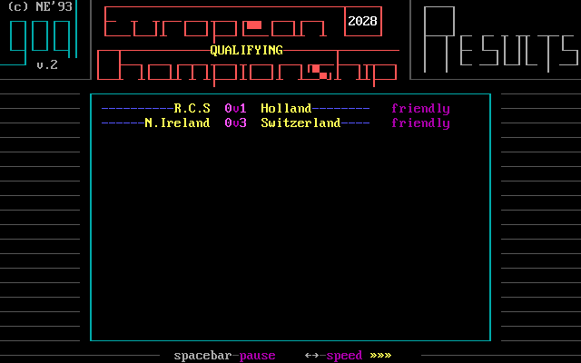

# Fixtures, competition and campaign years

The original manager hub keeps the managed country, world/European ranking and next opponent in view while the user decides whether to review people, fixtures or competition. This makes the next decision legible: prepare this team for that opponent, or inspect wider results before continuing. [confirmed: E015-r0007 state 16; M244-G1A-01 step 2; E031 C17–C21]

*Holland after loading the published G1A checkpoint, `M244-G1A-02 step 2`; the left card shows Eire as the next opponent and the right column names the twenty. The same screen is the origin for the captured fixture, squad and team-tactic branches. [confirmed: M244-G1A-02 step 2; E031 G1A save register]*

## Fixture list and which matches to watch

*Fixture list, `M244-G1A-03 step 4`, opened by a single Enter after one Down on the manager menu. Each row names both teams and labels the fixture “friendly” or “qualifying”; the top-right hint currently says Enter gives an auto result for the selected other match. Up/Down scrolls. [confirmed: M244-G1A-03 steps 2–4]*

*One Down on the fixture list moves selection, `M244-G1A-03 step 5`; this capture shows a “watch match” hint for its selected row. The E031 guide separately observed Enter toggling an other-country match between watch and automatic result, with a later “Do you want to watch this match?” prompt for marked games. The prompt depends on match context. [confirmed: M244-G1A-03 steps 4–5; E031 C18, C35]*

*Italy fixture-list watch state, `E015-r0007 state 18`; the selected row and bottom instructions are legible in the full image. It confirms this is a recurring list state, not unique to the Holland save. [confirmed: E015-r0007 state 18]*

*Automatic-result alternative, `E015-r0007 state 24`. Read the selected-row hint before acting: the same list can present materially different handling for a selected fixture. The exact intervening E015 key burst is not treated as one-key causality. [confirmed: E015-r0007 states 18,24; E031 C18]*

In **team info**, a country card can be inspected; Space shows that country's players. On your own fixture list, E031 observed Enter canceling a friendly and Enter on the canceled item arranging another. The label/context must be checked before treating Enter as one universal action. [confirmed: E031 C17, C17b, C17c]

## Tournament and standings

*Tournament, `M244-G1A-03 step 8`; Holland's Group F table is beside its group matches. The lower controls offer continents on the left and Qualifying/Finals/Championship displays on the right. The screen prints Up/Down for groups, Space for continent and Left/Right for display. [confirmed: M244-G1A-03 step 8]*

*One Down selects Group G, `M244-G1A-03 step 9`. The table and the match list both change; the user sees the context of a group, not an isolated rank. [confirmed: M244-G1A-03 steps 8–9]*

The table visibly has P, W, D, L, F, A and T headings; W/D/L align with results language, but this chapter does not assert an unreviewed formula for T or every tiebreak. A manager uses the table to see whether results are enough to advance, and the adjacent fixtures to see opponents and remaining matches. The full standings rules are in the reviewed archaeology specification rather than deduced from zero-filled opening rows. [confirmed: M244-G1A-03 steps 8–9; reviewed F023; evidence gap: field-by-field display explanation]

## History and news

*History, `M244-G1A-03 step 12`, opened after Esc from tournament and one Down on the manager menu. The page has runs of wins/defeats, home/away/all records, successes, seasonal results and best place, top scorers/caps and largest wins/defeats. Its early-game rows are mostly zero or empty. [confirmed: M244-G1A-03 steps 10–12]*

The history page tells the player how this country has progressed over seasons, while the bulletin gives immediate news. E031 recorded retirement, quitting and pool advice headlines as the years advanced. A headline is information; it does not by itself prove a specific roster or dismissal mechanic without the cited outcome. [confirmed: E031 C20, C56–C60; reviewed F025]

*Welcome bulletin, `E015-r0007 state 14`. Its panels and “hit any key” prompt are shown here as the first newspaper state; later E031 bulletins include qualifying groups and player news. [confirmed: E015-r0007 state 14; E031 C56, C59, C66–C66b]*

## From one fixture to the next

*Round results, `E015-r0007 state 52`, after a match. The page lists more than the managed side's game; the next manager hub then updates its opponent context. [confirmed: E015-r0007 state 52; E031 C35, C52]*

*Round-playing state, `E015-r0007 state 27`; the bottom has pause/speed hints while other fixtures are processed. This is an automatic round phase, distinct from a watched pitch. [confirmed: E015-r0007 state 27]*

E031's Holland run supplies the observed long loop: 2028 European qualifying/friendlies, a following year of friendlies after elimination, 2030 World Cup qualifying, 2030 World Cup finals, then the next European cycle in 2032. The guide calls these years in the original manual's four-year cycle. Between rounds the manager can revisit squad condition and pool, adjust roles/tactics, inspect fixtures/tables and save. [confirmed: E031 C52–C53c, C72–C75e, C65b; E031 g1 `progress.md`; owner explanation quoted in E031 guide]

| E031 Holland checkpoint | What the saved state establishes | Source |
| --- | --- | --- |
| G1A | Before the first 2028 match, Eire is next | [save register](https://github.com/diegoami/goal2-archaeology/blob/main/experiments/E031-play-the-game/out/saves.tsv); M244-G1A-02 step 2 |
| G1E | All twelve 2028 matches played, Holland second in Group F | E031 save register; E031 C53 |
| G2A | Next stage begun after elimination, ages advance | E031 save register; E031 C52b, C61b |
| G3A | World Cup qualifying stage begun | E031 save register; E031 C53c, C75c |
| G4A/G4C | World Cup group, then knockout last sixteen | E031 save register; E031 C72, C72b |
| G5A | Four-year cycle completed; 2032 qualifying begins | E031 save register; E031 C65b, C52e |

When “next opponents” empties, E031 observed **play next game** advancing remaining results and a winners page before the next stage. A player aged after a year transition. The current screenshots still need separate verified images of a winners page, stage transition and later bulletin; these are tracked in [coverage](coverage.md), not represented by an invented graphic. [confirmed: E031 C54–C56, C61–C61b; evidence gap: transition images]
