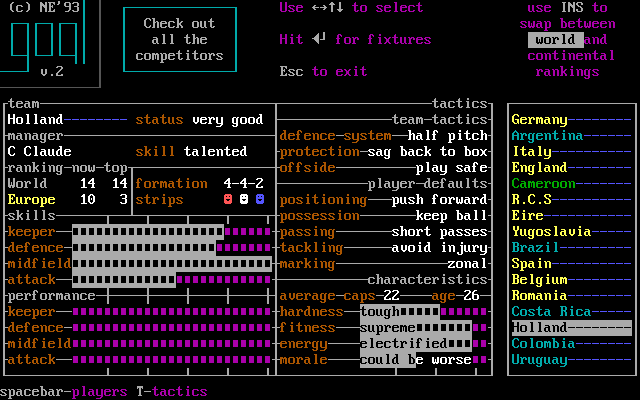
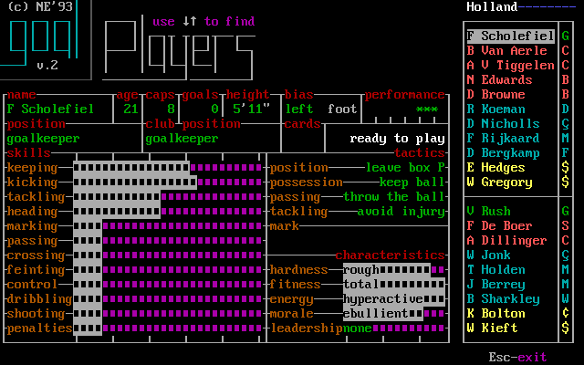
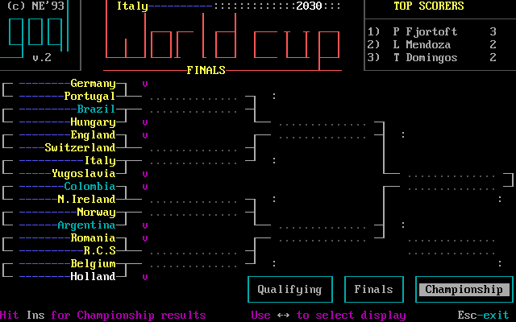
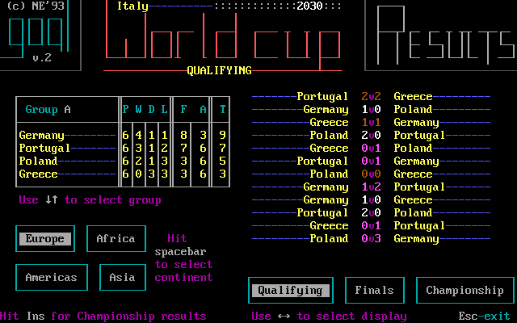
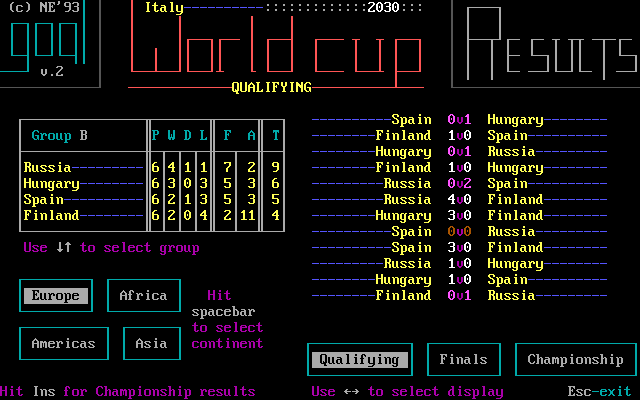
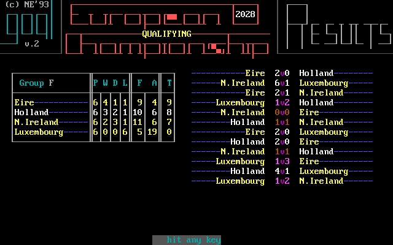
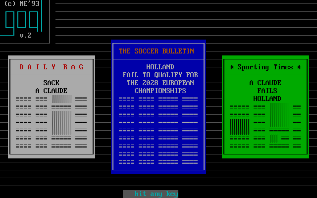
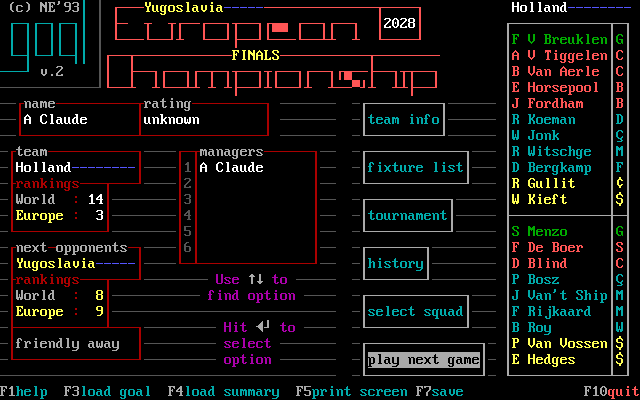

# Fixtures, competition and campaign years

The original manager hub keeps the managed country, world/European ranking and next opponent in view while the user decides whether to review people, fixtures or competition. This makes the next decision legible: prepare this team for that opponent, or inspect wider results before continuing. [confirmed: E015-r0007 state 16; M244-G1A-01 step 2; E031 C17–C21]

*Holland after loading the published G1A checkpoint, `M244-G1A-02 step 2`; the left card shows Eire as the next opponent and the right column names the twenty. The same screen is the origin for the captured fixture, squad and team-tactic branches. [confirmed: M244-G1A-02 step 2; E031 G1A save register]*

## Country information and opponents

*The hub's highlighted **team info** action opened this Holland card with one Enter, `M244-G4C-05 step 3`. It keeps manager and team status, world/European ranking and movement, 4-4-2 formation, squad-stripe and skill bars, eight team tactics and characteristics on one page. The country list invites browsing competitors. The printed hints offer Space for players, T for tactics and `◄┘` (Enter) for fixtures; this capture separately verifies Space at step 4, while the other hinted transitions were not tested here. The exact units of bars and the formula behind “very good” remain outside this observation. [confirmed: M244-G4C-05 steps 2–4; evidence gap: bar units/status formula]*

*One Space from that card opened a player detail for the 2030 Holland twenty, `M244-G4C-05 step 4`. One Esc returned to team info and another to the hub (`steps 5–6`). The card gives an opponent-scouter the same individual labels as the managed squad, including skills, readiness and characteristics, without proving a roster edit in this read-only route. [confirmed: M244-G4C-05 steps 3–6]*

## Fixture list and which matches to watch

*Fixture list, `M244-G1A-03 step 4`, opened by a single Enter after one Down on the manager menu. Each row names both teams and labels the fixture “friendly” or “qualifying”. The selected Scotland–France row already has a `√`, meaning it is marked to watch. The top-right “auto result” hint names what Enter would do **next** to that row. Up/Down changes selection. [confirmed: M244-G1A-03 steps 2–4; E031 C18]*

*One Down on the fixture list moves selection to an unmarked row, `M244-G1A-03 step 5`; “watch match” says what Enter would do **next**. The `√` on Scotland–France was already present at step 4; Down did not toggle either match. E031 separately observed Enter marking an other-country match to watch, changing the next-action hint to “auto result”, and a later conditional watch prompt. [confirmed: M244-G1A-03 steps 4–5; E031 C18, C35]*

*Italy fixture list, `E015-r0007 state 18`: the selected row has no `√` and the hint offers “watch match” on Enter. The classifier name `fixtures-watch` describes that hint, not a current watch flag. [confirmed: E015-r0007 state 18; E031 C18]*

*Marked-to-watch alternative, `E015-r0007 state 24`: Greece–Hungary has `√`; “auto result” is the action Enter would take **next**. The classifier name `fixtures-auto` describes the hint, not the row's present watch state. The intervening E015 key burst does not prove a single-key toggle; E031 C18 supplies that observation. [confirmed: E015-r0007 states 18,24; E031 C18]*

In **team info**, a country card can be inspected; Space shows that country's players. On your own fixture list, E031 observed Enter canceling a friendly and Enter on the canceled item arranging another. The label/context must be checked before treating Enter as one universal action. [confirmed: E031 C17, C17b, C17c]

## Tournament and standings

*Tournament, `M244-G1A-03 step 8`; Holland's Group F table is beside its group matches. The lower controls offer continents on the left and Qualifying/Finals/Championship displays on the right. The screen prints Up/Down for groups, Space for continent and Left/Right for display. [confirmed: M244-G1A-03 step 8]*

*One Down selects Group G, `M244-G1A-03 step 9`. The table and the match list both change; the user sees the context of a group, not an isolated rank. [confirmed: M244-G1A-03 steps 8–9]*

The table visibly has P, W, D, L, F, A and T headings; W/D/L align with results language, but this chapter does not assert an unreviewed formula for T or every tiebreak. A manager uses the table to see whether results are enough to advance, and the adjacent fixtures to see opponents and remaining matches. The full standings rules are in the reviewed archaeology specification rather than deduced from zero-filled opening rows. [confirmed: M244-G1A-03 steps 8–9; reviewed F023; evidence gap: field-by-field display explanation]

*From the 2030 hub, two Downs selected tournament and Enter opened this World Cup knockout bracket, `M244-G4C-05 step 9`. **Championship** appears highlighted among the Qualifying/Finals/Championship display choices; “FINALS” in the page title may name the campaign stage, so this capture does not establish that the Finals display is selected. Sixteen knockout sides, future pairings and a top-scorers panel are visible. The bottom-left prints “Hit Ins for Championship results”; that action was not exercised here. An empty branch is an unplayed match, not an invented result. [confirmed: M244-G4C-05 steps 6–9; evidence gap: title/display distinction and Ins action]*

*One Right from the preceding bracket changed the visible page to **Qualifying**, `M244-G4C-05 step 10`; the prior image visually highlights Championship, without proving the title's display semantics. Group A's P/W/D/L/F/A/T table sits beside its dated result sequence, so ranking and opponents can be read together. The bottom lists continent choices and prints Up/Down for groups, Space for continent, and Left/Right for display. [confirmed: M244-G4C-05 steps 9–10; evidence gap: title/display distinction]*

*One Down moved from Group A to Group B, `M244-G4C-05 step 11`, changing both table and adjacent match list. This captures the scrolling behavior in a later campaign stage. [confirmed: M244-G4C-05 steps 10–11]*

## History and news

*History, `M244-G1A-03 step 12`, opened after Esc from tournament and one Down on the manager menu. The page has runs of wins/defeats, home/away/all records, successes, seasonal results and best place, top scorers/caps and largest wins/defeats. Its early-game rows are mostly zero or empty. [confirmed: M244-G1A-03 steps 10–12]*

The history page tells the player how this country has progressed over seasons, while the bulletin gives immediate news. E031 recorded retirement, quitting and pool advice headlines as the years advanced. A headline is information; it does not by itself prove a specific roster or dismissal mechanic without the cited outcome. [confirmed: E031 C20, C56–C60; reviewed F025]

*Welcome bulletin, `E015-r0007 state 14`. Its panels and “hit any key” prompt are shown here as the first newspaper state; later E031 bulletins include qualifying groups and player news. [confirmed: E015-r0007 state 14; E031 C56, C59, C66–C66b]*

## From one fixture to the next

*Round results, `E015-r0007 state 52`, after a match. The page lists more than the managed side's game; the next manager hub then updates its opponent context. [confirmed: E015-r0007 state 52; E031 C35, C52]*

*Round-playing state, `E015-r0007 state 27`; the bottom has pause/speed hints while other fixtures are processed. This is an automatic round phase, distinct from a watched pitch. [confirmed: E015-r0007 state 27]*

E031's Holland run supplies the observed long loop: 2028 European qualifying/friendlies, a following year of friendlies after elimination, 2030 World Cup qualifying, 2030 World Cup finals, then the next European cycle in 2032. The guide calls these years in the original manual's four-year cycle. Between rounds the manager can revisit squad condition and pool, adjust roles/tactics, inspect fixtures/tables and save. [confirmed: E031 C52–C53c, C72–C75e, C65b; E031 g1 `progress.md`; owner explanation quoted in E031 guide]

| E031 Holland checkpoint | What the saved state establishes | Source |
| --- | --- | --- |
| G1A | Before the first 2028 match, Eire is next | [save register](https://github.com/diegoami/goal2-archaeology/blob/main/experiments/E031-play-the-game/out/saves.tsv); M244-G1A-02 step 2 |
| G1E | All twelve 2028 matches played, Holland second in Group F | E031 save register; E031 C53 |
| G2A | Next stage begun after elimination, ages advance | E031 save register; E031 C52b, C61b |
| G3A | World Cup qualifying stage begun | E031 save register; E031 C53c, C75c |
| G4A/G4C | World Cup group, then knockout last sixteen | E031 save register; E031 C72, C72b |
| G5A | Four-year cycle completed; 2032 qualifying begins | E031 save register; E031 C65b, C52e |

*After loading the published end-of-qualification G1E checkpoint and choosing **play next game**, step 13 answered N for a match and step 14 acknowledged its result with Enter; this completed Group F table then appeared, `M244-G1E-06 step 14`. Eire finished above Holland while the right column lists individual qualifying results. The source G1E save hash and single-action path are in the [capture method](capture-method.md). [confirmed: M244-G1E-06 steps 2–14; E031 G1E save register]*

*The later bulletin, `M244-G1E-06 step 18`, explicitly reports that Holland failed to qualify for the 2028 European Championships. Newspaper side panels contain harsh headlines about manager A Claude. The image proves the news was shown; the next captured hub is still Holland, so this caption does not infer an automatic dismissal from a headline. [confirmed: M244-G1E-06 steps 18–19]*

*One Enter acknowledged that bulletin and returned to the Holland hub, `M244-G1E-06 step 19`. The top now says **FINALS**, the next opponent is Yugoslavia and the next fixture is a friendly away; the selected manager and squad remain visible. This is a concrete before/after campaign transition, not a fabricated full tournament flow. [confirmed: M244-G1E-06 steps 18–19]*

When “next opponents” empties, E031 observed **play next game** advancing remaining results and a winners page before the next stage. A player aged after a year transition. The current screenshots still need separate verified images of a winners page, stage transition and later bulletin; these are tracked in [coverage](coverage.md), not represented by an invented graphic. [confirmed: E031 C54–C56, C61–C61b; evidence gap: transition images]
