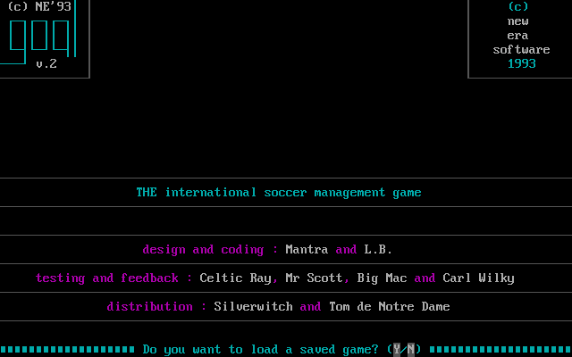
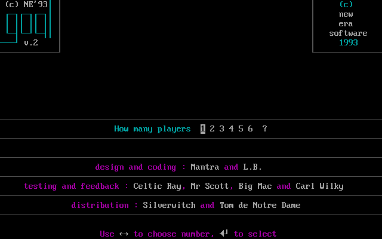
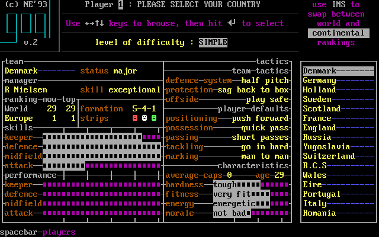
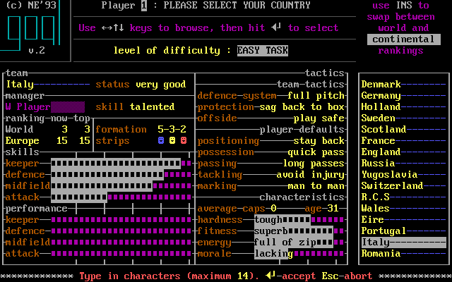
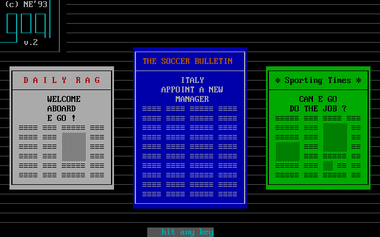
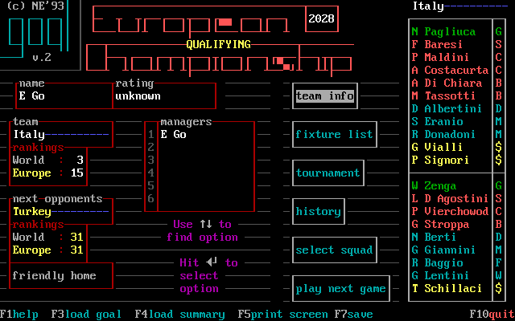
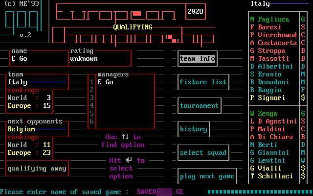

# First session: from launch to a match

The screens below show a **sample**, using different retained sittings where a single continuous screen series is unavailable. Follow the controls in the text; read each picture for the information the original presents. The original DOS layout is evidence for decisions and context, not a required remaster layout. [confirmed: E015-r0001, r0004, r0007; E031 C11–C15, C35–C40]

## Start and choose a country

*Original title, `E015-r0001 state 2`, savestate SHA-256 `55ea9e307aa5…` (full hash in [image provenance](image-provenance.tsv)). The bottom line asks whether to load; this is a question to answer, not a menu selection. [confirmed: E015-r0001 state 2; E031 C11–C12]*

For a new game, answer **N**. Answer **Y** to load a saved `.GL` game; with several saves, the original presents a list, and Esc reaches name entry. The screenshot shows the question before either choice. [confirmed: E031 C11, C11b, C12]

*Player-count selector, `E015-r0004 state 2`, savestate SHA-256 `f4ec5c7194ef…`. The highlighted digit is the current choice; the printed hint gives Left/Right and Enter. [confirmed: E015-r0004 state 2; E031 C12]*

Choose the number of local managers with **Left/Right**, then **Enter**. The one-manager walkthrough continues below. With two managers, country and name selection repeat for each; the main menu later offers **next player**. [confirmed: E031 C12, C16, C16b]

*Country browser, `E015-r0007 state 3`, savestate SHA-256 recorded in [image provenance](image-provenance.tsv). The center card shows the selected country's manager, rankings, formation, tactics, skill bars, characteristics and `level of difficulty : SIMPLE` for Denmark; E031 saw `EASY TASK` in another selection. The right list places the selection among countries. This is Denmark in this retained state, while the later manager screenshot belongs to Italy. [confirmed: E015-r0007 state 3; E031 C13–C14b]*

Use **Up/Down** to browse the visible countries and **Left/Right** for the next group of 16. The card helps weigh the country's world and continental ranking, printed difficulty description, squad strengths, current formation and tactic tendencies before choosing. The printed **Ins** hint swaps world and continental rankings; **Space** shows country players and **Enter** selects the country. The meaning of every bar and shorthand still needs an individual field-by-field audit; a magenta bar should not be treated as a numeric rating without that evidence. [confirmed: E015-r0007 state 3; E031 C13–C15; evidence gap: bar scale]

*Name entry, `E015-r0007 state 10`. The name-entry line overlays the country browser; the bottom hint says maximum 14 characters, Enter accepts and Esc aborts. [confirmed: E015-r0007 state 10; E031 C15]*

Type a manager name and press **Enter**. The first typed character replaces the initial “Player” name in the observed session. [confirmed: E031 C15, C15b]

## Read the news and management hub

*Welcome bulletin, `E015-r0007 state 14`. Newspaper panels report the new manager; the lower strip prompts “hit any key.” A later bulletin can carry competition and squad news, so it is part of campaign context. [confirmed: E015-r0007 state 14; E031 C66, C66b, C56, C59]*

Advance the bulletin with a key. The subsequent management hub puts the next opponent and country rankings beside the menu, so a manager can decide whether to inspect the team, fixture, competition or squad before proceeding. [confirmed: E031 C66, C66b, C17–C21; E015-r0007 state 16]

*Manager hub, `E015-r0007 state 16`. The left column names Italy, its rankings and next opponent; the middle has six actions; the right repeats the squad strip, including position abbreviations. The bottom line advertises function keys. The formation and player condition are one more key away in **select squad**. [confirmed: E015-r0007 state 16; E031 C17–C21, C27]*

Use **Up/Down** to move the menu highlight and **Enter** to choose. **Team info** opens country cards; **fixture list** shows the round and can mark another match to watch; **tournament** shows groups/results; **history** shows past results and statistics; **select squad** is where players and tactics can be changed; **play next game** advances to the next fixture. **F7** saves and **F10** asks to quit. These were observed as separate E031 actions, not inferred from the E015 key-burst map. [confirmed: E031 C17–C21, C25–C26]

## Prepare and watch

Before playing, inspect **select squad**. In the retained G1A save, **Space** on the hub opened the squad immediately. Its upper instructions distinguish the twenty selected players from the wider national pool, and Ins offers the assistant's recommended twenty. [confirmed: M244-G1A-02 steps 2–3; E031 C21, C27, C29]

*Pre-match Holland squad, `M244-G1A-02 step 3` after one Space key; [capture log](captures/m244-g1a-02.json) records the verified G1A source, state/PNG hashes and screen digest. The selected Van Breukelen card puts name, age, caps/goals, height, dominant foot, position and club position above skill bars; the center has tactics and characteristics; the right strip shows the twenty. The white “ready to play” status is visible. [confirmed: M244-G1A-02 step 3]*

*Koeman card after one Down from the prior state, `M244-G1A-02 step 4`. Compare his position, bars and characteristics with Van Breukelen before deciding who belongs in the XI; the card changes as the highlight moves. The bars' scale is not documented here as a precise numeric value. [confirmed: M244-G1A-02 steps 3–4; evidence gap: exact bar scale]*

The card's printed keys are **Up/Down** to find a player, **Left/Right** to toggle squad and pool, **R/C** to reposition, **T** for the selected player's tactics, **Enter** to start a move and **Esc** to leave. E031 separately observed pool replacement as Enter on a pool player, Left, then Enter on a squad player; one Enter alone is only the first half of that move. [confirmed: M244-G1A-02 steps 3–9; E031 C27–C28b, C31, C33]

*National pool, `M244-G1A-02 step 5` after one Right from the squad card. The selected Stott card and the right-hand pool list replace the twenty-player squad strip. A second observed Down moved to the next pool player in step 6; this is a separate browsing state, not proof that a player was selected. [confirmed: M244-G1A-02 steps 4–6]*

*Koeman's tactics, `M244-G1A-02 step 8` after returning to squad with Left and pressing T. The bottom hint changes to arrow selection, Enter alteration and Esc exit. The middle shows position, possession, passing, tackling and marking choices; these belong to the selected player. [confirmed: M244-G1A-02 steps 7–9; E031 C33–C33d]*

*Holland team tactics, `M244-G1A-02 step 11`. Esc left individual tactics, another Esc returned to the hub, and a single T opened the team card. The eight visible team lines include defence system, protection, offside, positioning, possession, passing, tackling and marking; Enter changes the highlighted line. Team settings and one player's settings are distinct decisions. [confirmed: M244-G1A-02 steps 8–11; E031 C07, C33]*

See the [squad and tactics chapter](squad-and-tactics.md) for player fields, swaps, formation and bench decisions. [confirmed: E031 C27–C34, C41]

*Match menu, `E015-r0007 state 30`, a Greece–Hungary match observed in another branch of the sitting. It shows each side's lineup and formation, access to team tactics and players, plus tournament, match stats and **play**. The bottom hint offers Ins to toggle automatic action replay. This is an authentic example of the screen kind, not Italy's next match. [confirmed: E015-r0007 state 30; E031 C37]*

When the game presents the watch question, **Y** enters the watched branch and **N** chooses the quick branch. In your match, the menu's **play** opens captain selection; **Up/Down** moves the captain highlight and **Enter** accepts. The card also prints **C-computer select**, an offered shortcut distinct from the separately observed Enter choice. The observed F030 finding says the highlighted computer choice stands after the timed wait, but a fresh player should press Enter deliberately. [confirmed: E031 C35, C37, C38, C38b; E015-r0007 state 63; reviewed F030]

*Live pitch, `E015-r0007 state 31`, again Greece–Hungary. The header has score and match context, text commentary sits above the pitch, the pitch marks players/ball, and the bottom legend displays speed, result, commentary and bench controls. The exact meaning of every glyph and the F9 suffix is still open in this guide. [confirmed: E015-r0007 state 31; E031 C39–C39c; evidence gap: glyph legend]*

During a watched match, **Left** slowed the game by one speed marker in E031; **Space** opened commentary; **R** requested quick continuation, which can still stop at half-time or extra-time menus and a shoot-out prompt. The pitch also prints **Esc/Enter–bench**, but this direct route was not single-step exercised. At halftime, a board offers Enter or Space to reach the menu, where **players** allows substitutions before **play** begins the second half. The guide reports five substitutions in a friendly and two in competition matches based on its observed screens and original manual. [confirmed: E031 C39–C41c, C08; M244-G4C-07 steps 32–55; original GOAL.HLP; evidence gap: direct pitch-to-bench action]

At full time, the menu highlights **exit** where the pre-match menu offered **play**; inspect **match stats** before returning to the manager menu. The board gives full-time and half-time scores, scorer minutes, MAN OF THE MATCH, corners, free kicks, penalties, shots and shots on target, saves, fouls, bookings/cards, possession and territory. The side-by-side numbers explain how the match unfolded beyond the score. [confirmed: E015-r0007 states 50–51; E031 C24b, C51]

*Statistics and “save the match summary?” prompt, `E015-r0007 state 51`. This Greece–Hungary example is a separate retained match; the screen places each team's numbers side by side and a conditional Y/N summary question below. [confirmed: E015-r0007 state 51; E031 C51]*

When a round finishes, the results page lists matches and asks for a key to continue. The manager hub then gives the next opponent. Before leaving a useful checkpoint, press **F7**, enter a save name and press **Enter**; the title's **Y** path reloads that `.GL` later. The screenshot below shows the save-name line over the hub. [confirmed: E015-r0007 states 52, 215; E031 C25, C25b, C11]

*Round results, `E015-r0007 state 52`. The list is the bridge from an individual match back to the wider fixture sequence. [confirmed: E015-r0007 state 52]*

*Save-name prompt, `E015-r0007 state 215`. The original prints the proposed filename and `.GL` suffix at the bottom. Esc cancels per the reviewed prompt finding. [confirmed: E015-r0007 state 215; E031 C25; reviewed F030]*

The [match chapter](match-and-results.md) follows intervention, halftime, substitution and results in detail; [startup and save](startup-save-replay.md) illustrates the load and quit alternatives. [confirmed: E031 C35–C51]
