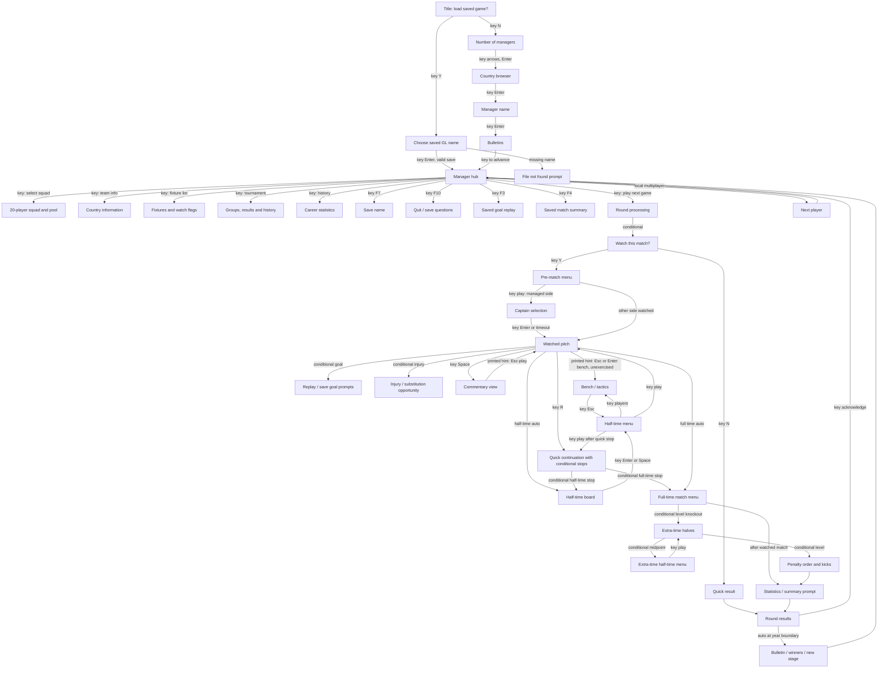

# Connected original-game flow

Arrows marked **key** below are observed player actions; **printed hint** labels an offered control without a single-step exercise. **Auto** marks an observed game-driven continuation. **Conditional** means the game asks only in some contexts; a branch in this diagram does not mean every fixture presents it. The diagram condenses E031 C11–C52 and the screen sources in the [inventory](screen-inventory.md); the table following it gives checkable transitions. [confirmed: E031 C11–C52; E015 catalogue]

| From → to | Trigger and what was observed | Evidence |
| --- | --- | --- |
| Title → new/count/country/name | N, choose count with arrows/Enter, browse country, Enter, type and accept name | E031 C12–C15b; E015-r0004 state 2, r0007 states 3 and 10 |
| Title → load → hub or error | Y, one save prefilled; Enter loaded G1A in a fresh one-key capture; several saves have a list | M244-G1A-01 steps 0–2; E031 C11–C11b; E015-r0008 state 10 |
| Name → bulletin → hub | New-manager news and group page, acknowledged by key | E031 C66–C66b; E015-r0007 states 14–16 |
| Hub → squad/pool/tactics | Space to squad; arrows browse; T opens selected player's editor; Esc twice and T opens team editor | M244-G1A-02 steps 2–11; E031 C27–C33 |
| Hub → country/fixtures/tournament/history | Menu selection; fixture watch flag, group navigation and history | M244-G1A-03 steps 2–12; E031 C17–C20 |
| Hub → save/quit/replay/summary | F7, F10, F3, F4 respectively; these are separate branches | E031 C23–C26; E015-r0007 states 207, 215, 223–224 |
| Hub → round → watch prompt | Play next game advances; marked and managed fixtures can ask Y/N | E031 C35–C35c, C68; E015-r0007 states 27–28 |
| Watch prompt → managed match menu → captain → pitch | Y, then play and Enter for highlighted captain; other-side watch lacks captain | E031 C37–C39, C68b; E015-r0007 states 30–31, 63 |
| Pitch → commentary → pitch | Space opened commentary; its printed hint says Esc-play, not separately exercised in this capture | E031 C39c; E015-r0007 state 67 |
| Pitch → bench (printed) | Legend offers Esc or Enter for bench; a direct in-play transition was not single-step exercised | E031 C39; E015-r0007 states 31,42 |
| Pitch → half-time board → menu/bench → pitch | Half-time board is automatic; Enter or Space on that board reached menu, players opens bench, play resumes | E031 C40–C41; E015-r0007 states 44, 76–82 |
| Pitch → conditional replay/taker/injury | Goal, set piece or injury can interrupt with a prompt; timers/defaults differ | E031 C42–C46; reviewed F030 |
| Pitch → quick continuation | R during watched match accelerates play; half-time, full-time, extra-time and shoot-out stops can still require acknowledgment or decisions | E031 C08, C68c; M244-G4C-07 steps 32–55 |
| Full-time → extra time → shoot-out | Knockout draw; extra-time menu and half-time; still level gives order prompt then kicks | E031 C47–C50; E031 g1 step 3874 |
| Watched result → stats/summary → round results | Post-match summary-save question, stats board, then round list | E031 C24b, C51; E015-r0007 states 50–52 |
| Results → stage / next manager | Remaining fixtures and winners can advance campaign; multi-manager hub can hand to next player | E031 C16–C16b, C52–C55 |

A marked other-country match, a friendly, a qualifying match and a World Cup knockout match do not share every prompt. E031 C35–C35c distinguishes their watch questions. E031 C68b observed no captain screen for the other-country watched match. The exact no-substitution, replay-file and more-than-two-manager paths remain unexercised. [confirmed: E031 C35–C35c, C68b; evidence gaps listed in coverage]
