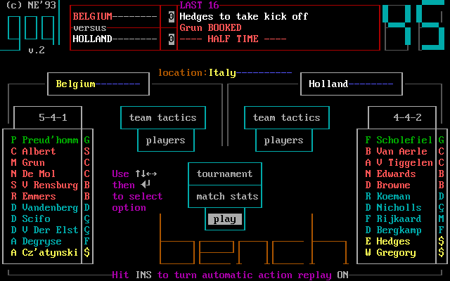
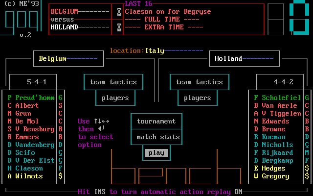
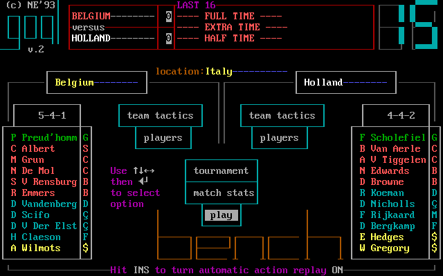
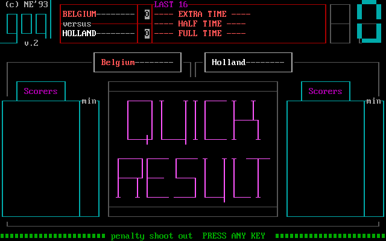
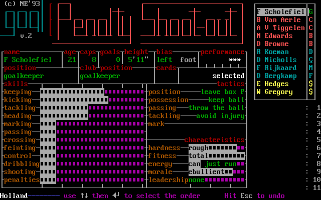
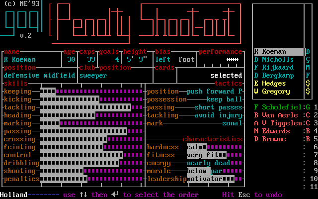
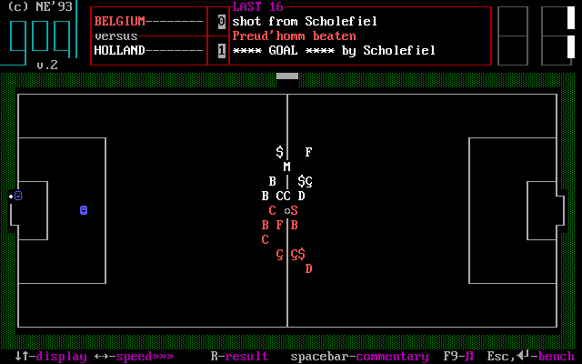

# A round, watched match, interventions and results

A match can be processed quickly or watched. The original sometimes asks whether to watch a selected fixture, then puts the managed side's choices on a match menu before the pitch. The prompt's Y/N and context are visible; a marked other-country fixture follows a shorter branch without the managed captain screen. [confirmed: E031 C18, C35–C38, C68–C68b]

*Watch question, `E015-r0007 state 28`. Its menu still shows teams, lineups and match actions underneath. E031 recorded Y entering watch; the reviewed prompt finding says this particular question has no timeout. [confirmed: E015-r0007 state 28; E031 C35; reviewed F030]*

*Greece versus Hungary example, `E015-r0007 state 30`. Both formations and eleven-player strips remain visible while the cursor moves among team tactics, players, tournament, match stats and play; `location:` names the venue. Ins toggles automatic action replay, with the current setting named at bottom. This is the place to compare sides and decide whether to change management before kick-off. [confirmed: E015-r0007 state 30; E031 C36–C37]*

For a managed watched match, **play** leads to captain selection; Enter accepts the highlighted player, or Up/Down chooses another before Enter. A quick result bypasses the watched pitch and its interventions; E031's Holland run used quick rounds for most fixtures while retaining watched examples. The computer's highlighted captain choice is timed according to reviewed F030. [confirmed: E031 C38–C38b, C35, C63; reviewed F030]

*Captain select, `E015-r0007 state 63`. The player card and opponent/score context stay on screen while the selection is made. The card also prints `C-computer select`; that hint is distinct from the observed Up/Down and Enter choice. [confirmed: E015-r0007 state 63; E031 C38–C38b]*

## Pitch, speed and commentary

*Live pitch, `E015-r0007 state 31`. The header has match type, sides, score and event text; colored marks, goals and a ball are shown on the pitch. The bottom line prints display, speed, result, commentary and bench key hints. The picture represents a watched other-country game, so do not infer managed-team tactics from it. [confirmed: E015-r0007 state 31; E031 C39–C39c]*

E031 observed **Left** reducing speed by one `»` marker, **Up/Down** changing display marks, **Space** opening commentary, and **R** requesting quick continuation. That continuation can still stop at half-time, extra-time and shoot-out decisions, as M244-G4C-07 steps 32–55 show. The pitch prints **Esc/Enter–bench** as a direct management hint, but a single-key use of that route was not recorded. The displayed F9 suffix and exact meaning of every pitch glyph remain unverified. Speed here is an original-game control, distinct from the remaster's playback-rate design tracked in #243. [confirmed: E031 C39–C39c, C08; E015-r0007 state 31; M244-G4C-07 steps 32–55; evidence gap: direct bench key, F9 and glyph legend]

*Commentary view, `E015-r0007 state 67`. A scroll of event sentences appears beside the pitch while score/time remain. The screen prints `Esc-play` for returning to play; that printed exit hint was not separately exercised in this capture. A manager can interpret the score in the context of chances and actions. [confirmed: E015-r0007 state 67; E031 C39c]*

## Conditional moments

After a goal, the original may ask to show an action replay and then whether to save the goal. With automatic replay switched off at the match menu, those questions do not appear according to the reviewed prompt finding. Set-piece taker prompts for corner and goal kick allow a selected player or C for computer choice; their default timeout behavior is in F030, while E031 captured each prompt text. These overlays require their own images before coverage is complete. [confirmed: E031 C37, C42–C43b; reviewed F030; evidence gap: replay/taker prompt screenshots]

*Greece versus Hungary live event, `E015-r0007 state 42`: the header reports “Kovacs INJURED” and “Fischer on for Kovacs” while the pitch and score remain visible. This is an observed injury and replacement for the side in this match; it does not prove the managed-team substitution path. [confirmed: E015-r0007 state 42]*

A rival substitution can produce a notice; a managed player's injury can produce an injury notice followed by “SUBSTITUTION OPPORTUNITY”. E031 also observed an injured player left on during a quick continuation repeatedly triggering the notice until the manager removed him. The case of no substitutions remaining was not seen and must not be invented. [confirmed: E031 C44–C46b, C71–C71b; evidence gap: no-substitution case]

## Half-time and bench

*Half-time menu, `E015-r0007 state 44`; the clock is 45 and match context remains. The bench is reached through **players**, and **play** starts the next half after management. E031 saw Enter or Space at the half-time board lead to the menu. [confirmed: E015-r0007 state 44; E031 C40–C40c]*

*Take-off prompt, `E015-r0007 state 76`. The card still shows the player's skills/condition; the bench overlay states how many substitutions remain and what Enter will select. This supports a condition-based replacement decision. [confirmed: E015-r0007 state 76]*

*Put-on prompt, `E015-r0007 state 82`. The two prompts are materially different states of one exchange. E031 recorded the two Enters working in either order and verified the substitute persisted at the next menu. [confirmed: E015-r0007 state 82; E031 C41d–C41k]*

The original manual/E031 evidence gives five substitutions in a friendly and two in a competition match. The right-side list, remaining count and each player's status support the choice. Esc once can leave the roster screen unchanged and a second Esc return to the match menu in the observed path; treat this as observed behavior, not a universal cancel guarantee for every intermediate state. [confirmed: E031 C41–C41j; original GOAL.HLP]

*Illegal-substitution response, `E015-r0007 state 176`. The blocked attempt is visibly rejected rather than silently applied; the overlay prints `PRESS ANY KEY` to acknowledge it. The exact rejection predicate and acknowledgment transition need adjacent single-step evidence before being stated as rules. [confirmed: E015-r0007 state 176; evidence gap: precise predicate and key transition]*

## Full time, extra time and penalties

*Full-time menu, `E015-r0007 state 50`, where result context, `location:` and match actions remain. The highlighted action is **exit**, replacing pre-match **play**. In knockout play, E031 instead observed an “EXTRA TIME” menu with **play** when level after regulation; extra time also has its own half-time. The length of that extra-time half was not established by the E031 guide. [confirmed: E015-r0007 state 50; E031 C47–C47b; evidence gap: extra-time half length]*

*Belgium versus Holland last sixteen after the managed match was started from G4C and **R** requested quick continuation, `M244-G4C-07 step 40`. The menu keeps both lineups, formations, score and **play** decision while the header says HALF TIME; its event line also reports `Grun BOOKED`. This is a visible booking event, not a separate card-notice overlay. Its 0–0 path is a new run, distinct from E031's 2–2 watched path. [confirmed: M244-G4C-07 steps 29–40]*

*The same quick-run continuation reached the menu headed FULL TIME / EXTRA TIME at 0–0, `M244-G4C-07 step 45`; **play** remains the highlighted next action. This is the authentic conditional extra-time state referred to in E031 C47. [confirmed: M244-G4C-07 steps 41–45; E031 C47]*

*After one Enter on that menu, the header gained an additional HALF TIME line during extra time, `M244-G4C-07 step 50`. The displayed clock reads `15` and the same management actions remain visible. This proves the additional midpoint screen; the image alone does not establish an extra-time duration rule. [confirmed: M244-G4C-07 steps 45–50; E031 C47b]*

*Belgium 2–2 Holland, last sixteen, `E031 g1 step 3874`; published savestate SHA-256 `3ea57029282b849fd3114a995178f35e48c420c768f0702b9d3b7d48600dc1fc` and PNG hash are in [image provenance](image-provenance.tsv). The screen itself says “penalty shoot out PRESS ANY KEY”; it is the transition before choosing the order, not an invented order UI. [confirmed: E031 `out/states.tsv`, g1 step 3874; E031 C48]*

*The G4C quick continuation also arrived at a separate 0–0 penalty prompt, `M244-G4C-07 step 55`. The next image is reached by one Space. Compare this with the preceding E031 2–2 watched save: both paths show the prompt, but the scores and source runs differ. [confirmed: M244-G4C-07 steps 50–56; E031 g1 step 3874]*

*One Space opened the managed Holland order picker, `M244-G4C-07 step 56`. The right side shows eleven numbered empty slots; Up/Down and Enter select an order, and the bottom says Esc undoes a pick. The selected player's complete card remains visible while choosing. [confirmed: M244-G4C-07 steps 55–56; E031 C48b]*

*In a second isolated run restored from step 56's private temporary savestate, five single Enter presses filled order slots 1–5 and advanced the selected card, `M244-G4C-08 step 5`. The source state hash and restoration check are in the [capture method](capture-method.md); this is not a new game or a fabricated list. [confirmed: M244-G4C-08 steps 0–5]*

*After all eleven choices, the same run displayed Scholefiel's shot and a 0–1 shoot-out score, `M244-G4C-08 step 19`. Event commentary and the ball/pitch stay visible; this image proves a kick outcome, not the final winner. [confirmed: M244-G4C-08 steps 11–19]*

After this prompt, the managed team orders its takers using Up/Down and Enter; Esc undoes an order choice. E031 logged numbered picks, individual kick commentary and a sixth-kick continuation after five each were level. The other side's order was not seen. The order picker and a scored kick are illustrated above. Different taker choices, misses/saves and the complete final penalty board remain alternative-state gaps. [confirmed: E031 C48b–C49d; evidence gap: order and kick images]

## Statistics and round exit

*Match statistics with a conditional summary-save prompt, `E015-r0007 state 51`. The board compares final and half-time scores, scorer names and minutes, corners, free kicks, penalties, shots, shots on target, saves, fouls, red/yellow cards, possession and territory; it also names MAN OF THE MATCH. Shots on target and saves help separate finishing from chance volume, while the half-time score and scorer minutes show when the result changed. The bottom asks Y/N whether to save the match summary to disk; reviewed F030 says it occurs after a watched match and times out to No. [confirmed: E015-r0007 state 51; E031 C51–C51b; reviewed F030]*

*Summary view, `E015-r0007 state 207`. E031 used F4 at the hub to load a match summary, then **match stats** to inspect its board. The specific screen shown here is one retained state; loading other summaries could change the values. [confirmed: E015-r0007 state 207; E031 C24–C24b]*

*Round results, `E015-r0007 state 52`. After acknowledging results/bulletins, the manager returns to the hub to prepare for another fixture or save. The screenshot does not establish the number of intermediate screens for every competition branch. [confirmed: E015-r0007 state 52; E031 C35, C52–C55]*
