# One uninterrupted playthrough: from the title to the second round

This chapter follows one sitting of the original, as a player would meet it: from the title screen, through a new Holland career, the first round with a watched match, a save, a quit and a reload, to the second round's quick-result match and the hub after it. Every picture is a screen of that one run, `T156-R1`, in order. Unlike the other chapters, nothing here is pieced together from separate sessions. [confirmed: T156-R1 steps 0–321]

**How the run was made.** goal2-archaeology's E031 `PlayDriver` ran the original under DOSBox-X 2024.03.01 on a private Xvfb display, at `cycles=fixed 8000`, from the verified release copy (set `goal2-67cf27d6`), with all of its state under `/tmp`. The run started at the original's own title, not from a saved game. Each logged step is **one key** or **one timed wait**. The step records the screen digest read just before it, the digest read after it, and the SHA-256 of the savestate read after it. Each picture was rendered from that savestate and its PNG hash recorded. The [capture log](captures/t156-r1.json) holds all 322 steps; the [image provenance](image-provenance.tsv) lists every picture; the tool is in `measurements/T156/capture/`; and `measurements/T156/check_png_hashes.py` recomputes every PNG hash from the committed files. The savestates stayed in `/tmp`; no original file is in this repository. Read [capture method](capture-method.md) for the shared method. [confirmed: T156-R1 log `method`]

Two places in the run are not a key's effect on a live screen, and the log says so. In **step 241**, the last key of the quit ended the program, so there was no screen to read: the driver reported that DOSBox-X had exited with code 0. That step was written by hand from that report. In **step 242**, DOSBox-X started again from a fresh copy of the release, with the three files the game had written (the saved game, a saved goal and a match summary) copied in. Their hashes are in the step. This is how a player reloads after quitting. [confirmed: T156-R1 steps 238–244]

Captions cite `T156-R1 step N`: the picture is the screen read after that step's key or wait. Labels in the log are the capture's own notes; three typed during the run were wrong, and the log corrects them with a note. A single observation shows what happened once, not a rule. [confirmed: T156-R1 log]

## The flow on one page

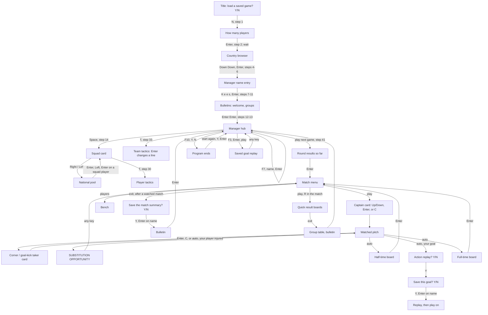

The diagram is drawn from this run alone. Each arrow is one step, or a short run of steps named in the sections below. [confirmed: T156-R1 steps 0–321]

| Screen | Key in this run | What followed |
| --- | --- | --- |
| Title | **N** | number of players (step 1) |
| Number of players | **Enter** | "HANG ON A TICK", then the country browser after a 3 s wait (steps 2–3) |
| Country browser | **Down**, **Down**, **Enter** | Holland's card, then name entry (steps 4–6) |
| Name entry | **K**, **e**, **e**, **s**, **Enter** | welcome bulletin (steps 7–11) |
| Bulletin | **Enter** ×2 | groups bulletin, then the hub (steps 12–13) |
| Hub | **Space** / **T** / **F7** / **F10** / **F3** | squad / team tactics / save name / quit question / saved goal name (steps 14, 33, 233, 239, 245) |
| Squad | **Right**, **Enter**, **Left**, **Enter**, **T**, **Esc** | pool, pick, squad, put here, player tactics, back (steps 16–32) |
| Match menu | arrows, **Enter** | players / match stats / play / exit (steps 43, 74, 195, 198) |
| Captain card | **Up** then **Enter**; or **C** | the pitch (steps 44–45, 266) |
| Pitch | timed waits; **R** | events and boards come on their own; R gives the quick result (steps 46–192, 267) |
| Taker card | **Enter**, **C**, or no key | match menu (step 47), pitch (step 152), pitch after 6–12 s (step 58) |
| Replay question | **Y**, **Y**, **Enter** | save question, file name, replay (steps 176–178) |
| Summary question | **Y**, **Enter** | file name, bulletin (steps 199–200) |
| Quit | **F10**, **Y**, **N** | quit question, save question, program ends (steps 239–241) |

## Start a career

The title asks whether to load a saved game. **N** starts a new one. [confirmed: T156-R1 steps 0–1]

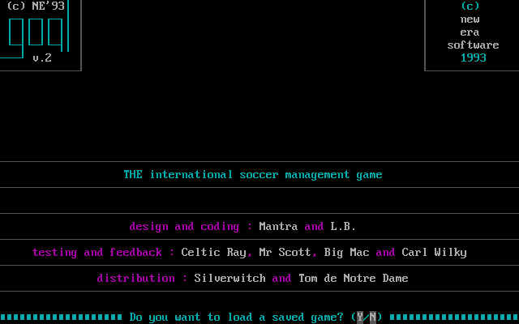

*Title, `T156-R1 step 0` (launch). This run's render is byte-identical to the older E015 picture (same PNG SHA-256), so that file is shown. [confirmed: T156-R1 step 0]*

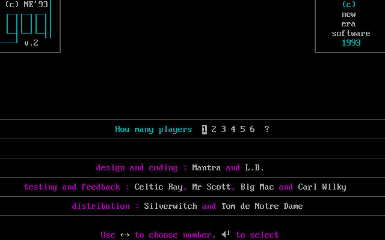

*After **N**, `T156-R1 step 1`: "How many players 1 2 3 4 5 6 ?", with 1 highlighted. The render is byte-identical to the older picture. [confirmed: T156-R1 step 1]*

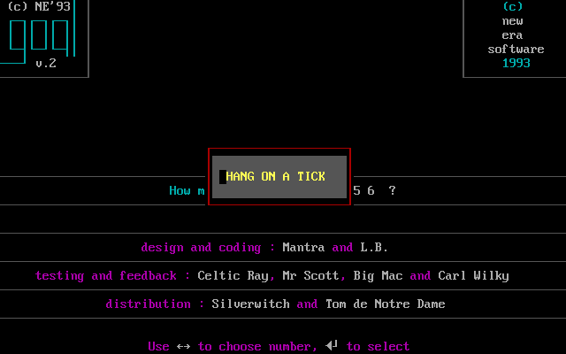

*After **Enter** on one player, `T156-R1 step 2`: a "HANG ON A TICK" box while the game prepares. A 3-second wait (step 3) then showed the country browser. [confirmed: T156-R1 steps 2–3]*

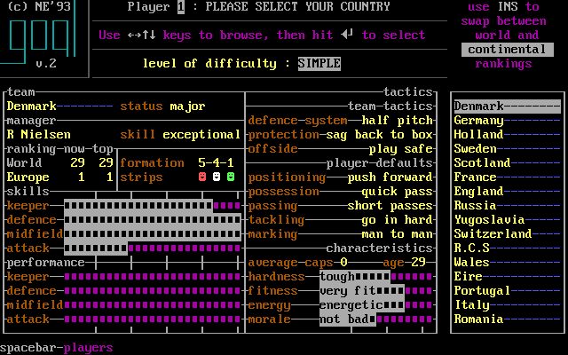

*The country browser after the 3-second wait, `T156-R1 step 3`, opening on Denmark. This run's render is byte-identical to the [first-session](first-session.md) picture of Denmark, so that file is shown. [confirmed: T156-R1 step 3]*

Two **Down** keys move to Germany, then Holland (steps 4–5). [confirmed: T156-R1 steps 3–5]

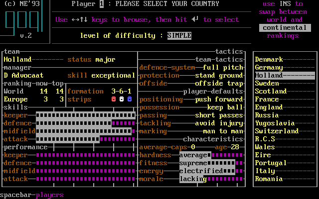

*Holland, `T156-R1 step 5`: status major, manager D Advocaat, world ranking 14, Europe 3, formation 3-6-1, "level of difficulty : SIMPLE". [confirmed: T156-R1 step 5]*

*After **Enter**, `T156-R1 step 6`: "Type in characters (maximum 14). ◄┘-accept Esc-abort". [confirmed: T156-R1 step 6]*

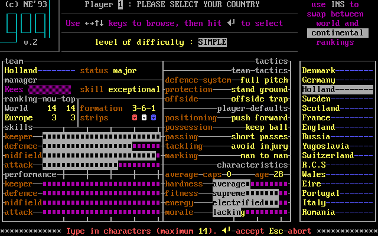

*Four keys, **K**, **e**, **e**, **s**, one per step (steps 7–10). The manager field reads "Kees". The first key replaced the default name. [confirmed: T156-R1 steps 7–10]*

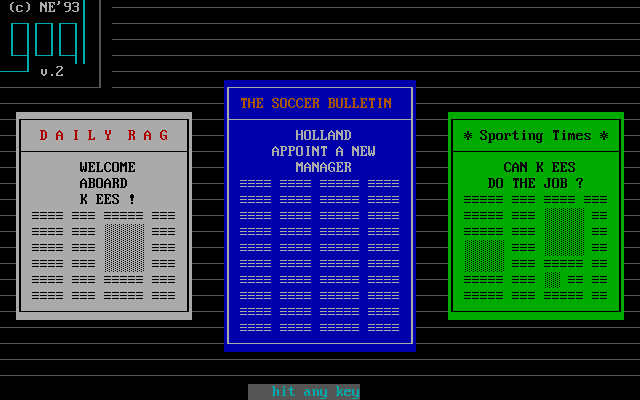

*After **Enter**, `T156-R1 step 11`: THE SOCCER BULLETIN, "HOLLAND APPOINT A NEW MANAGER", "WELCOME ABOARD K EES !". The papers split the name, as E031 saw with "C LAUDE". [confirmed: T156-R1 step 11; E031 C15b]*

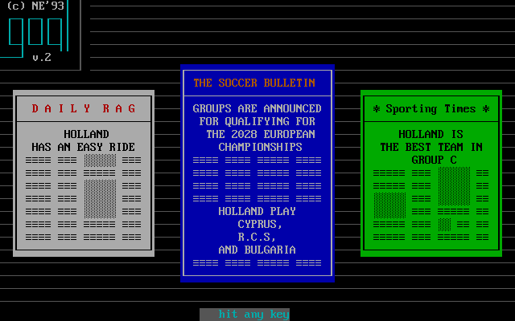

*One more **Enter**, `T156-R1 step 12`: "GROUPS ARE ANNOUNCED FOR QUALIFYING FOR THE 2028 EUROPEAN CHAMPIONSHIPS"; Holland play Cyprus, R.C.S and Bulgaria in Group C. [confirmed: T156-R1 step 12]*

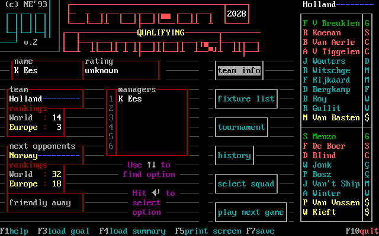

*The hub, `T156-R1 step 13`, after one more **Enter**. 2028, QUALIFYING. Manager "K Ees", rating unknown. Next opponent Norway, a friendly away. The six options are on the right of the centre, the twenty players on the far right. [confirmed: T156-R1 step 13]*

## Management before the first match

**Squad.** **Space** on the hub opens the squad card on the first player (step 14); **Down** moves to the next (step 15, Koeman). **Right** shows the national pool (step 16). [confirmed: T156-R1 steps 14–16]

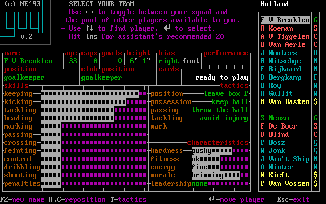

*`T156-R1 step 14`: Van Breukelen's card, "ready to play"; the hint offers Ins for the assistant's recommended 20. [confirmed: T156-R1 step 14]*

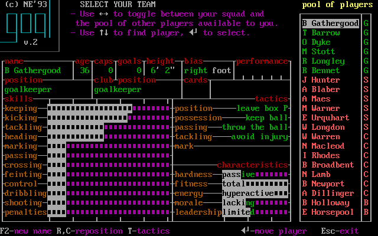

*`T156-R1 step 16`, after **Down** and **Right**: the pool list, with B Gathergood (36, goalkeeper) on the card. [confirmed: T156-R1 steps 15–16]*

**A pool pick** takes three moves: **Enter** on the pool player (step 17; the hint changes to "◄┘-put here"), **Left** back to the squad (step 18), then **Enter** on the player to replace. Ten **Down** keys walked the squad card from Tiggelen to the reserve keeper S Menzo (steps 19–28), and **Enter** put Gathergood in his place (step 29). [confirmed: T156-R1 steps 17–29]

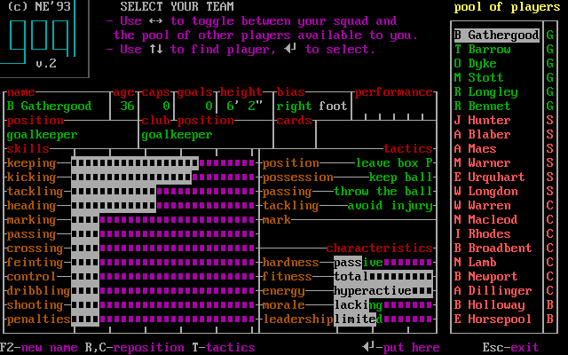

*`T156-R1 step 17`: **Enter** on Gathergood; the bottom line now reads "◄┘-put here". [confirmed: T156-R1 step 17]*

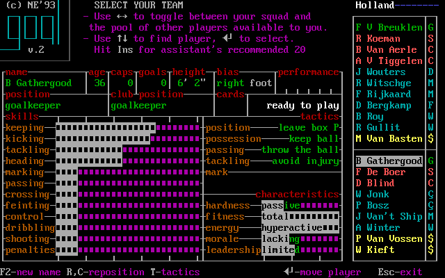

*`T156-R1 step 29`: Gathergood is now on the bench, in the reserve keeper's place, and Menzo has left the squad list. [confirmed: T156-R1 steps 28–29]*

**Tactics.** **T** on the squad card opens that player's tactics (step 30). **Esc** twice returns to the hub (steps 31–32), and **T** on the hub opens the team's tactics (step 33). One **Enter** changes the highlighted line (step 34). [confirmed: T156-R1 steps 30–34]

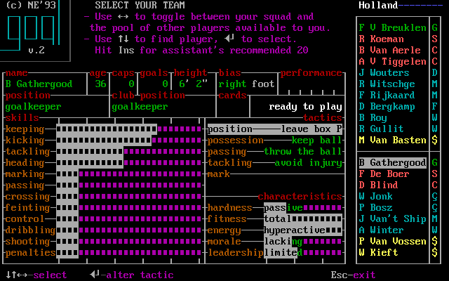

*`T156-R1 step 30`: the bottom line is "↓↑←→-select ◄┘-alter tactic Esc-exit"; the tactics box belongs to the player on the card. [confirmed: T156-R1 step 30]*

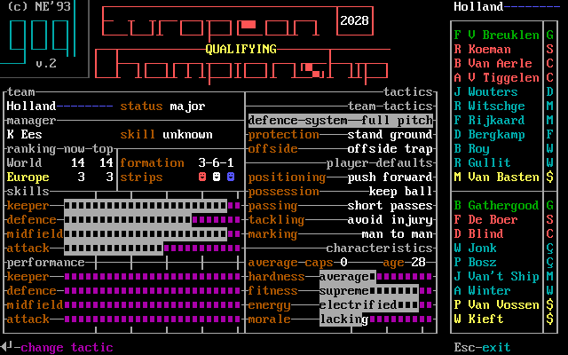

*`T156-R1 step 33`: Holland's team card with the team tactics: defence system full pitch, protection stand ground, offside trap. [confirmed: T156-R1 step 33]*

*`T156-R1 step 34`, one **Enter**: the defence system changed from "full pitch" to "half pitch"; no other line changed. [confirmed: T156-R1 steps 33–34]*

**Esc** left team tactics (step 35). Five **Down** keys moved the hub highlight to **play next game** (steps 36–40), and **Enter** started the round (step 41). The captain is chosen at the start of the match, below. [confirmed: T156-R1 steps 35–41]

## Round one: the results so far, and the match menu

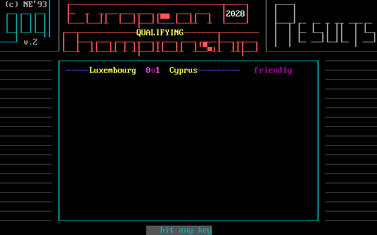

*`T156-R1 step 41`: the round's results so far, Luxembourg 0–1 Cyprus (a friendly), "hit any key". [confirmed: T156-R1 step 41]*

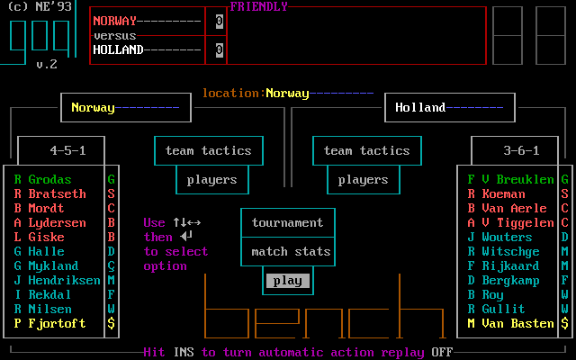

*After **Enter**, `T156-R1 step 42`: the match menu, FRIENDLY, Norway (4-5-1) v Holland (3-6-1), location Norway, with **play** highlighted. The game asked no watch question for this match: it went straight to the menu. [confirmed: T156-R1 step 42]*

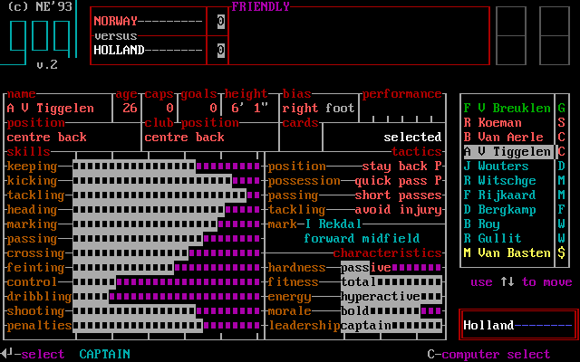

*After **Enter** on play, `T156-R1 step 43`: "◄┘-select CAPTAIN … C-computer select", with A V Tiggelen highlighted. [confirmed: T156-R1 step 43]*

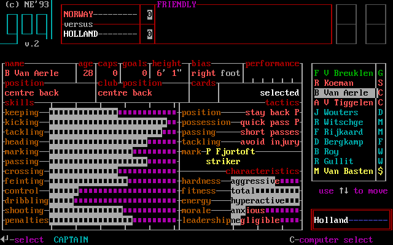

*One **Up**, `T156-R1 step 44`: B Van Aerle highlighted; **Enter** accepted him (step 45). [confirmed: T156-R1 steps 44–45]*

## The watched match: first half

The match runs on its own; the run read it every 2 seconds, each read one timed-wait step. The pitch legend prints "↓↑-display ←→-speed R-result spacebar-commentary F9-♫ Esc,◄┘-bench". [confirmed: T156-R1 steps 45–118]

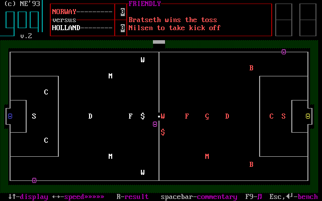

*`T156-R1 step 45`: "Bratseth wins the toss", "Nilsen to take kick off". [confirmed: T156-R1 step 45]*

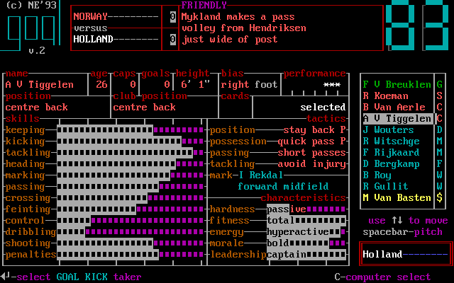

*A 2 s wait, `T156-R1 step 46`: "◄┘-select GOAL KICK taker … C-computer select", with Tiggelen's card. This is the managed-side taker prompt. [confirmed: T156-R1 step 46]*

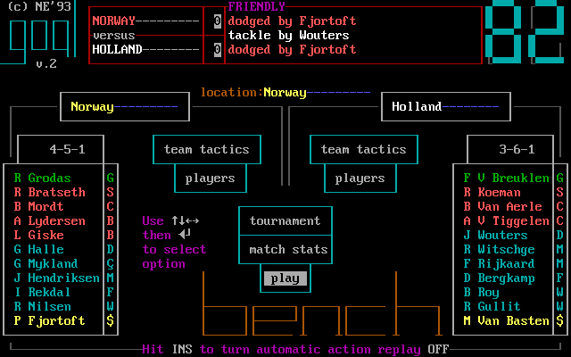

*One **Enter** on the taker card (step 47) was followed by the match menu, not the pitch. The read after it and a 2 s wait (step 48) both show the menu. This run does not show why. **Enter** on **play** resumed the match (step 49). [confirmed: T156-R1 steps 47–49]*

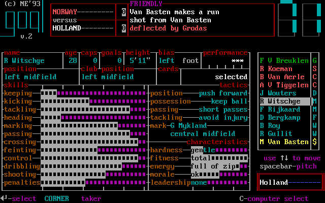

*`T156-R1 step 56`, after six more waits: "◄┘-select CORNER taker", Witschge on the card. [confirmed: T156-R1 steps 50–56]*

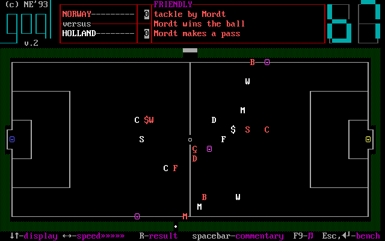

*No key this time. A 6 s wait left the card unchanged (step 57); a second 6 s wait showed the pitch again (step 58). The prompt ended by itself between about 6 and 12 seconds of host time. [confirmed: T156-R1 steps 56–58; reviewed F030 for the 10 s wait]*

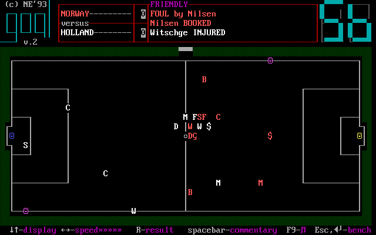

*`T156-R1 step 66`: the commentary reads "FOUL by Nilsen", "Nilsen BOOKED", "Witschge INJURED". The booking appears as a commentary line; no separate card overlay was read in any 2 s wait of this match. That does not prove that no overlay exists between reads. [confirmed: T156-R1 steps 59–66]*

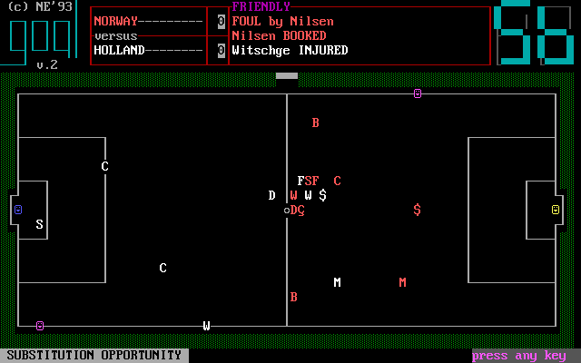

*One second later, `T156-R1 step 67`: "SUBSTITUTION OPPORTUNITY … press any key", the managed team's injury notice. [confirmed: T156-R1 step 67]*

**Enter** led to the match menu (step 68); Witschge had moved to the bottom of the list and the formation read 3-5-1. Three **Up** keys reached Holland's **players**; a **Right** moved to Norway's and a **Left** came back (steps 69–73). [confirmed: T156-R1 steps 68–73]

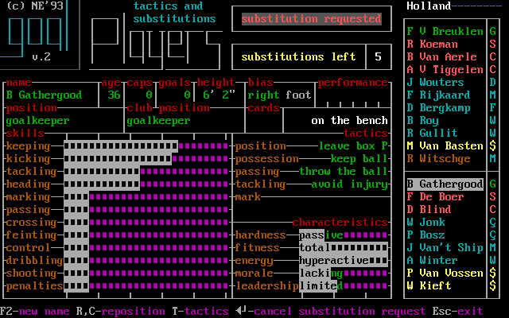

*`T156-R1 step 74`: the bench says "substitution requested", 5 substitutions left, and the hint "◄┘-cancel substitution request". Five **Down** keys moved the card through the bench to J Van't Ship (steps 75–79); the hint did not change. [confirmed: T156-R1 steps 74–79]*

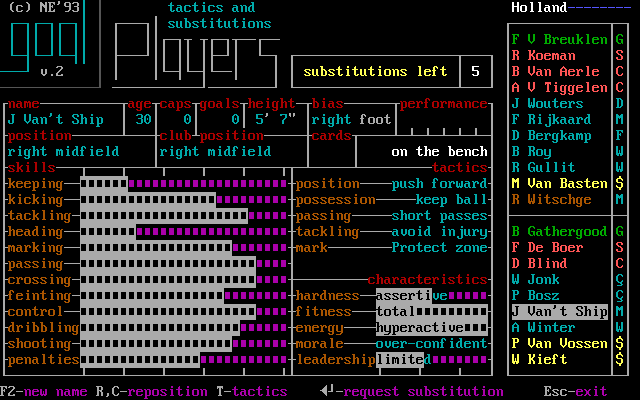

*One **Enter**, `T156-R1 step 80`: the "substitution requested" box is gone and the hint reads "◄┘-request substitution". A second **Enter** (step 81) brought the requested screen back, byte for byte. In this watched match, Enter here toggled a request; it did not swap a player. [confirmed: T156-R1 steps 79–81]*

**Esc**, three **Down** keys and **Enter** on **play** resumed the match (steps 82–86). Two more opportunities came at later stoppages (steps 89 and 100). Each time, the bench showed the same requested screen (steps 94 and 105, the same digest as step 81), even with the card on the injured Witschge (steps 106–111). Holland's formation on these menus read 3-5-1 until half time (steps 68, 115, 120). [confirmed: T156-R1 steps 68, 82–120]

## Half time and one substitution

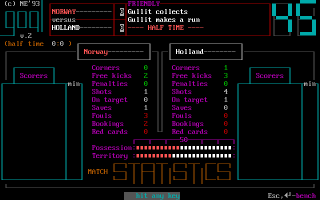

*"---- HALF TIME ----" (step 118), then the board after a 1 s wait, `T156-R1 step 119`: 0:0; corners, free kicks, penalties, shots, on target, saves, fouls, bookings (Norway 2), red cards, possession and territory. The bottom line reads "hit any key … Esc,◄┘-bench". [confirmed: T156-R1 steps 118–119]*

**Enter** led to the match menu (step 120), and three **Up** keys to Holland's **players** (steps 121–123). [confirmed: T156-R1 steps 120–123]

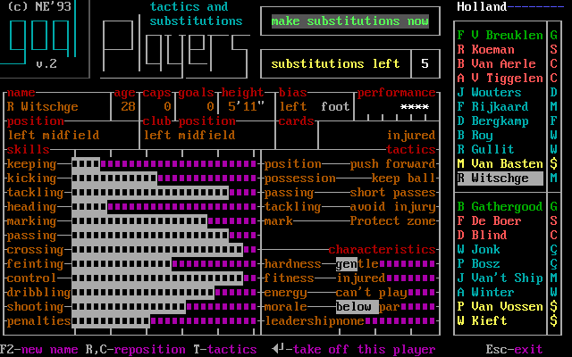

*`T156-R1 step 124`: now the box says "make substitutions now", and the hint on the selected Witschge is "◄┘-take off this player". [confirmed: T156-R1 step 124]*

**Enter** on Witschge (step 125) changed nothing visible, as E031 saw. Six **Down** keys moved to Van't Ship, whose hint was "◄┘-put on this player" (steps 126–131). **Enter** made the change (step 132). [confirmed: T156-R1 steps 125–132; E031 C41k]

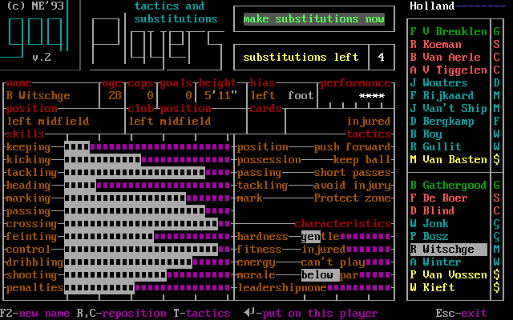

*`T156-R1 step 132`: Van't Ship is in the eleven and Witschge on the bench; 4 substitutions left. The card shows the **injured player**: status "injured", fitness "injured", energy "can't play". [confirmed: T156-R1 step 132]*

**Esc** returned to the menu, where Holland's formation read 3-6-1 again (step 133). Three **Down** keys and **Enter** on **play** started the second half (steps 134–137). [confirmed: T156-R1 steps 133–137]

## Second half, the goal and full time

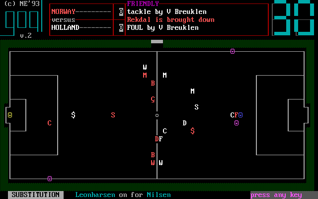

*`T156-R1 step 149`: "SUBSTITUTION Leonharsen on for Nilsen … press any key", the other side's change. **Enter** returned to the pitch (step 150). [confirmed: T156-R1 steps 138–150]*

A second goal-kick card came at step 151; this time **C** (computer select) returned straight to the pitch (step 152). [confirmed: T156-R1 steps 151–152]

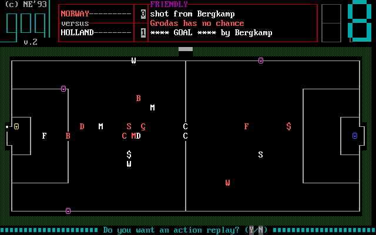

*`T156-R1 step 175`: "**** GOAL **** by Bergkamp", Holland 1–0, and "Do you want an action replay? (Y/N)". This is the managed side's goal prompt. [confirmed: T156-R1 steps 153–175]*

*One **Y**, `T156-R1 step 176`: "Do you want to save this goal? (Y/N)". No replay was on the screen before this question. [confirmed: T156-R1 step 176]*

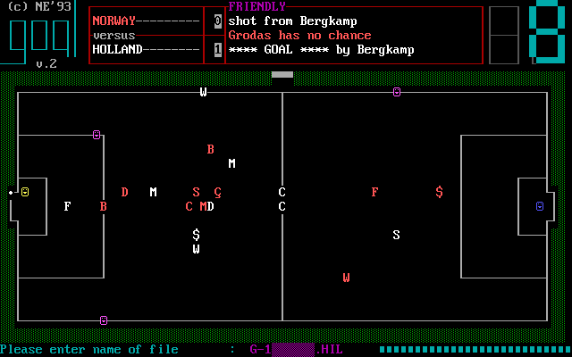

*One **Y**, `T156-R1 step 177`: "Please enter name of file : G-1.HIL", a proposed name. [confirmed: T156-R1 step 177]*

*One **Enter**, `T156-R1 step 178`: the legend reads "REPLAY" where "R-result" was, and the header shows 0–0 during the replay. The file G-1.HIL was now in the game folder (the log's note on this step). Five 2 s waits later the legend read "R-result" again (step 184). [confirmed: T156-R1 steps 178–184]*

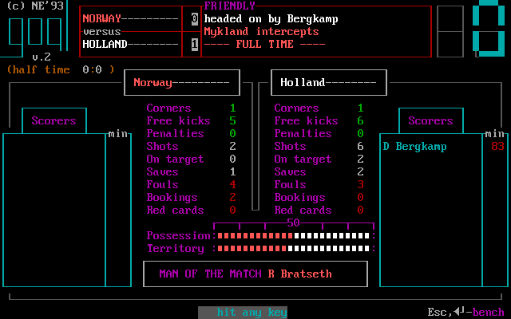

*"---- FULL TIME ----" (step 191), then the board after a 1 s wait, `T156-R1 step 192`: Norway 0–1 Holland, half time 0:0, scorer D Bergkamp 83, MAN OF THE MATCH R Bratseth. [confirmed: T156-R1 steps 185–192]*

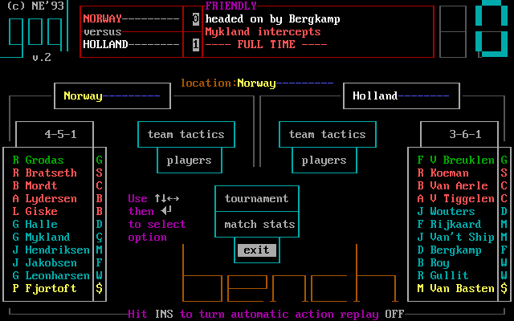

*After **Enter**, `T156-R1 step 193`: the menu offers **exit** where **play** was. **Up** and **Enter** on **match stats** showed the same board again (steps 194–195, the same digest as step 192). **Enter** and **Down** came back to **exit** (steps 196–197). [confirmed: T156-R1 steps 193–197]*

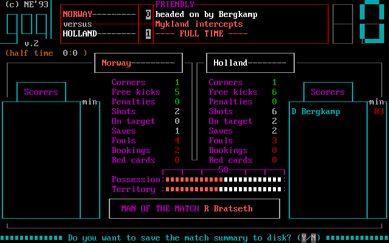

*One **Enter** on **exit**, `T156-R1 step 198`: "Do you want to save the match summary to disk? (Y/N)" over the board. [confirmed: T156-R1 step 198]*

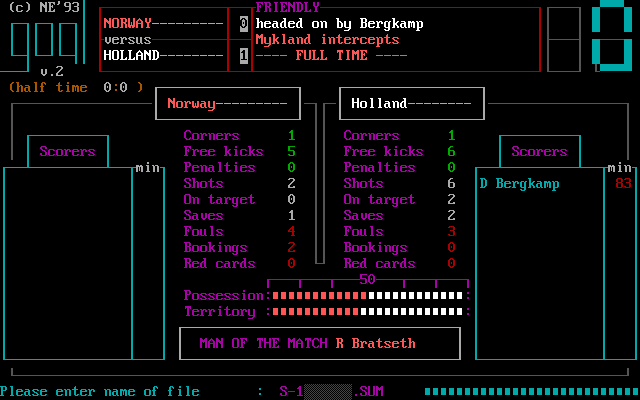

*One **Y**, `T156-R1 step 199`: "Please enter name of file : S-1.SUM". [confirmed: T156-R1 step 199]*

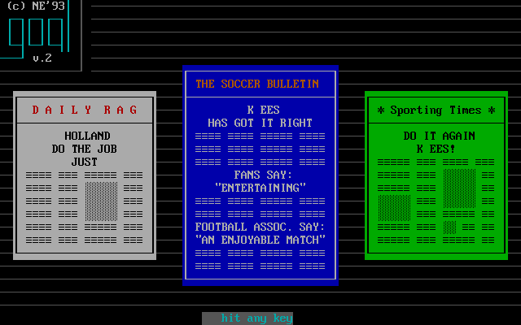

*One **Enter**, `T156-R1 step 200`: a bulletin about the match, "K EES HAS GOT IT RIGHT", "HOLLAND DO THE JOB JUST". [confirmed: T156-R1 step 200]*

## The hub after round one

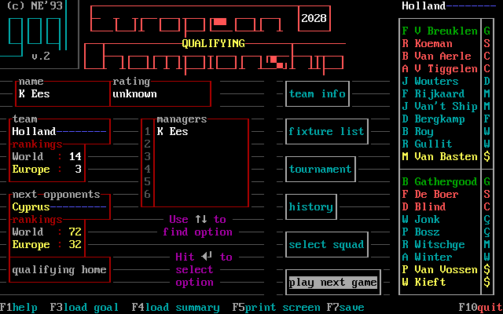

*One **Enter**, `T156-R1 step 201`: the next opponent is Cyprus, a qualifier at home. This is the end of round one; the round's only other result shown was Luxembourg–Cyprus (step 41). [confirmed: T156-R1 steps 41, 201]*

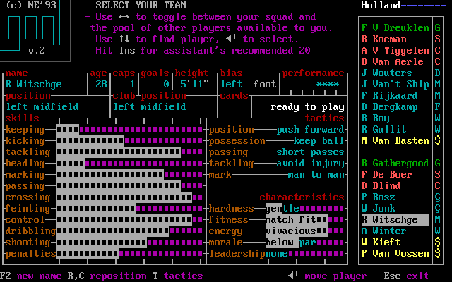

*One **Space**, `T156-R1 step 202`: the squad opened on Witschge, now "ready to play", fitness "match fit", one cap. The injury of step 66 did not carry into the next round here. Sixteen **Down** keys then moved past him (steps 203–218), and **Esc** returned to the hub (step 219). [confirmed: T156-R1 steps 66, 132, 202–219]*

Four **Up** keys reached **fixture list** (steps 220–223). [confirmed: T156-R1 steps 220–223]

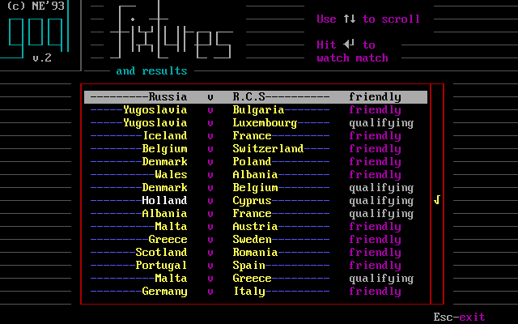

*One **Enter**, `T156-R1 step 224`: the coming fixtures, with Holland v Cyprus ticked; "Hit ◄┘ to watch match". **Esc** and **Down** moved to **tournament** (steps 225–226). [confirmed: T156-R1 steps 224–226]*

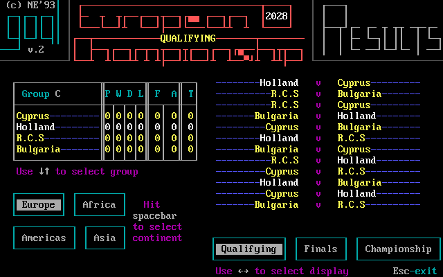

*One **Enter**, `T156-R1 step 227`: the qualifying display, Europe highlighted, Group C (Cyprus, Holland, R.C.S, Bulgaria, all zero) beside its twelve fixtures. [confirmed: T156-R1 step 227]*

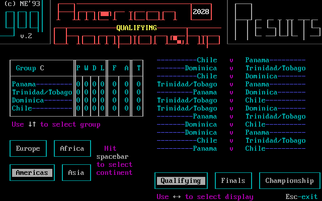

*One **Space**, `T156-R1 step 228`: the continent changed to the **Americas**: their qualifying Group C (Panama, Trinidad/Tobago, Dominica, Chile) and its fixtures. This is another continent's display. [confirmed: T156-R1 step 228]*

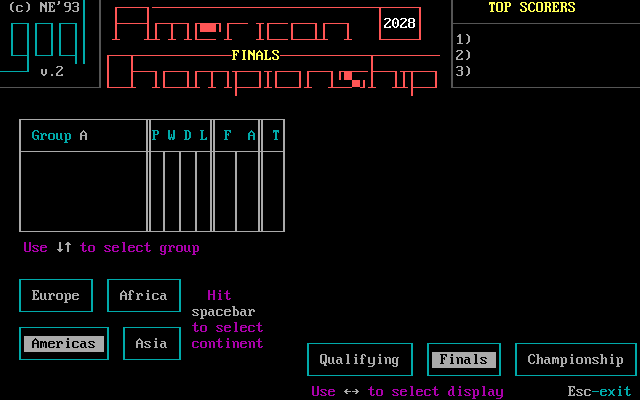

*One **Right**, `T156-R1 step 229`: the **Finals** display, an empty Group A and a TOP SCORERS panel. [confirmed: T156-R1 step 229]*

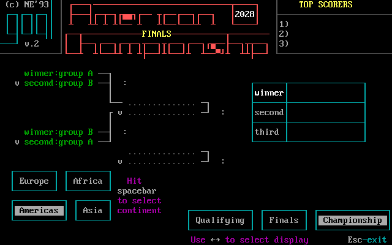

*One more **Right**, `T156-R1 step 230`: the **Championship** display, a bracket "winner:group A v second:group B" and a winner/second/third table, all empty. No "Hit Ins for Championship results" line is printed here. **Ins** (step 231) changed nothing. [confirmed: T156-R1 steps 230–231]*

## Save, quit and reload

**Esc** returned to the hub (step 232) and **F7** asked for a name (step 233). [confirmed: T156-R1 steps 232–233]

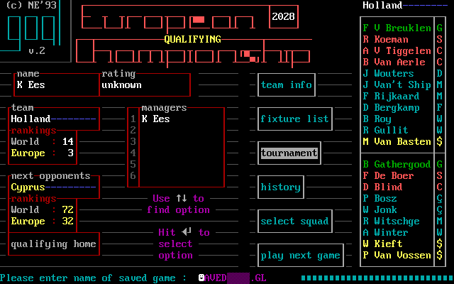

*`T156-R1 step 233`: "Please enter name of saved game : SAVED.GL", the cursor on its first letter. [confirmed: T156-R1 step 233]*

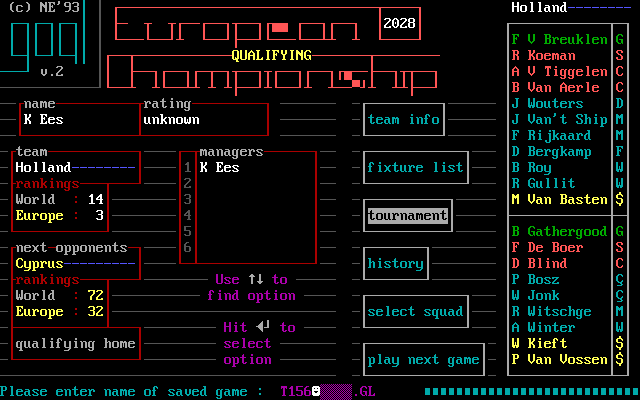

*Four keys, **T**, **1**, **5**, **6** (steps 234–237): "T156.GL". **Enter** saved it and returned to the hub (step 238). The game folder then held T156.GL, 169,553 bytes (the log's note on this step). [confirmed: T156-R1 steps 234–238]*

*One **F10**, `T156-R1 step 239`: "Are you sure you want to quit? (Y/N)". [confirmed: T156-R1 step 239]*

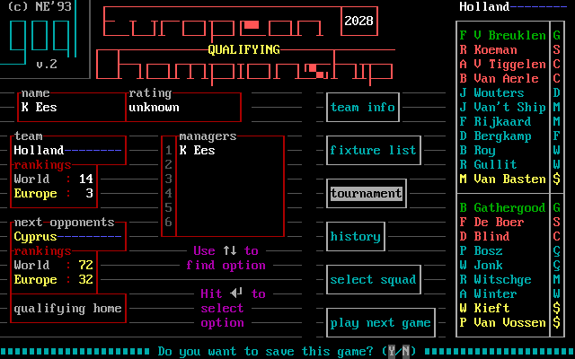

*One **Y**, `T156-R1 step 240`: "Do you want to save this game? (Y/N)". One **N** (step 241) ended the program: there was no screen after it, and DOSBox-X exited with code 0. [confirmed: T156-R1 steps 240–241]*

Starting again (step 242) shows the same title; its render is byte-identical to step 0. [confirmed: T156-R1 steps 0, 242]

*One **Y**, `T156-R1 step 243`: "Please enter name of saved game : T156.GL", already filled in with the one save there is. [confirmed: T156-R1 step 243]*

*One **Enter**, `T156-R1 step 244`: the hub again, next opponent Cyprus. Later, with the highlight moved to fixture list and then tournament (steps 257–258), the screen was byte-identical to the hub before the save at those highlights (steps 225 and 232). [confirmed: T156-R1 steps 225, 232, 244, 257–258]*

**The saved goal.** **F3** on the hub asks for a goal file (step 245). [confirmed: T156-R1 step 245]

*`T156-R1 step 245`: "Please enter name of file : G-1.HIL", proposing the goal saved in step 177. [confirmed: T156-R1 step 245]*

*One **Enter**, `T156-R1 step 246`: a match menu for Norway v Holland at 0–0, with **play** highlighted. [confirmed: T156-R1 step 246]*

*One **Enter** on play, `T156-R1 step 247`: the pitch with "REPLAY" in the legend. [confirmed: T156-R1 step 247]*

*Seven 2 s waits later, `T156-R1 step 254`: "**** GOAL **** by Bergkamp", 1–0. The next wait showed "hit any key" (step 255), and **Enter** returned to the hub (step 256, the same digest as step 244). [confirmed: T156-R1 steps 248–256]*

## The start of round two

Five **Down** keys moved to **play next game** (steps 257–261). **Enter** started the round (step 262). [confirmed: T156-R1 steps 257–262]

*`T156-R1 step 262`: the results arrive one by one, with "spacebar-pause ←→-speed »»»": Russia 2–1 R.C.S and Yugoslavia 2–1 Bulgaria so far. [confirmed: T156-R1 step 262]*

*A 2 s wait, `T156-R1 step 263`: eight results, two of them European qualifiers (Yugoslavia 3–0 Luxembourg, Denmark 2–0 Belgium), then "hit any key". [confirmed: T156-R1 step 263]*

*One **Enter**, `T156-R1 step 264`: QUALIFYING, Holland v Cyprus, with Holland now on the left. Again, no watch question came first. [confirmed: T156-R1 step 264]*

*One **Enter** on play, `T156-R1 step 265`: the captain card. **C** (computer select) went straight to the pitch (step 266). [confirmed: T156-R1 steps 265–266]*

*One **R** on the pitch, `T156-R1 step 267`: the legend reads "HANG ON" where "R-result" was. [confirmed: T156-R1 step 267]*

*Three 1 s waits later, `T156-R1 step 270`: the half-time board of a **quick result**. A large "QUICK RESULT" banner stands where a watched match's statistics are (step 119); the scorers (J Wouters 1) and the bookings in the commentary remain. [confirmed: T156-R1 steps 119, 268–270]*

**Enter** and **Enter** on **play** went on (steps 271–272). [confirmed: T156-R1 steps 271–272]

*`T156-R1 step 274`: "Gullit INJURED", Roy has scored (59), Cyprus have one (P'vasiliu 49), and "SUBSTITUTION OPPORTUNITY". The quick result stopped for the managed side's injury. [confirmed: T156-R1 steps 273–274; E031 C46]*

**Enter** led to the menu (step 275). Three **Up** keys reached Holland's **players**, now on the left (steps 276–278). [confirmed: T156-R1 steps 275–278]

*One **Enter**, `T156-R1 step 279`: "make substitutions now", **2** substitutions left in this qualifier, and the "take off" hint. In the watched friendly, the bench reached from the same notice offered only a request (step 74). [confirmed: T156-R1 steps 74, 279]*

The injured Gullit had moved to the end of the eleven. Nine **Down** keys, one **Up** and two **Down** keys reached him (steps 280–291). His card said "injured". **Enter** on him (step 292) changed nothing visible. Eight **Down** keys (steps 293–300) ended on W Kieft, one place further than the intended A Winter. [confirmed: T156-R1 steps 280–300]

*One **Enter**, `T156-R1 step 301`: Kieft on for Gullit, **1** substitution left. [confirmed: T156-R1 step 301]*

**Esc**, three **Down** keys and **Enter** on **play** went on (steps 302–306). [confirmed: T156-R1 steps 302–306]

*Four 1 s waits later, `T156-R1 step 310`: the full-time board, Holland 2–1 Cyprus, with the same QUICK RESULT banner. **Enter**, **Up** and **Enter** on **match stats** showed this same board (step 313, the same digest): after a quick result, the match stats are the banner, not the statistics table. [confirmed: T156-R1 steps 307–313]*

**Enter** and **Down** back to **exit** (steps 314–315); **Enter** on exit (step 316). [confirmed: T156-R1 steps 314–316]

*`T156-R1 step 316`: no summary question this time. The tournament page came instead: Group C with Holland 1 1 0 0, 2–1, 2 points; Cyprus 1 0 0 1, 1–2, 0 points; and Holland 2v1 Cyprus at the top of the fixtures. [confirmed: T156-R1 step 316]*

*One **Enter**, `T156-R1 step 317`: "HOLLAND SHOW TRUE SUPERIORITY", with the physio and the football association quoted. [confirmed: T156-R1 step 317]*

*One **Enter**, `T156-R1 step 318`: the hub, next opponent Belgium, a friendly at home; Kieft is in the list of eleven and Gullit is on the bench. [confirmed: T156-R1 step 318]*

***Space** opened the squad on A Winter (step 319); one **Up**, `T156-R1 step 320`: Gullit, "ready to play", fitness "supreme". As with Witschge, the injury did not carry into the next round. **Esc** returned to the hub (step 321), where the run ends. [confirmed: T156-R1 steps 274, 291, 319–321]*

## What this run did not reach

- **Suspended player card**: no Holland player was sent off or suspended in two matches.
- **Championship results view**: the 2028 Championship display printed no Ins hint, and Ins did nothing (step 231). The hint is printed on the World Cup bracket ([fixtures and campaign](competition-and-campaign.md)), which needs a World Cup year.
- **Card-notice overlay**: bookings appeared only in the commentary in the reads taken every 1–2 s.
- **Watch question**: neither of Holland's matches asked whether to watch; this run never saw the question.

The [coverage checklist](coverage.md) records these with the gaps this run closed. [confirmed: T156-R1 steps 0–321]
