# Squad, pool, positions and tactics

The squad screen is a decision surface, not just a name list. A manager can compare the current twenty with the national pool, inspect a highlighted player, change a squad slot, set positions and individual tactics, then review the team-wide choices. The two columns of players and the card change with the current selection. [confirmed: M244-G1A-02 steps 3–11; E031 C27–C33]

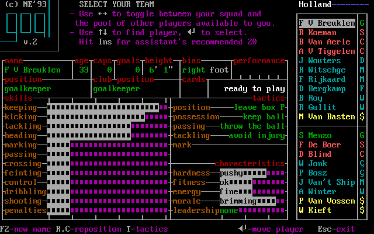

*Holland squad before the first match, `M244-G1A-02 step 3` ([single-key log](captures/m244-g1a-02.json)); right strip is the selected twenty, and the main card is Van Breukelen. Source savestate and PNG hashes are in the log. [confirmed: M244-G1A-02 step 3]*

The top row gives the selected player's **name**, **age**, **caps**, **goals**, **height**, **bias** (shown as right foot in this example) and **performance** box. The row below distinguishes current **position** from **club-position**; the card also has **cards** and a readiness message. These fields let the player assess experience, role and availability before picking an XI. The exact scale/trigger of the performance box and the card boxes is not established by this image alone. [confirmed: M244-G1A-02 step 3; evidence gap: performance and card-box encoding]

The visible skill labels are keeping, kicking, tackling, heading, marking, passing, crossing, feinting, control, dribbling, shooting and penalties. The characteristic labels are hardness, fitness, energy, morale and leadership. Their bars permit visual comparison; this guide makes no unsupported conversion to a precise 1–9 or percentage value. For an outfield role, the player may compare the relevant labels and position with another card before moving a squad place. [confirmed: M244-G1A-02 steps 3–4; evidence gap: exact bar units]

*One Down changes the highlighted card to Koeman, `M244-G1A-02 step 4`. His displayed position and bar pattern differ from the prior goalkeeper card; this is why selection context must remain visible beside a list. [confirmed: M244-G1A-02 steps 3–4]*

## Browse and exchange

The top hint says Left/Right toggles between the squad and the pool, Up/Down finds a player, Enter selects, and Ins accepts the assistant's recommended twenty. The bottom hint adds F2 name, R/C reposition, T tactics, Enter move player and Esc exit. The observed pool list did not wrap when Up was pressed at its top. [confirmed: M244-G1A-02 steps 3–6; E031 C06, C27, C29–C31]

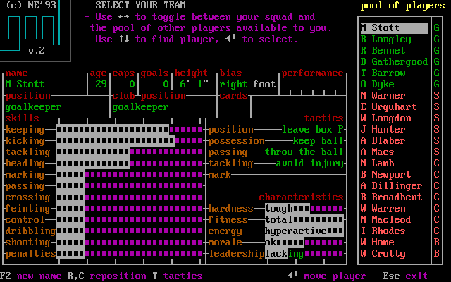

*The first pool card, Stott, `M244-G1A-02 step 5` after a single Right. The right list changes from Holland's twenty to available players; the player card keeps the same field arrangement for comparison. [confirmed: M244-G1A-02 steps 4–5]*

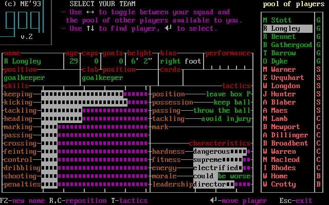

*One Down browses another pool player, `M244-G1A-02 step 6`; browsing alone does not add him to the selected squad. [confirmed: M244-G1A-02 steps 5–6]*

To replace a squad player, E031 observed Enter on a pool player, Left to the twenty, then Enter on the slot to replace. The two Enters make one exchange. Ins performed the assistant's twenty immediately in the observed session, removing several named players; because that changes the whole group without another prompt, inspect the right strip afterward. [confirmed: E031 C28–C29i]

## Positions, formation and availability

On a player card, **R** steps through positions and **C** restores club position. The E031 guide observed a player move through the fourteen positions. The team card's displayed formation changed after the manager made picks, swaps and role changes (4-4-2, 3-5-2 and 4-3-3 in the E031 session). This establishes an observed connection, not an algorithm for computing a formation from every position combination. [confirmed: E031 C31–C32c]

*One R on Koeman, `M244-G1A-04 step 5`, changed the current position from sweeper to centre back while club-position stayed sweeper; the right roster code changed S to C. This particular role change also displayed “man to man” on the mark line. [confirmed: M244-G1A-04 steps 4–5]*

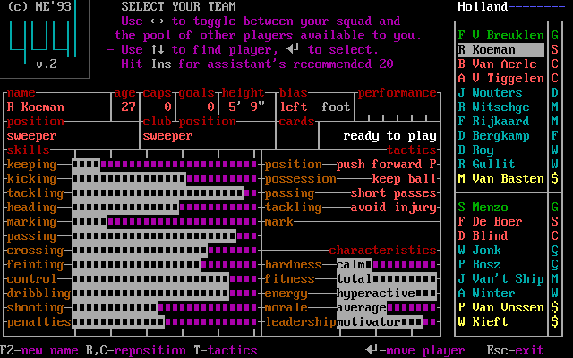

*One C, `M244-G1A-04 step 6`, restored current position and roster code to sweeper; the displayed mark line returned to blank. Compare these two full cards before and after a deliberate role change. [confirmed: M244-G1A-04 steps 5–6]*

A card may show **injured** or **suspended** instead of ready. This is a reason to inspect readiness before advancing to a fixture; the first screenshot shows only a ready state. The detailed injury/ban eligibility rules should be taken from reviewed findings, not guessed from this card. [confirmed: E031 C34, C34b; evidence gap: all readiness-state images]

## Individual and team tactics

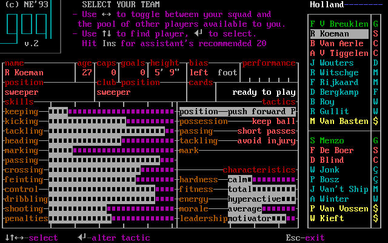

*One T on Koeman's card opened the individual editor, `M244-G1A-02 step 8`. Its hint changes to arrows for selection, Enter to alter a tactic, and Esc to leave. The visible categories are position, possession, passing, tackling and mark. [confirmed: M244-G1A-02 steps 7–9]*

*After opening Koeman's editor, four Downs wrapped the highlight to **position** and one Enter removed a visible trailing `P` from “push forward”, `M244-G1A-04 steps 7–12`. The log proves this before/after display change; the exact meaning of `P` is not established by the image. [confirmed: M244-G1A-04 steps 7–12; evidence gap: P meaning]*

E031 observed Enter cycling a player's own option and the mark row progressing from “Protect zone” to named opposing players. Marking therefore has a player-specific opponent decision; a static image of “Protect zone” is one state only. E031 and the original manual say marks are cleared after each match. [confirmed: E031 C33–C33d; original GOAL.HLP]

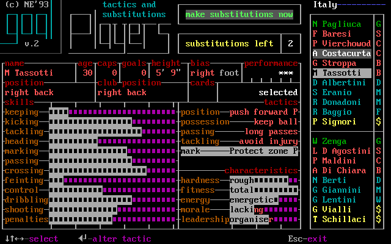

*Italy match bench, `E015-r0007 state 165`: the individual editor shows “Protect zone P” on the mark row, next to the selected player's skills and a substitutions-left counter. [confirmed: E015-r0007 state 165]*

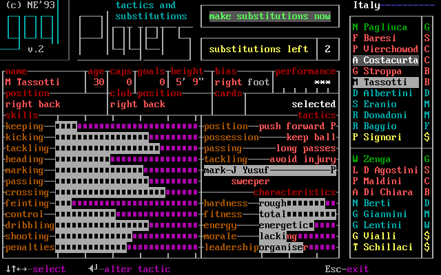

*The adjacent retained state, `E015-r0007 state 166`, shows “J Yusuf” in the mark row. E031 separately recorded one-key cycling from zone to named opponent; the E015 adjacency by itself does not prove which key caused it. The screen also names the opposing player's role under the mark line. [confirmed: E015-r0007 states 165–166; E031 C33c–C33d]*

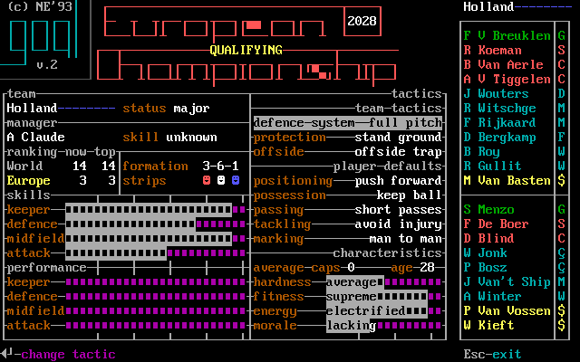

*After Esc from individual tactics, Esc from squad and T at the manager hub, this team editor appeared, `M244-G1A-02 step 11`. The card retains country context while the bottom says Enter changes a tactic. [confirmed: M244-G1A-02 steps 8–11]*

The eight visible team lines are defence system, protection, offside, positioning, possession, passing, tackling and marking. The current value is printed to the right of each label, such as “full pitch”, “stand ground” or “short passes” in this state. A manager can compare that plan with the opponent and intended XI; the exact effect on the original engine belongs to reviewed findings, not to this screenshot. [confirmed: M244-G1A-02 step 11; E031 C07; evidence gap: every value/effect]

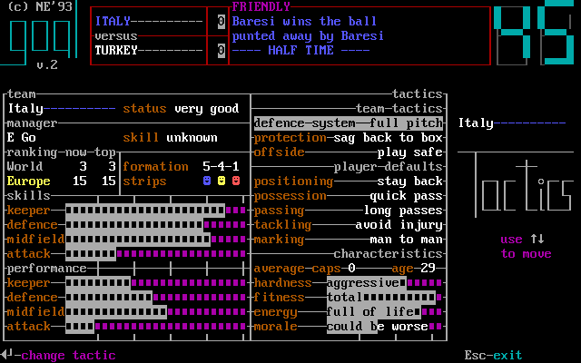

*Italy team tactics in a different E015 match, `E015-r0007 state 119`. Different displayed values show that the preceding Holland card is one choice state. Full source state hash is in [image provenance](image-provenance.tsv). [confirmed: E015-r0007 state 119]*

## Captain and in-match bench

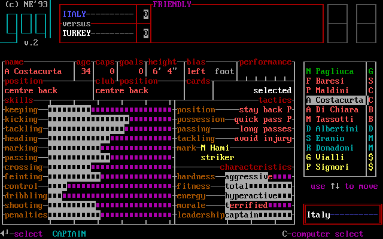

*Captain prompt, `E015-r0007 state 63`. The card displays the highlighted player and the bottom offers selection. E031 observed Up/Down then Enter accepting another player, while reviewed F030 describes the timeout choice. [confirmed: E015-r0007 state 63; E031 C38–C38b; reviewed F030]*

The in-match **players** branch reuses the player card but adds a **substitutions left** counter and a prompt to take off a starter or put on a bench player. Friendly and competition limits differed in E031: five and two respectively in the observed/manual-backed cases. The two candidate Enters can occur in either order; E031 recorded no visible lineup change after only the first. [confirmed: E031 C41–C41k; original GOAL.HLP]

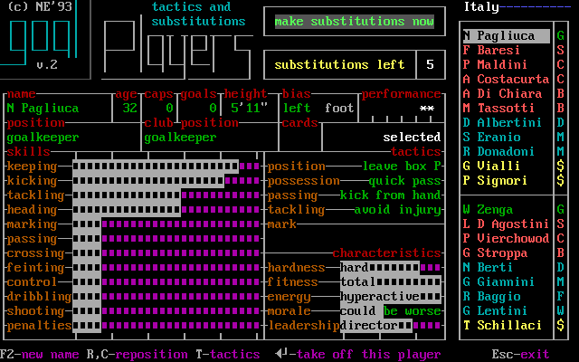

*Take-off state, `E015-r0007 state 76`. The highlighted starter and “substitutions left” appear together. [confirmed: E015-r0007 state 76]*

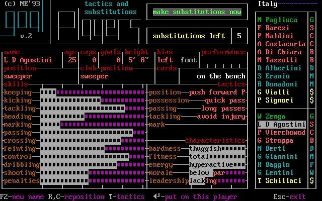

*Put-on state, `E015-r0007 state 82`. Compare the changed prompt and right-side roster before confirming the second half of an exchange. [confirmed: E015-r0007 state 82; E031 C41e–C41i]*

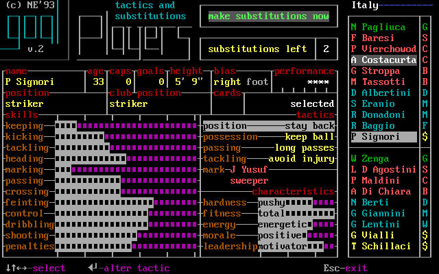

*Bench tactics state, `E015-r0007 state 150`; the same individual categories remain reachable in a match. [confirmed: E015-r0007 state 150]*

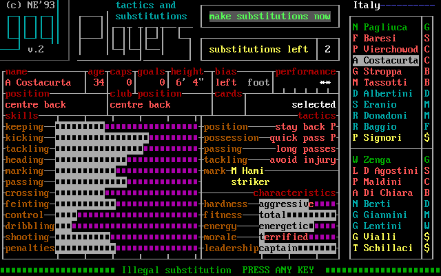

*Illegal substitution warning, `E015-r0007 state 176`. It is a distinct screen that requires acknowledgment; the preceding action in the E015 keymap must be read as a burst unless a single-key step is independently logged. [confirmed: E015-r0007 state 176; archaeology `docs/screens.md`]*

The bench branch is part of the [watched-match flow](match-and-results.md). A substitution or tactical change here happens before play resumes; use the match menu's **play** again for the next segment. [confirmed: E031 C40b, C41h]
