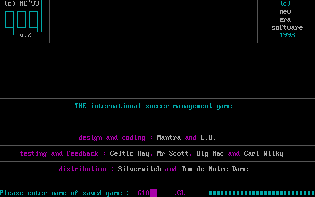
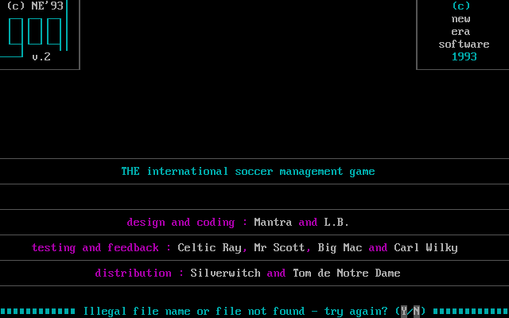
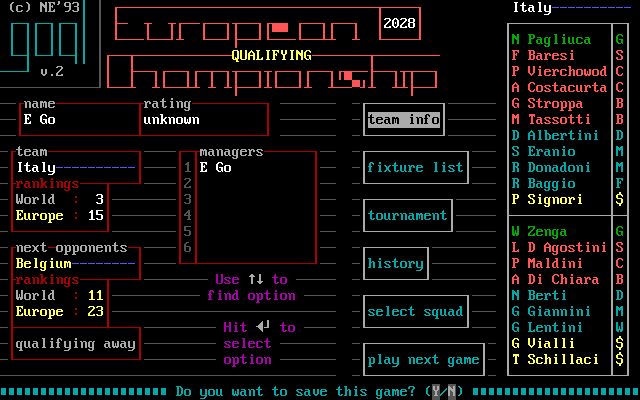
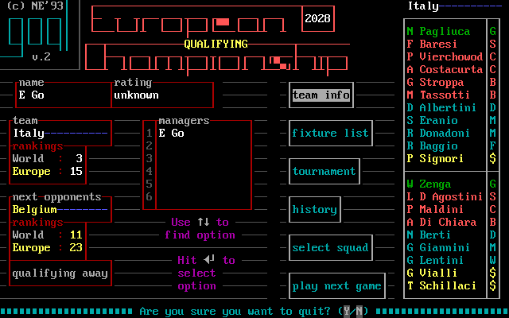

# Start, load, save, replay and quit

The title screen branches into a new game or a saved `.GL`. The source E015 image is a fresh launch; the G1A capture below shows the one-save name line reached by answering Y, then the Holland manager menu reached by Enter. These are independently observed one-key steps. [confirmed: E015-r0001 state 2; M244-G1A-01 steps 0–2; E031 C11–C12]

*Title question, `E015-r0001 state 2`; respond Y or N. [confirmed: E015-r0001 state 2; E031 C11–C12]*

*Single-save load-name prompt, `M244-G1A-01 step 1` after Y; “G1A” is prefilled before `.GL`. Enter at step 2 loaded Holland. The [capture log](captures/m244-g1a-01.json) gives the input, screen digest and hashes. With several saves E031 observed a list and Esc to type a filename, an alternative state still awaiting an illustration. [confirmed: M244-G1A-01 steps 0–2; E031 C11–C11b]*

*Load failure, `E015-r0008 state 10`. It belongs to the load branch; the screen prints `try again? (Y/N)`, so a player is offered retry or refusal after an invalid name. The exact preceding filename and the Y/N transitions need their own single-step record before being specified. [confirmed: E015-r0008 state 10; evidence gap: recovery transition]*

For a new session answer **N**, select one to six local managers with Left/Right and Enter, browse countries, and type each manager's name. The country card's rankings, tactics and skill profile support that choice; the name line allows up to fourteen characters and Esc abort. The first manager walkthrough with those images is in [first session](first-session.md). [confirmed: E031 C12–C15b; E015-r0004 state 2, E015-r0007 states 3 and 10]

*The title's player-count branch, `E015-r0004 state 2`. The printed hint identifies Left/Right and Enter. [confirmed: E015-r0004 state 2]*

With two players, E031 observed each person selecting a country/name, then a **next player** sixth hub action handing control to the next manager. It played one two-player round; the effect of three to six managers beyond the offered count was not exercised. A second-manager hub screenshot is a tracked image gap. [confirmed: E031 C16–C16b; E031 `out/mp` session; evidence gap: >2-player play]

## Save and quit

*F7 save-name entry, `E015-r0007 state 215`, over the current manager context. E031 observed the initial suggestion `SAVED`, then the most recently used name on later saves; Enter commits, while reviewed F030 says Esc cancels. A `.GL` original save must stay out of the remaster repository. [confirmed: E015-r0007 state 215; E031 C25–C25c; reviewed F030]*

*Save question during exit, `E015-r0007 state 224`. This is distinct from F7's filename entry: it appears after the quit decision. [confirmed: E015-r0007 state 224; E031 C26]*

*F10 quit question, `E015-r0007 state 223`. Answering it led to a save question and then GOAL exited in E031; the E015 screenshot alone supports only this first visible prompt. [confirmed: E015-r0007 state 223; E031 C26–C26b]*

Saving is a useful campaign boundary after checking the next fixture and squad. E031 retained 17 named milestone saves, including the start of each year and before/after important World Cup matches. They are private release assets with hashes, not files in this documentation tree. [confirmed: E031 `out/saves.tsv`, `README.md`; E031 C25]

## Saved goal and summary

From the hub, **F3** opened a saved-goal replay from the shipped `Y.HIL`; E031 observed a **play** action showing REPLAY. **F4** loaded a match summary as a match menu, from which **match stats** exposed the statistics board. These are two distinct retrospective paths. The saved-goal viewer itself still needs a legible authentic screenshot; the summary screen below is available. [confirmed: E031 C23–C24b; evidence gap: replay image]

*Match summary, `E015-r0007 state 207`; the comparison board appears after the summary is loaded and its stats action selected. [confirmed: E015-r0007 state 207; E031 C24–C24b]*

F1 opened the original help viewer, but the E031 savestate driver then crashed on subsequent reads; this is an emulator/driver limitation, not evidence that ordinary GOAL2 help is broken. No help-viewer screenshot is committed yet, so its navigation and content remain unverified here. [confirmed: E031 C04–C04c; evidence gap: help-viewer capture]
