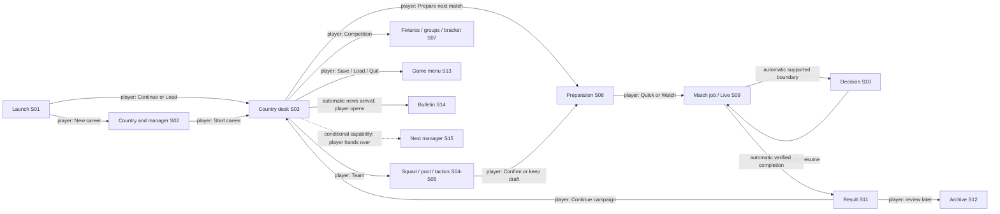

# Structure and complete player journeys

[designed: #253] The main loop is **understand the next national-team challenge → prepare people and a plan → choose how to experience the match → intervene when supported → understand the result → return to the campaign**. Preparation and consequence remain as important as the pitch. A single country/manager identity and a visible next action connect every screen. These are proposed flows; engine limitations below are explicit dependencies, not newly authorized work.

## Screen hierarchy

[designed: #253] The installed desktop app owns its window, local session and game menu. Main navigation has five stable destinations: **Country desk**, **Team**, **Competition**, **Match centre**, **Archive**. A labelled **Game** menu contains Save, Save as, Load, New career, Settings, Help and Quit. The campaign header contains country/manager, year/stage, pending draft or save state and a persistent **Prepare next match** action. In live play, the header instead prioritizes clock/score/phase and the current decision; the campaign breadcrumb remains available where safe.

| Key | Proposed surface and children | Persistent context / entry |
| --- | --- | --- |
| S01 | [designed] Launch: Continue, saved careers, New career, resource/setup guidance | Country/year/next fixture/last-save details on each valid save; error beside failed item |
| S02 | [designed] New career: country browser → manager → review/start | Country profile, ranks, challenge, roster preview; original local-manager option is a separate capability dependency |
| S03 | [designed] Country desk: next fixture, readiness, briefing/news, campaign position | Active country/manager; own and opponent rankings; XI/bench preview; next action |
| S04 | [designed] Team: Squad / Team instructions / Player instructions | Twenty roster rows, selected complete card, XI/bench, captain and formation; draft bar |
| S05 | [designed] Team → National pool / Compare | Outgoing and incoming full identities/cards; same attribute order; selection policy and exchange review |
| S06 | [designed] Country profile and opponent scout | Own/opponent distinction, rankings/profile/players/tactics; opponent editing unavailable with reason |
| S07 | [designed] Competition: Fixtures / Groups / Bracket / Scorers | Season, competition, continent, group/display selectors; table and adjacent fixtures |
| S08 | [designed] Match centre → Preparation | Fixture, both sides, lineups/formation/captain, readiness, quick/watch explanations and speed |
| S09 | [designed] Match centre → Live | Clock/phase/score, pitch, commentary, playback choice, supported management actions |
| S10 | [designed] Live decision panel: bench, captain/taker, halftime, extra time, shoot-out order | Same fixture/score/phase; candidates/cards; exact supported choices; pending action and resume |
| S11 | [designed] Match centre → Result: Overview / Statistics / Round results | Full/half scores, scorer minutes, stage resolution, side-by-side stats and Continue campaign |
| S12 | [designed] Archive: Matches / Country records / Replays | Match date/competition/provenance; same result schema; explicit missing historical fields |
| S13 | [designed] Game menu and save/load dialogs | Active career, pending draft, last durable save, explicit overwrite/replacement decisions |
| S14 | [designed] Country desk → Bulletin / News detail | Consequence, country/year, named affected players, relevant Team/Competition links |
| S15 | [designed] Local-manager handoff | Current/next manager and country, who must prepare next; unavailable until session ownership exists |

[designed: #253] Team and pool are siblings within one decision workspace. Competition owns campaign browsing; Match centre owns delivery of a selected fixture and its result. Archive owns retrospective discovery. A country profile opens as a contextual pane and returns to the originating row, without changing the active country. A dedicated “Browse countries” action replaces the always-present replacement-country dropdown; choosing New career remains explicit. These are deliberate changes from today's shell and the DOS menu.

## J01 — first launch, new career or load

[confirmed: manual first-session/startup; E031 C11–C16; M244-G1A-01] The original branches load/new, offers1–6 managers, country profiles and manager naming; two managers were exercised, higher counts were only offered. [designed] On first launch, the app explains any missing verified local resources in ordinary game terms and opens a file chooser with a Retry action. No emulator path, seed word or worker protocol belongs in normal onboarding. An advanced diagnostics panel can expose technical details for support.

[designed] A returning player sees **Continue Holland — 2030, next Belgium** and the last successful save time, plus Load another career and New career. Continue validates a complete candidate before replacing the live session. Failure stays on the selected save with a useful error and Load another/Retry; it never starts a new career automatically. When a current game exists, Load/New review identifies the game being replaced and offers Save current, Replace without saving and Cancel. A failed Save keeps replacement pending and preserves the old session.

[designed] New career → country browser shows ranks, difficulty text, manager/status, team strengths/performance, formation, team tendencies, average age/caps and a Players action, with unavailable fields explicitly labelled. Search/ranking selector and keyboard arrows browse without selecting. **Choose country** advances to manager naming; Back preserves the draft country. Review shows country, manager and supported campaign settings before **Start career**. The current single-manager capability is the initial slice. A future local-manager choice repeats country/name per manager only after B07 establishes supported identity, persistence and handoff; no six-manager promise is inferred from the original count offer.

[designed] Starting creates one disposable candidate and publishes it only after validation. Automatic welcome/news availability leads to Country desk with **Review your team** and **Prepare next match**. The player opens/acknowledges news; automatic news does not advance fixtures. First-session guidance disappears after completion but stays available through Help.

[designed: B02/B06] Editable manager-name setup depends on B06's name/state/persistence contract and later supported capability. The first incremental B02 slice may keep the current/default identity with a clear explanation; it must not enable an unsupported field or claim naming parity. Player records and guest memory are serialized today; that fact alone does not establish a complete editable identity contract.

## J02 — the country desk and understanding the next action

[confirmed: manager-menu; M244-G1A-02 step2; M244-G1E-06 step19] The original puts country/next-opponent ranks, fixture type, manager context and twenty-player strip beside the action menu. [designed] S03 combines that orientation with a clear readiness checklist: XI selected, captain selected, unavailable starters, unconfirmed changes and opponent scouted. Each problem links to its exact Team row or preparation field. The next fixture card names competition/phase/home-away and links to the opponent profile; a small group-context card links to the selected group with its fixtures. These cards summarize; the full information stays one named action away.

[designed] **Prepare next match** never simulates a match. If a supported fixture exists it opens S08. If no managed fixture is left but the supported calendar can continue, the action becomes **Review round / Continue calendar**, stating what will resolve. If the next stage is unsupported, it states that boundary and retains Team, Archive and Save. Empty opponent data never strands the player on a disabled unlabeled Play button. Actual progression rules remain with T50–T59.

## J03 — squad, pool, instructions and confirmation

[confirmed: squad manual; E031 C27–C34; M244-G1A-02/04] The original combines selected-player information with squad/pool, two-part moves, individual and team tactics, positions and assistant selection. [designed] Open Team: the compact twenty-player table shows XI, player, position, Ability, Energy, Confidence and Availability as required by T84. The selected card exposes identity, current/club role, all12 skills, five characteristics, performance/cards/readiness and personal instruction source. The formation/pitch board and bench show the same selected identities; selection and XI membership have different visual cues.

[designed] Arrow keys select a row; Space toggles an eligible XI checkbox; a clear **Add to XI / Move to bench** action offers the same mouse operation. Captain is an explicit named control in this workspace. Show all attributes retains the accepted38/37-column contract with table-contained horizontal scrolling, frozen identity and full-ID selection. Sorting/filtering is a view, never a change to source team order or ID. Unknown decoded values retain explicit source limitations; no cosmetic percentage substitutes for original units.

[designed] National pool opens beside the selected outgoing player. Search/position filtering changes only visible reserves. Selecting an incoming reserve pins both complete cards; **Review exchange** names both people, eligibility and the applicable pool-window rule before **Exchange**. A filter that hides the incoming choice clears it visibly; it cannot exchange a stale hidden ID. The existing exchange policy and source-order semantics remain unchanged. An assistant action, if eventually supported, previews a full change list before applying to the draft; the original's immediate twenty-player change is a deliberate usability departure.

[designed] Team instructions show eight labelled current values. Player instructions show current position/club restore, possession, passing, tackling and contextual mark. A role change previews its effect on the formation summary and any instruction change. Opponent marking lists the opponent identity/role and marks the choice as match-specific when that behavior is supported; it does not invent live context from a template. The existing Squad page owns current team-bit display, composed by B03; T84 owns player-card/personal read-only display, and #248 defines verified personal editable choices and refusal states. Full setup/opponent team defaults remain unowned G05. Unsupported edits are explained, rather than presented as successful no-ops.

[designed] Every edit stays in an explicit draft. **Confirm team** validates eleven distinct available players, captain, supported tactics and any scoped edit. A failed confirmation highlights the field and keeps the draft. **Discard** restores confirmed choices; ordinary navigation preserves a draft. Entering preparation from a dirty Team shows Review changes / Discard changes / Back; it never silently confirms. Save retains confirmed state under the current contract and explains any unconfirmed draft. Proposed draft persistence would be a separate owner decision.

## J04 — prepare for a competition and scout an opponent

[confirmed: competition manual; M244-G1A-03 steps4–12; M244-G4C-05 steps3–11] Country information, player cards, group tables with adjacent fixtures, rankings, bracket and scorers were exposed. [designed] From the next-fixture opponent, open S06 read-only profile: country/status/manager/rank now/top, formation, team skills/performance, characteristics/tactics and player cards use the same labels as one's own side. **Back to preparation** restores the same own draft and selected player.

[designed] Competition defaults to the managed competition/group, preserving year/stage/continent/display context. The table and its relevant remaining fixtures/results remain together. Group/continent/display selectors update both; explanatory column labels distinguish original T semantics from current supported Pts/GD. The Bracket shows future matches as unplayed; Scorers lists known names/counts. Qualification is provisional until the stored schedule resolves. A printed original Ins Championship-results hint does not establish its semantics; an unavailable equivalent says so.

[designed] Fixture rows distinguish **Watch selected** state from an **Add to watch list / Remove from watch list** action. Own-friendly **Cancel / Rearrange** is a separate action requiring a supported scheduling contract. #249 audits/displays existing fixture/group/opponent data only. Watch scheduling is unowned G01/O08; rearrangement G02/O09; complete profiles/records G05/O12 and generated news G03/O10. New competition mechanics retain their existing contracts. These do not appear as working features without separately scoped capabilities. Visiting Competition never advances a fixture.

## J05 — choose Quick or Watch and start deliberately

[confirmed: match manual; E031 C35–C39; F030] Original watch prompts are conditional, hold without timeout and distinguish managed and other-country matches. [designed] S08 presents fixture/venue/phase, both lineups/formations, captain and readiness alongside **Quick result** and **Watch match**. Each choice describes its supported delivery and limitations beside the button. Today quick-friendly simulation and watched-original execution are distinct routes; the proposal cannot promise identical outcomes merely by renaming them.

[designed] Watch exposes **Slow / Normal / Fast** before Start, as T85 requires; Normal defaults, session choice survives navigation, and the rate freezes for the job. It controls sample presentation, not original engine pace. No sample-rate number appears in ordinary labels. A supported competitive Quick/Play route uses its accepted original resolver; competitive Watch remains unavailable with a reason until explicitly implemented. The action label follows the actual route. Missing runtime resources offer a retry/setup path and leave the prepared team intact.

[designed] The player presses the selected Start action once. Loading shows the ordered sides and **Starting match**, a responsive progress state and Cancel. The app serializes publication, blocks conflicting management/save actions and leaves explanatory read-only context accessible. A failed/cancelled job returns to preparation with the previous committed state/save intact and a Retry action. No automatic duplicate start occurs on redraw, navigation or focus.

## J06 — watched play and supported intervention

[confirmed: match-live/commentary; E031 C39–C46; M244-G4C-07] The original shows score/time, pitch/event text, commentary and speed, with conditional notices. Direct pitch-to-bench and Esc-play were printed hints without single-step proof. [designed] The continuous Match centre keeps score/clock/phase, pitch and latest event visible; commentary occupies the same canvas as a scrollable event feed. A follow-live toggle indicates whether the player is reviewing earlier events. Current time/score never scroll away with old commentary. Team markers have numbers/shapes and a visible legend; country color is supplementary.

[designed] **Manage team** opens S10 only at a supported runtime boundary. Where the worker cannot accept an intervention, it explains “Changes are available at …” or “This match is view-only” before play. #250 audits pause/answer/resume support; it does not infer it from kit methods. Selecting Off/On pins both players' full cards, role, condition/readiness and remaining substitutions. **Confirm substitution** performs one validated exchange; reject/cancel preserves the last committed lineup and explains the actual reason. Friendly/competition limits follow accepted remaster contracts, not this proposal's transcription of original5/2 observations.

[designed] An actual injury, card or substitution event updates the feed automatically. A required managed decision opens a contextual panel with the affected identity and supported options; an informational rival event needs no management confirmation. No-substitutions-left stays an explicit evidence/support gap; a disabled replacement explains the accepted runtime rule rather than fabricating an original dialog. The existing quick-friendly halftime widget remains a distinct capability until integrated through its accepted controller.

[designed] **Quick continuation is unavailable**: there is no supported in-flight mode switch in the current viewer or retained delivery contracts. S09 shows a disabled Finish quickly action with that reason. LI08 is unowned G01/O08; #250 is audit only for this question. A separately approved continuation capability must prove required half/extra/shoot-out stops, cancellation and complete publication tails before any enablement; this plan does not authorize it. Replay/taker questions show their enforced default/timer only when supplied by the runtime. Proposed non-expiring decisions are an owner choice contingent on engine equivalence, not an automatic accessibility change to an original timed loop.

## J07 — halftime, extra time and shoot-out

[confirmed: E031 C40–C50; M244-G4C-07/08] Half-time, extra-time entry/midpoint and shoot-out order are distinct original states, including after R quick continuation. [designed] Automatic halftime enters S10 with **Half-time — 45:00**, score and comparison statistics. Supported bench/instruction choices stay on this surface. The player explicitly selects **Start second half**; opening/closing a panel cannot resume the engine. A quick-result stop labels the delivery mode so the player understands why a decision appeared.

[designed] A supported level knockout moves automatically to **Regulation complete — extra time required**; **Start extra time** is explicit. An actual extra-time midpoint shows its own phase/clock and **Resume extra time**. The UI displays the authoritative clock; it does not derive an extra-time duration from a screenshot. After a supported tied extra time, acknowledge the shoot-out start and choose the entire ordered eleven with a selected player card, penalties/condition visible and Undo. Confirm order is a deliberate proposed improvement over implicit completion; engine integration must preserve original choices and continuation.

[designed] Kicks show taker, outcome, running penalty score and numbered progress, including sudden death where supported. Normal match score and kicks remain separate. Full-time result is published only after the complete accepted output/tail; a final-whistle event alone is insufficient. Current competitive resolution already supplies stage summaries but does not make competitive watched ordering/editing available. Existing competition tasks retain Quick/stage-resolution mechanics; #250 is a support audit/first supported intervention. Competitive/other-country watched execution and its extra-time/order route remain explicitly unowned G01/O08.

## J08 — result, wider round and the next campaign decision

[confirmed: match-summary/round-results; M244-history/elimination/finals-stage-hub; E031 C51–C61] The original explains results with comparison stats, scorer minutes, MAN OF THE MATCH, wider scores, history and news. [designed] S11 opens automatically only after verified completion. It shows normal/half/extra-time/shoot-out stages, scorers/minutes, MOTM and the original comparative categories together. Quick/historical missing measures say **Not recorded**, preserving the difference from zero. Provenance identifies the result route in understandable wording; diagnostics can retain raw rating details.

[designed] **Round results** reveals the rest of the current round; **Continue campaign** explicitly returns to Country desk with the next supported fixture and updated readiness/context. Any bulletin links an affected player or competition. Elimination remains a campaign consequence, with friendly/other-fixture continuation where supported; a SACK headline is not proof of engine dismissal. Actual terminal/dismissal states require the campaign contract's own data and next-action behavior. At a year/stage boundary, summarize resolved results, qualified/eliminated status and known roster changes before continuing. No missing stage is simulated by the UI.

[designed] Archive lists retained matches with opponent, competition/date where stored, score and delivery provenance. Open result reuses S11 with a read-only **Return to campaign** action. Country records exposes the full original history dimensions. Replays have a separate tab with available recording metadata; absent durable replay data produces an honest explanation. #251 audits/displays retained summaries when available; it does not own recording/playback. Complete country records are unowned G05/O12, generated news G03/O10, and durable replay/export G04/O11. No active contract is extended.

## J09 — save, resume, quit and local handoff

[confirmed: startup manual; E031 C23–C26b/C16–C16b; F030] Save, quit/save, summary and saved-goal routes were distinct; two local managers were exercised. [designed] Ctrl+S/Game → Save writes the confirmed local session atomically and shows durable success after the writer succeeds. Save as names the destination and asks before overwriting. Save failure shows Retry / Save elsewhere and preserves the prior good file. During a pending match, Save explains whether only the last committed checkpoint is available under the accepted contract; mid-match continuation is not promised.

[designed] Quit with unsaved committed changes opens Save and quit / Quit without saving / Cancel. An unconfirmed draft is named separately; no default destructive action gets Enter merely because a dialog appeared. Closing a live job explains that cancelling returns to the prior checkpoint, then uses the bounded owned-child shutdown. Resume restores the exact supported continuation and result/history state; it never draws new players, starts a match or discards a valid active game on validation failure. Original .GL/.HIL/.SUM extensions are evidence, not a compatibility requirement for rebuild saves.

[designed] A future local handoff shows **Pass to Manager B — Scotland** and what remains before the round can advance. The next manager explicitly accepts; private drafts and manager ownership persist independently, with shared fixture scheduling deduplicated. B07 first scopes save identity, shared fixtures, both-manager matches and failure/return paths; current single-manager state cannot satisfy that flow by showing a Next player button. Until approved/supported, no local multiplayer setup is offered as playable. All players can still inspect the documented original offered count and two-player evidence without implying the missing capability is shipped.
