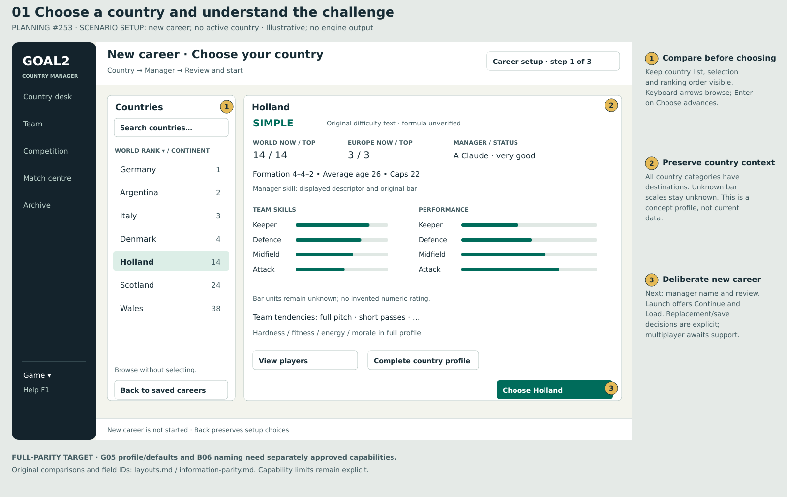
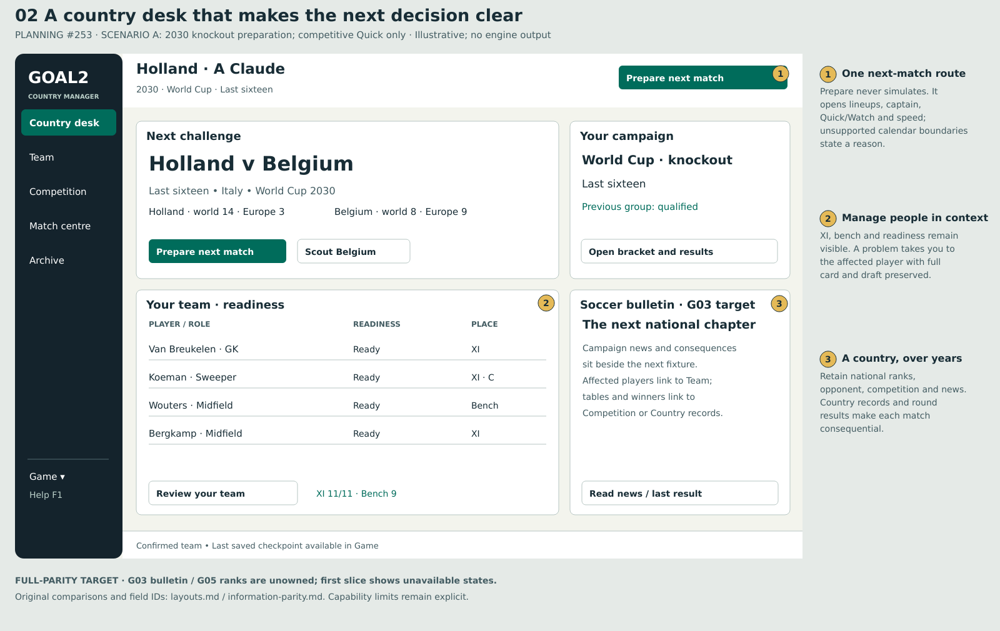
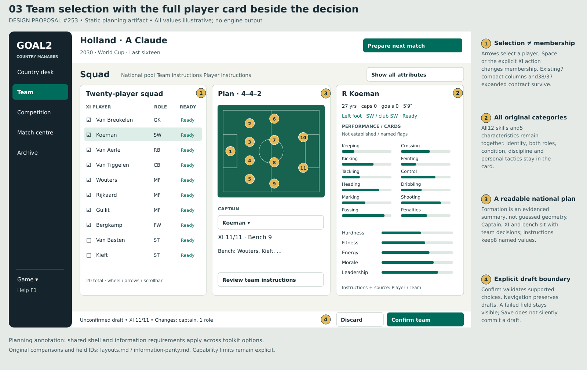
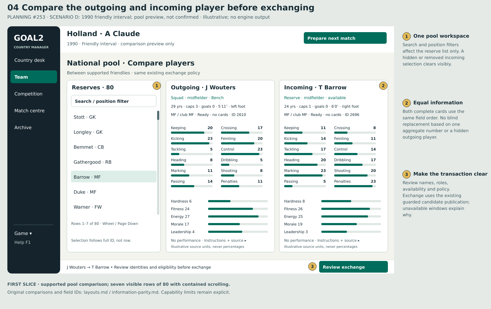
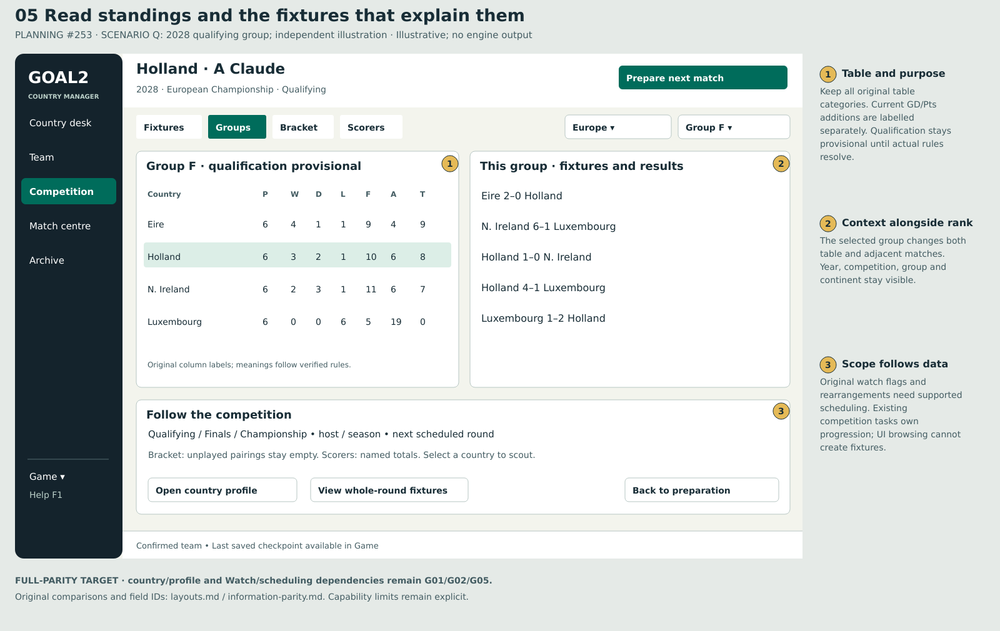
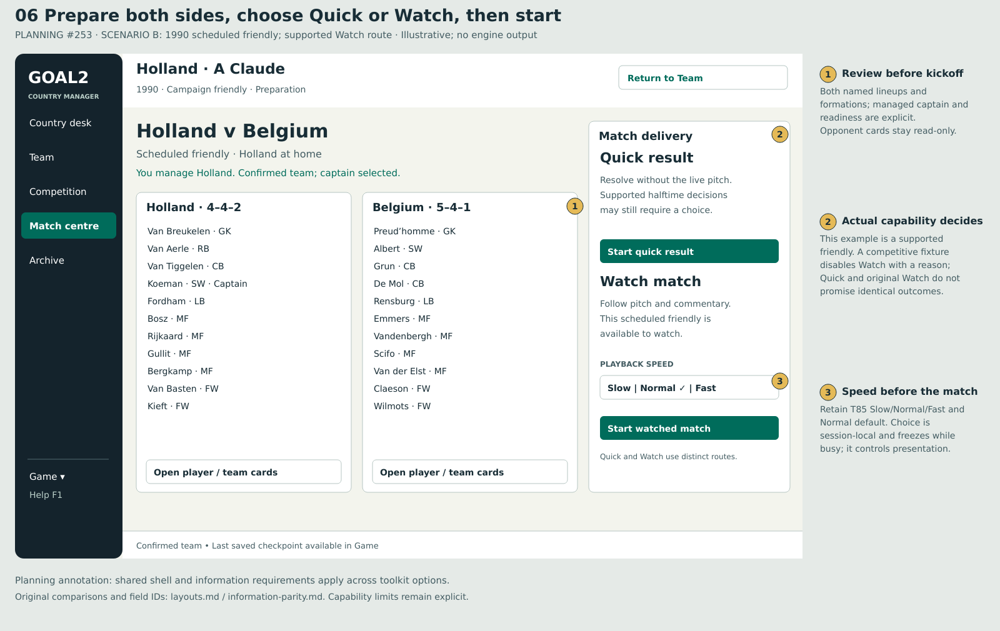
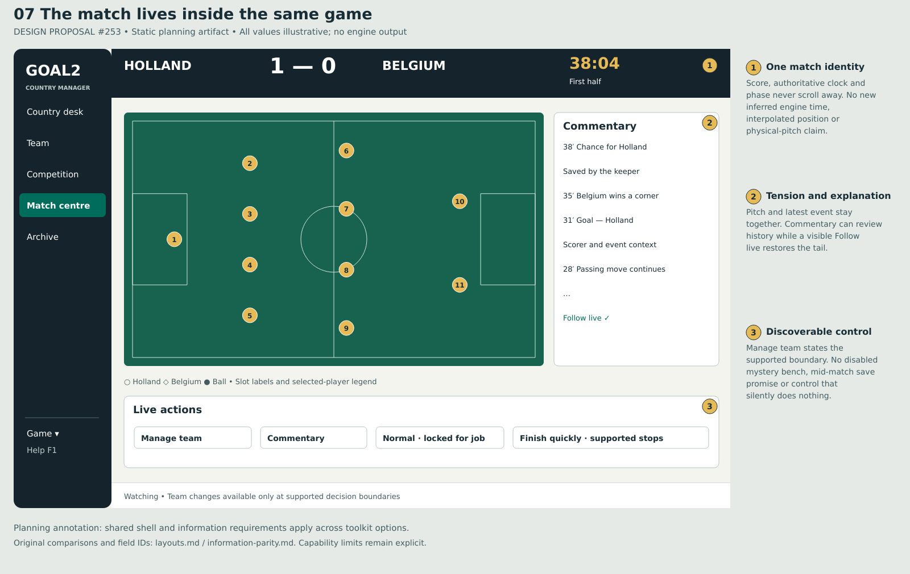
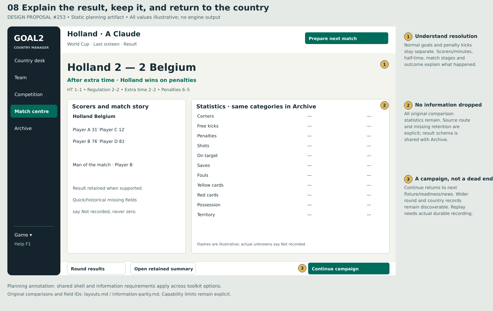
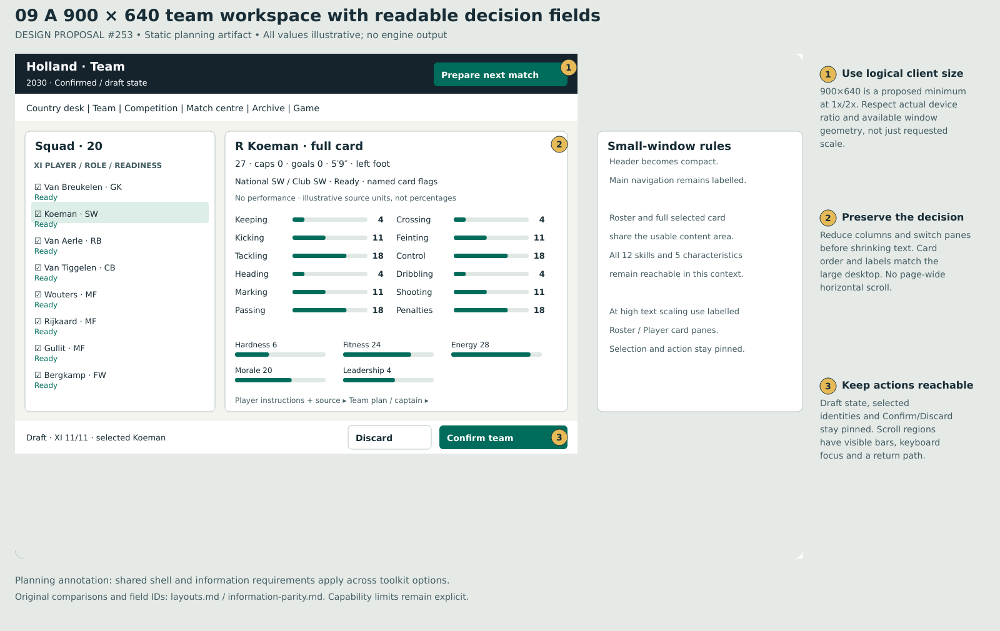
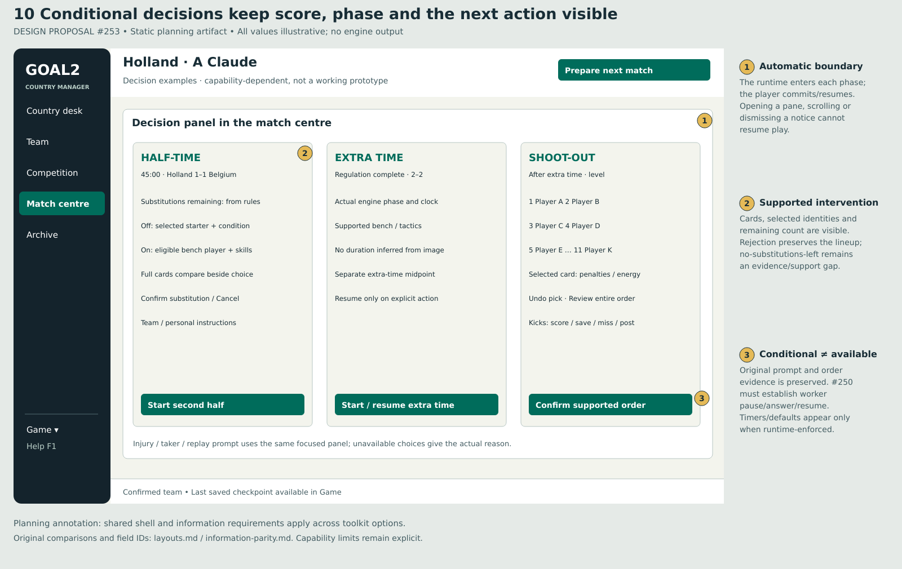

# Annotated layouts, visual identity and interaction rules

[designed: #253] The proposal is **Country desk**: a compact, readable national-management game with consistent workspaces and a strong match identity. The authored SVGs and their PNG exports are static planning artifacts. They import no game code, accept no input and do not demonstrate runtime behavior. All example players/figures/bars are illustrative, including source-unit numbers. Original unknown encodings are explicitly unknown; supported numeric projections follow T84's field contract, never invented percentages. Actual-current-build captures are separately labelled in the [assessment](assessment.md).

[designed: #253] The large layouts show a1260×808 logical application region inside a1600×1010 annotation sheet; the small-window layout shows an actual900×640 region. These are illustrative compositions at desktop scale, not claims of accepted native geometry. Implementation acceptance uses1440×900 and900×640 logical clients, actual1x/2x, platform focus and increased text scale. The layout's numbers map to the right-side annotations. Open a PNG/SVG for full-size reading.

## Representative whole-game views

| Journey / original comparison | Proposed annotated view / what is preserved |
| --- | --- |
| [confirmed: original country-select](../original-game/images/country-select.png); original load/new/count/name are in the [startup chapter](../original-game/startup-save-replay.md).  | [designed] **01 Country setup.** Choice supported by rank/difficulty, status/manager, skills/performance, formation/strips and player inspection; distinct launch/load and review/start flow. [PNG](layouts/01-country-setup.png) · [SVG](layouts/01-country-setup.svg).  |
| [confirmed: original manager hub](../original-game/images/manager-menu.png); country/opponent/rank/squad context surrounds menu.  | [designed] **02 Country desk.** Next challenge, own/opponent ranks, campaign position, readiness and bulletin. Preparation has one clear route; records/round results remain discoverable. [PNG](layouts/02-country-desk.png) · [SVG](layouts/02-country-desk.svg).  |
| [confirmed: original full squad card](../original-game/images/m244-squad.png); current/club positions,12 skills/5 characteristics and instructions support selection.  | [designed] **03 Team workspace.** Seven compact table columns plus full selected card, all20 names with XI11/Bench9 split beside the full card, captain/formation and pinned draft action. Numeric examples are source-unit illustrations; no normalized rating replaces any category. [PNG](layouts/03-team-workspace.png) · [SVG](layouts/03-team-workspace.svg).  |
| [confirmed: original pool card](../original-game/images/m244-pool.png); E031's two-stage exchange needs both identities.  | [designed] **04 Pool comparison.** Filtered pool beside pinned outgoing/incoming complete cards; same attribute order and deliberate review/exchange. The first card is no longer held only in memory while another is browsed. [PNG](layouts/04-pool-compare.png) · [SVG](layouts/04-pool-compare.svg).  |
| [confirmed: original group table and fixtures](../original-game/images/m244-tournament-group-f.png); [bracket](../original-game/images/m244-world-finals-bracket.png) has future blanks and scorers.  | [designed] **05 Competition.** Table and relevant fixtures together, with year/group/continent/display context. Bracket and scorer routes preserve the wider national competition. [PNG](layouts/05-competition.png) · [SVG](layouts/05-competition.svg).  |
| [confirmed: original pre-match menu](../original-game/images/match-menu.png); formations, named lineups, venue and tactics/players precede play.  | [designed] **06 Preparation.** Both named lineups and formations, managed captain/readiness, Quick/Watch explanations and speed before explicit Start. Example uses a supported friendly; competitive Watch is disabled with a reason. [PNG](layouts/06-match-preparation.png) · [SVG](layouts/06-match-preparation.svg).  |
| [confirmed: original live pitch](../original-game/images/match-live.png), [commentary](../original-game/images/match-commentary.png) and [injury event](../original-game/images/injury-event.png).  | [designed] **07 Live match.** Two teams/ball/legend, authoritative score/clock/phase, commentary and visible control context. This is the logical visual system; recommended first delivery may use a coordinated owned SDL window. No native embedding or live edit capability is proven by this drawing. [PNG](layouts/07-live-match.png) · [SVG](layouts/07-live-match.svg).  |
| [confirmed: original result statistics](../original-game/images/match-summary-save-prompt.png) and [round results](../original-game/images/round-results.png).  | [designed] **08 Result and return.** Separate stage/penalty resolution, named scorer/minute columns, MOTM, original comparative statistics and clear Continue campaign. Unknown data says Not recorded; zero remains a real value. [PNG](layouts/08-result-and-campaign.png) · [SVG](layouts/08-result-and-campaign.svg).  |
| [confirmed: original squad](../original-game/images/m244-squad.png) fits its decision/card information in one dense screen. Current actual small-window composition is in the [runtime capture](evidence/runtime-06/desktop-squad-900.png). | [designed] **09 Small desktop window.** Compact header, labelled navigation, explicit roster scrollbar/Bench jump and full-card panes and pinned selected identity/draft actions. All12 skills and5 characteristics remain in context; increased text scaling switches labelled panes before reducing readable text. [PNG](layouts/09-small-window.png) · [SVG](layouts/09-small-window.svg).  |
| [confirmed: original halftime](../original-game/images/match-menu-halftime.png), [extra-time menu](../original-game/images/m244-extra-time-menu.png), [midpoint](../original-game/images/m244-extra-time-halftime.png), [order](../original-game/images/m244-shootout-order.png) and [kick](../original-game/images/m244-shootout-first-goal.png) are distinct conditional states. | [designed] **10 Conditional decisions.** Phase-aware next actions, substitution candidates/count/full cards, extra-time midpoint/resume and all20 names/XI-bench strip beside a full card, with separate extra-time and complete taker-order/undo previews. These examples require #250's bounded support audit and separately scoped G01 mode-dependent capabilities; the contract preserves original evidence without enabling pretend controls. [PNG](layouts/10-match-decisions.png) · [SVG](layouts/10-match-decisions.svg).  |

## A modern national-team identity

[designed: #253] Use an ink/navy frame, warm paper data surfaces, deep emerald actions and a restrained amber event/focus accent. Country identity belongs in the header and opponent comparisons; do not invent authentic kits, flags or licensed marks from the current generic shirt. The original's bright functional color survives as controlled selection/event accents and a readable national bulletin, rather than recreating magenta text over black everywhere. Keep management and match typography, spacing, selected-state language and action placement related, even while the live pitch uses a darker frame.

[designed] Use a platform-appropriate sans serif with a predictable bundled/fallback strategy; the static sheets use DejaVu Sans. Proposed hierarchy:24–32px page/match title,18–22px section/card headings,14–16px controls/table reading,12–13px secondary metadata. Text scaling must not strand a critical field at the metadata size; the chosen frontend proof determines its actual native fonts. Use tabular numerals for scores, clock, columns and source-unit values. Do not use a decorative football font for information. An8px spacing rhythm,16–24px panel margins, visible row divisions, generous pointer targets and restrained borders make dense cards scannable.

[designed] Skills/characteristics show their verified raw value/domain or a literal unavailable explanation beside any bar. A bar must share the exact source interpretation and have an accessible textual value. Country profile bar units and original performance/card glyph semantics stay unknown unless independent evidence resolves them. Pitch positions/formation diagrams in the planning sheets are illustrative; runtime pitch rendering preserves accepted causal samples/hidden sentinels/slot identities and does not infer extra physical dimensions, interpolate motion or simulate another match.

## Mouse, keyboard and focus

| Interaction | Proposed contract |
| --- | --- |
| Navigation | [designed] Click labelled destination or Ctrl+1…5; focus moves to the page heading then follows a stable task order. Back returns to originating country/player/fixture/scroll position. A context pane never changes managed country or silently discards a draft. Help/F1 explains current actions. |
| Tables | [designed] Click/Up/Down selects; Home/End/PgUp/PgDn and visible scrollbars reach boundaries. Selection, keyboard focus and XI checkbox are distinct. Tab leaves the table; Shift+Tab reverses. Space changes an eligible XI checkbox only when that control owns focus. Sorting/filtering preserves full-ID identity and does not mutate team order. |
| Complete cards / comparison | [designed] Selecting a row updates its full card; Compare pins the outgoing and incoming identities. Expanded tables scroll horizontally inside their named container, with identity retained. Critical readiness, chosen players and primary action do not require horizontal page scrolling. |
| Buttons / dialogs | [designed] Enter activates the focused safe action; Space activates a focused button. Esc closes a context pane/cancels an uncommitted choice; it never silently discards a career. Destructive replacement/quit has explicit labelled alternatives and no surprise default. A modal traps focus and returns it to the opener. |
| Match controls | [designed] Pre-match delivery/speed is explicit; live controls reflect supported/current job state. Commentary has its own scroll/follow-live state; score/clock/phase remain fixed. Manage opens only a supported boundary; Resume is explicit. Shortcuts respect text editing and never consume ordinary player-name input. |
| Feedback | [designed] Pair color with text/icon/shape: checkmark for selected XI, C plus captain name, labelled injury/ban, typed event message. Focus has a distinct high-contrast border. Errors identify the affected field and recovery action, announced through the native accessible surface. |

[designed: #253] Normal reading contrast target is at least4.5:1, large text3:1 and meaningful focus/control boundaries3:1, checked on actual rendered enabled/disabled/selected surfaces. Team identity uses both labels/shapes and color. The native proof includes screen-reader table headers/current row, card name/value/source, draft state, validation errors and a text summary of match events; it does not assume a canvas pitch is independently readable. These are proposed acceptance targets, not a conformance certification.

## Resizing, motion and exceptional states

[designed] At wide desktops, selected card/table/plan are adjacent; comparison cards use equal widths. Below roughly1200 logical width, reduce decoration/header depth and move the plan to a named tab/pane; retain full card beside a useful roster. At900×640, use the compact header and explicit Roster / Player card / Plan panes when text scaling requires them. Collapse optional metadata columns before shrinking text; the T84 expanded comparison remains available in a contained table. Preserve visible scrollbars, selected identity, draft and primary action. Never depend on the requested Qt scale matching actual device ratio; #252's diagnostics remain distinct from supported-size assertions.

[designed] Optional motion is short and task-related:120–180ms panel/selection transitions, subtle goal/event emphasis and a clear phase change. Reduced motion removes decorative transitions without altering samples/events, clocks, prompt semantics or input timing. Do not animate layout while a user is selecting a row, answering a prompt or focusing a control. Pitch playback follows accepted samples; presentation speed is not engine timing.

| State | Proposed visible behavior and recovery |
| --- | --- |
| Loading resource/career | [designed] Keep chosen save/country identity; show progress and Retry/Choose another on failure. Do not display a successful new campaign as a fallback. |
| Starting / resolving match | [designed] Fixture and selected mode stay visible; show responsive progress/Cancel and explain locked save/edit actions. One job owns publication; Cancel returns to the prior committed checkpoint. |
| Unavailable capability | [designed] A visible reason sits beside the action: wrong fixture, absent runtime, view-only watch, pool window, missing stage or unrecorded data. Link an appropriate next action; do not silently no-op or manufacture a result. |
| Empty history / no goals / no fixture | [designed] Distinguish no recorded matches, a genuine0-goal result and an unsupported/finished calendar. Country desk always offers the correct available preparation/continue/save route. |
| Invalid lineup / exchange / instruction | [designed] Keep draft/candidate and identify actual refusal; no authoritative change. Bring the player/field into view; retain complete candidate information. |
| Save/load failure | [designed] Explain the selected operation/file in ordinary language, preserve active game and prior good save, and offer Retry / Save elsewhere / Load another / Cancel. Diagnostics stay separate from normal decisions. |
| Replace / overwrite / quit | [designed] Name the affected career/save and unconfirmed draft separately; explicit Save and continue / Discard committed changes / Cancel as appropriate. Successful saving precedes replacement/exit; a failed save keeps the decision pending. |
| Timed original prompt | [designed] Display the enforced default and available time only if the runtime supplies it. No invented wall-clock timeout or automatic Yes; accessibility timing changes require a separate proven owner choice. |
