# One country, one coherent story

[designed: #266] **All fourteen images below are final-target illustrations, not current-build captures.** They use fictional players and authored outcomes, not original assets or engine output. Each image has a visible target label. They show desired appearance and decisions without claiming a toolkit, embedded renderer or working missing capability. [Current-build captures and limits](evidence.md#current-reality) are separate.

[designed] The single main story is Holland, manager Alex, in an illustrative 2030 qualifying campaign. Resume before a scheduled home friendly with Belgium. Replace bench forward C de Wit with reserve R Noor, keep the XI/captain, choose Watch at Normal, reach half-time1–1, bring on J Jansen for P Bos, win2–1, then prepare the Eire qualifier. No qualification points are awarded for the friendly. New/start and error panels are alternative routes in that same career. Later-career/knockout panels are explicitly later possibilities, not hidden state changes in the friendly.

## 01 Start or resume

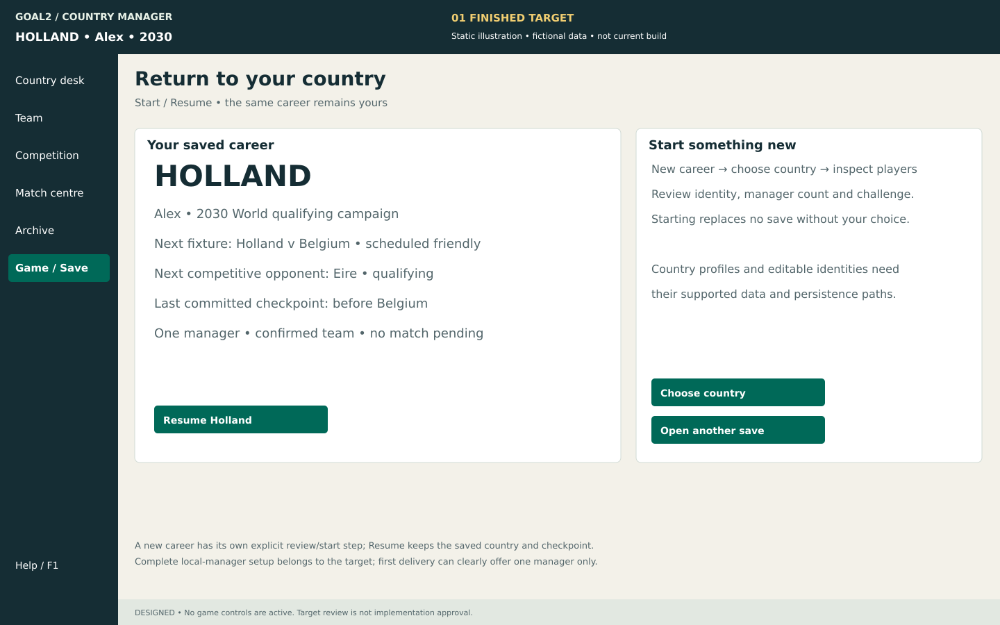

[designed] Resume names the country, manager, campaign, next fixture and checkpoint. New career leads to country preview, manager/identity review and explicit start; it does not silently replace a career or assume the original1–6-manager offer already works. See [original startup evidence](../original-game/startup-save-replay.md). [SVG](screens/01-start-resume.svg).

## 02 Return to the country desk

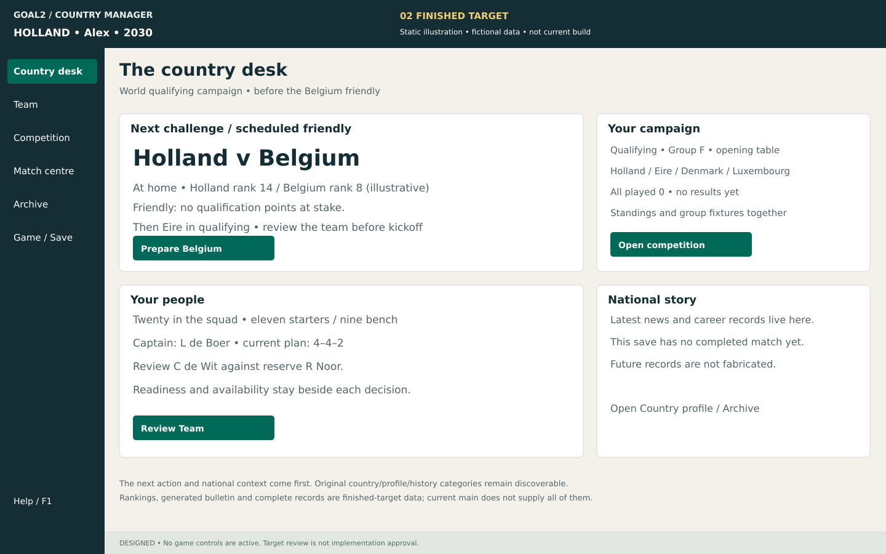

[designed] Belgium is a friendly before qualifying begins. The national context, team readiness and one preparation route remain adjacent. Group F has no played games; rankings are illustrative target data. Complete profiles, generated bulletin and history remain G03/G05 capability gaps, not evidence supplied by this image. [Original hub/country/campaign reference](../original-game/competition-and-campaign.md). [SVG](screens/02-country-desk.svg).

## 03 Understand the whole squad

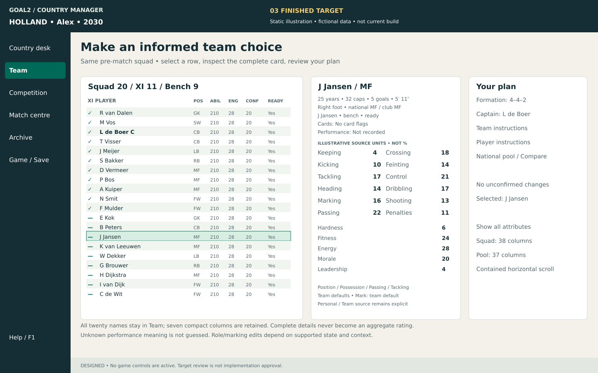

[designed] J Jansen is on the bench; L de Boer captains the unchanged XI. The selected complete card retains identity/biography, national/club positions, cards, performance/readiness, twelve skills, five characteristics and instructions. The plan routes lead to all eight team and five personal tactic categories; missing supported edits stay explicit. Extended tables preserve T84's38/37 columns. [Original full cards/tactics](../original-game/squad-and-tactics.md). [SVG](screens/03-team.svg).

## 04 Compare both people before an exchange

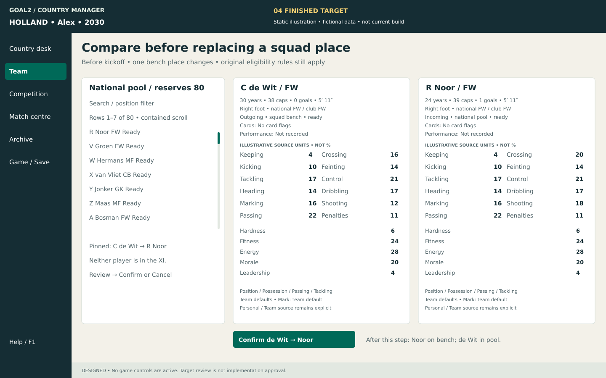

[designed] Both candidates are forwards outside the XI, so this exchange changes only one bench place. The cards use the same category order and complete detail. Their numbers are authored illustration units; they do not assert that these are decoded records or ratings. The story confirms de Wit→Noor; subsequent preparation retains Noor, with twenty squad members and nine on the bench. The original exchange eligibility/window remains authoritative. This panel's pool count is an illustrative80, with seven visible rows and contained scrolling, not a promise that every country has the same source dataset. [SVG](screens/04-pool.svg).

## 05 Prepare, choose Quick or Watch, then start

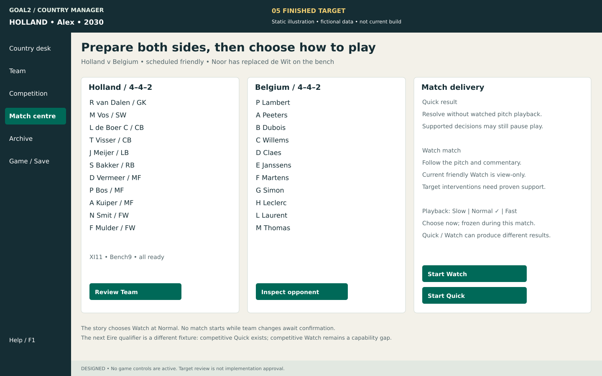

[designed] Both starting XIs are unchanged by the bench exchange. The story selects Watch at Normal. Quick/Watch differences and the present view-only limitation are stated beside the controls, rather than promising equivalence or live coaching. Speed is fixed before kickoff. Inspecting Belgium retains managed-country identity. The later Eire qualifier has a different support boundary: competitive Quick does not prove competitive Watch. [SVG](screens/05-preparation.svg).

## 06 Feel the match

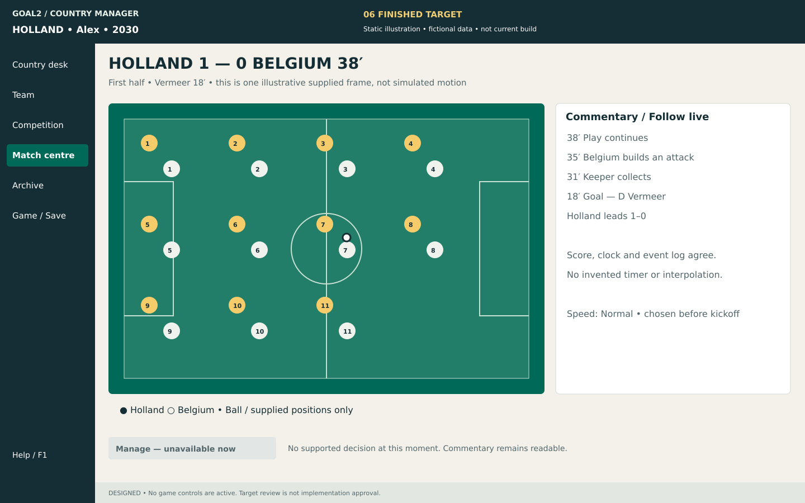

[designed] D Vermeer scored at18′; Holland leads1–0 at38′. Clock, phase, score and commentary agree. The numbered schematic pitch is a composition illustration, not physical positions, a real sample, interpolated motion or a new engine. Manage is unavailable because there is no supported decision at this instant. The planned complete game exposes only actual eligible interventions. [Original match evidence](../original-game/match-and-results.md). [SVG](screens/06-watched.svg).

## 07 Make a supported decision, then resume

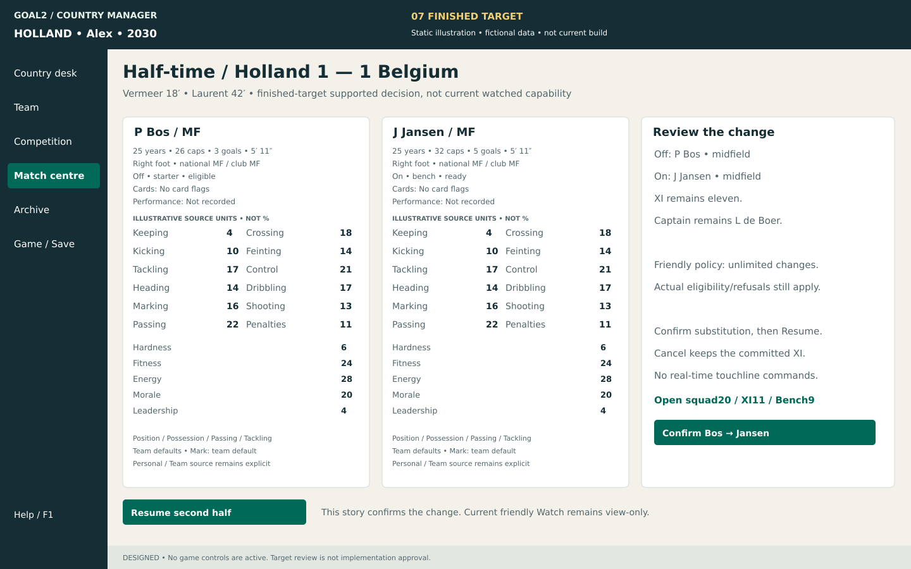

[designed] L Laurent equalizes for Belgium at42′. At half-time1–1, the later target permits Bos→Jansen in midfield. Confirm replaces one starter with one bench player and keeps captain L de Boer. This story applies the change and explicitly resumes. The cards retain the drawing's fixed illustrative values; they are not evidence of match-energy evolution. Runtime values must come from the actual paused state. Current friendly Watch is view-only; #250's bounded audit/first action and G01's missing mode-dependent capability still govern implementation. The friendly policy shown is the accepted remaster policy, not the original five-substitution observation. [SVG](screens/07-half-time.svg).

## 08 Understand the result

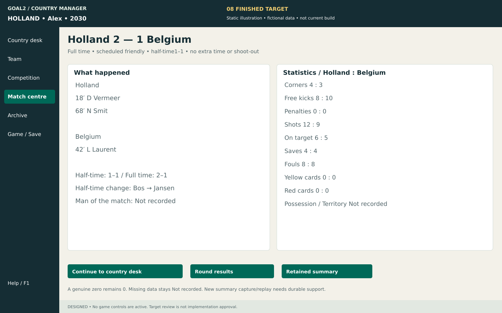

[designed] N Smit scores at68′, making the final2–1 (half-time1–1). The friendly does not go to extra time or penalties. Match goals, stats, substitutions and absent data remain distinct. Shots12/9, on-target6/5, saves4/4 and goals2/1 are mutually consistent illustration values; they are not an asserted definition of original statistics. A retained summary opens only when actually recorded; new durable summary/goal capture/export/replay remain G04. [SVG](screens/08-result.svg).

## 09 Continue and save the same career

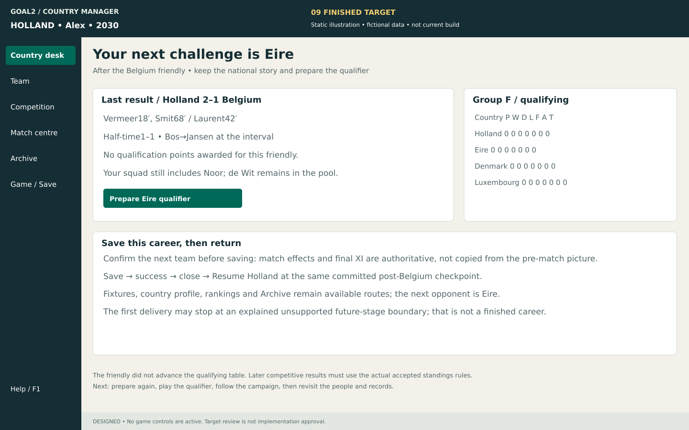

[designed] The desk remembers the Belgium result and prepares Eire. The zero qualifying table is unchanged by the friendly. It uses the original column labels, without inventing a nonzero T formula or future tie-break outcome. Save succeeds before exit; Resume restores the post-Belgium committed career, including authoritative match effects and confirmed changes. The illustration does not reuse the pre-match card as a post-match source. [SVG](screens/09-continue.svg).

## 10 Follow a national career

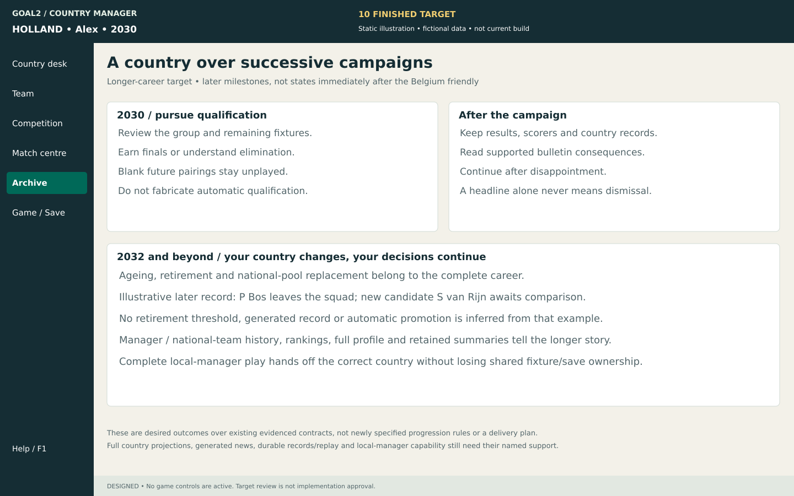

[designed] This is a later-career preview, not an immediate jump to2032 after the friendly. Finals must be earned; elimination has a clear continuation. A later Bos replacement is a fictional narrative example, not a threshold/retirement/generation rule. Actual later ages, retirement/replacement, manager effects and competition transitions follow their accepted contracts and evidence. Full records/news/profile and local-manager handoffs remain missing support dependencies. [Original longer-loop evidence](../original-game/competition-and-campaign.md). [SVG](screens/10-career.svg).

## 11 Read at a small window

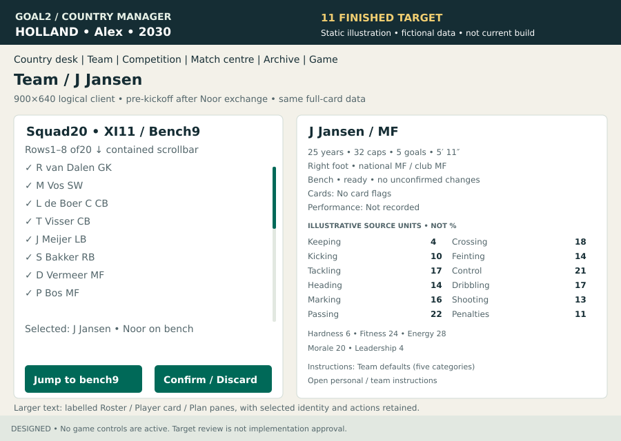

[designed] This returns to the explicitly labelled pre-kickoff post-pool state, with Jansen on the bench and Noor retained. Eight roster rows fit beside the same complete card; contained scrolling and Jump to bench reach every name. Selected identity and Confirm/Discard actions stay pinned. At increased text scale, labelled Roster/Player card/Plan panes replace simultaneous columns before text shrinks. That relocation requires actual keyboard/screen-reader/scale acceptance; a static900×640 PNG proves only the proposed composition. [SVG](screens/11-small-window.svg).

## 12 Know why an action is unavailable

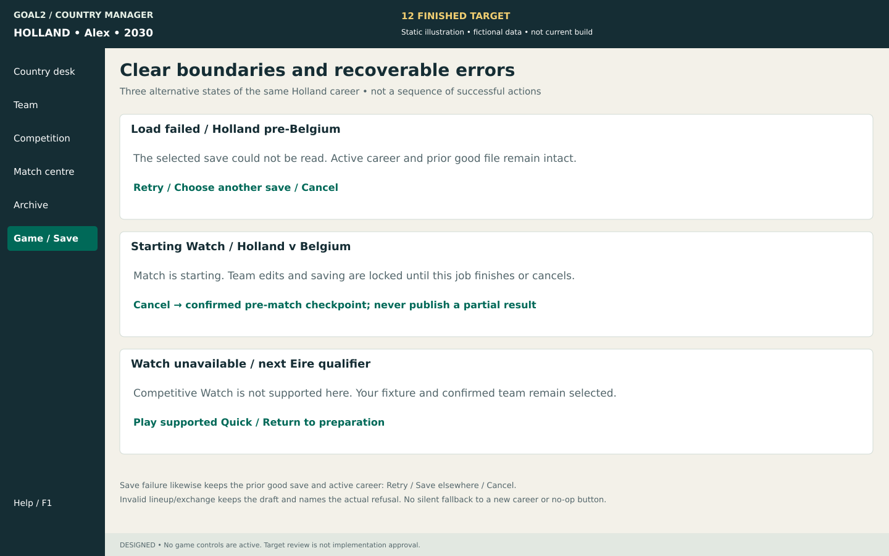

[designed] These are three alternatives in the same career, not a sequence of successful operations. Failure keeps the current career/prior save; starting keeps the fixture/mode visible and locks unsafe edits; cancellation returns to the committed pre-match checkpoint. Competitive Watch explains its limitation and offers supported Quick. Invalid lineup/exchange errors retain the draft and name the refusal. A failed save keeps the exit decision pending. The underlying job/save/timing contracts must prove those behaviors; this is desired feedback, not new authority. [SVG](screens/12-unavailable-errors.svg).

## 13 Conditional extra time and shoot-outs

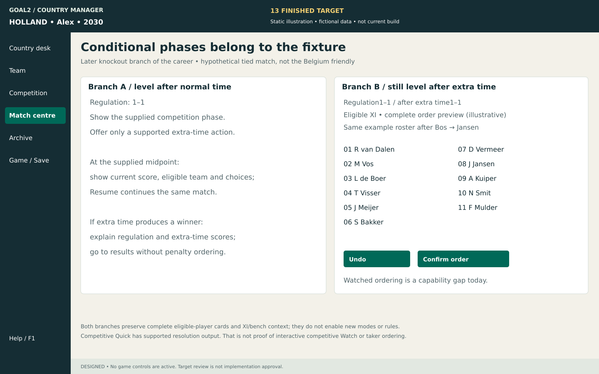

[designed] The labels deliberately separate these hypothetical later knockout branches from the Belgium friendly. An actual tie after normal time may require extra time under the supported competition rules. A later tie after extra time may require order/undo/confirmation and supplied kicks. Complete eligible-player cards and XI/bench context remain required, as in the main halftime example. Show actual defaults/timing only; never impose a new timeout. Competitive Quick result stages exist separately from interactive watched extra time/order, which remains G01 capability work. [Original conditional evidence](../original-game/match-and-results.md). [SVG](screens/13-conditional.svg).

## 14 Three credible directions

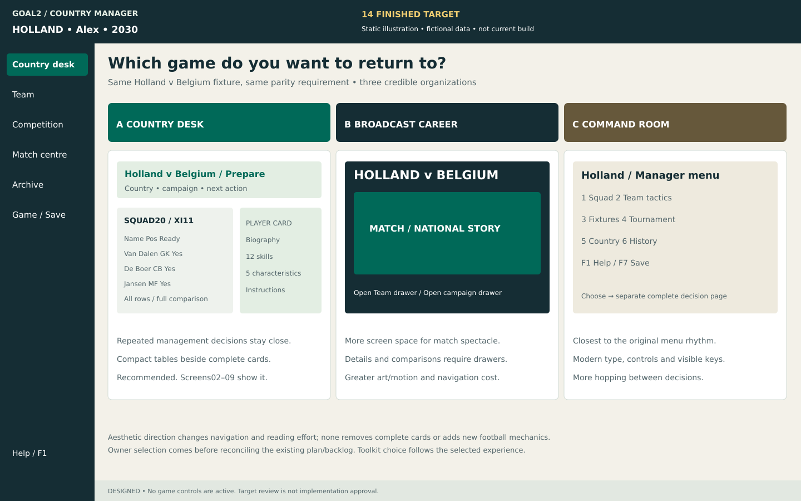

[designed] All three use the same fixture and retain full information parity. Country desk puts recurring decisions together. Broadcast career gives the next match/pitch more space and moves comparisons into drawers. Modern command room retains the original menu/screen rhythm with visible modern controls. The alternatives change navigation and emphasis, not the rules. Country desk is recommended because the repeated task is comparing players in a campaign context; broadcast emphasis remains a legitimate owner preference. [Select in product terms](README.md#product-choices-for-the-owner). [SVG](screens/14-directions.svg).
