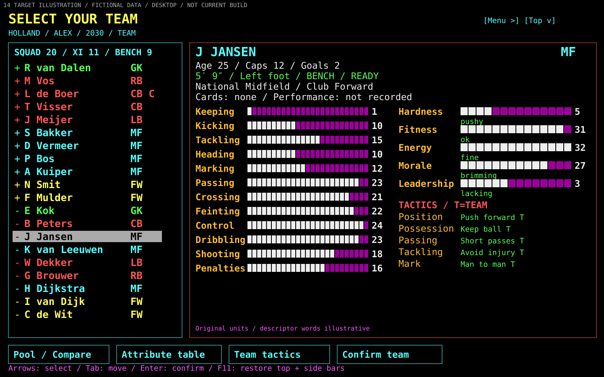
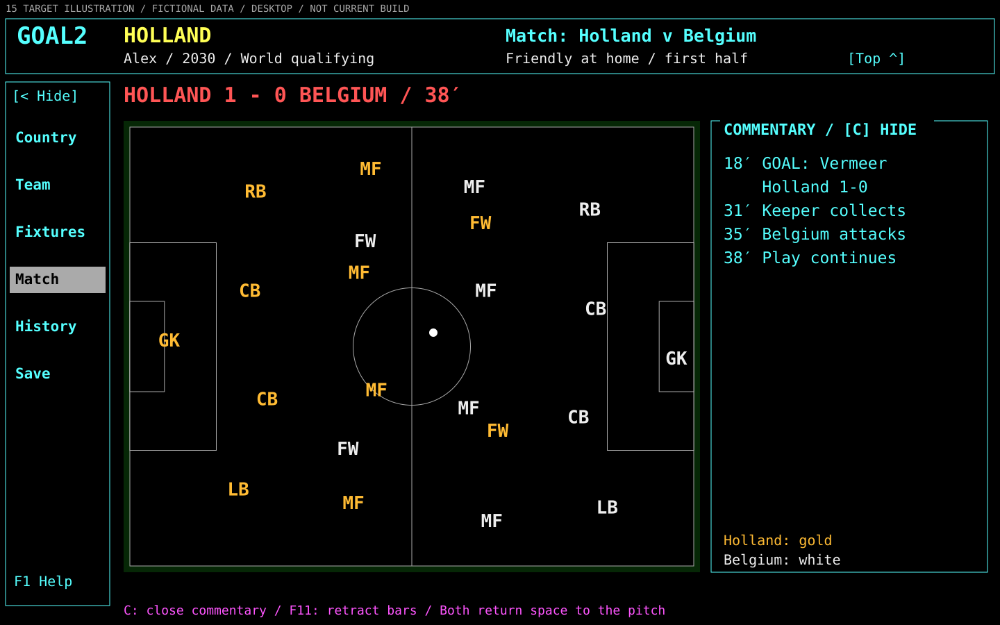
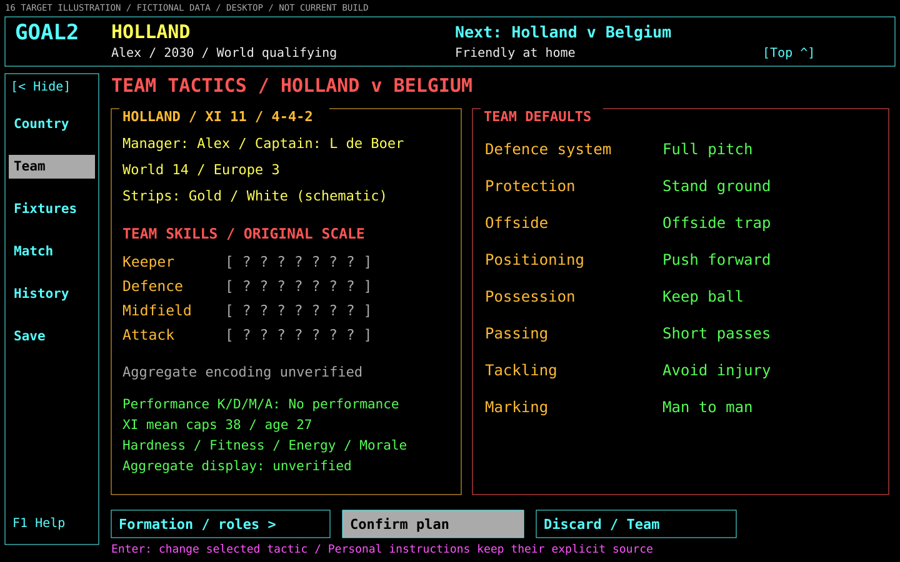
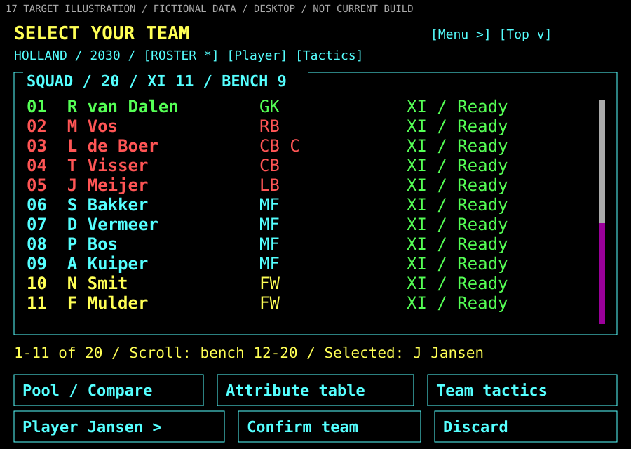
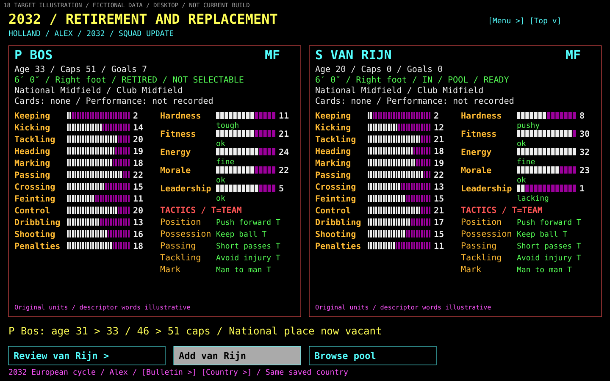
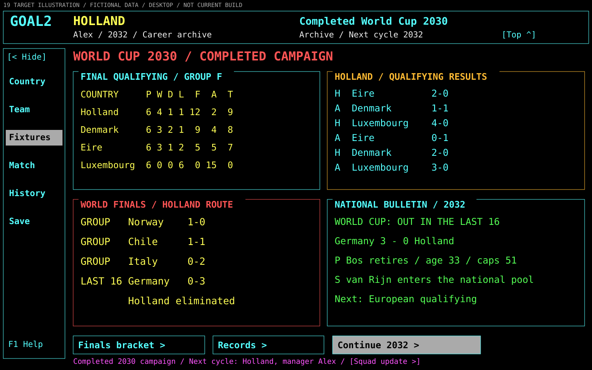

# One country, one coherent story

[designed: #266, revised to owner feedback 2026-10-20] **All nineteen new images below are final-target desktop illustrations, not current-build captures.** The original GOAL2 is now the visual baseline: black, distinct functional colors, large characters, information up front and segmented attribute bars. The former paper/emerald direction and three-way style choice are superseded. New screens use fictional players/authored outcomes, not original assets or engine output; each has a target label. Original comparison images are separately captioned. No toolkit, embedding or missing game capability is proven. [Feedback/source study](evidence.md#owner-correction-and-original-screen-study) and [current-build limits](evidence.md#current-reality) stay separate.

[designed] The single main story is Holland, manager Alex, in an illustrative 2030 qualifying campaign. Resume before a scheduled home friendly with Belgium. Replace bench forward C de Wit with reserve R Noor, keep the XI/captain, choose Watch at Normal, reach half-time 1–1, bring on J Jansen for P Bos, win 2–1, then prepare the Eire qualifier. No qualification points are awarded for the friendly. New/start and error panels are alternative routes in that same career. Later-career/knockout panels are explicitly later possibilities, not hidden state changes in the friendly.

## 01 Start or resume

[designed] Resume names the country, manager, campaign, next fixture and checkpoint. New career leads to country preview, manager/identity review and explicit start; it does not silently replace a career or assume the original 1–6-manager offer already works. See [original startup evidence](../original-game/startup-save-replay.md). [SVG](screens/01-start-resume.svg).

## 02 Return to the country desk

[designed] Belgium is a friendly before qualifying begins. The full role-colored twenty, own/opponent ranks and direct original-like menu put information in view immediately. Group F has no played games; rankings are illustrative target data. Complete profiles, generated bulletin and history remain G03/G05 gaps. The visible top/side bars have explicit retract controls. [Original hub/country/campaign reference](../original-game/competition-and-campaign.md). [SVG](screens/02-country-desk.svg).

## 03 Understand the whole squad

**Original reference — authentic reconstructed screen, not a new target:**

[confirmed: M244-G1A-02 step 3, accepted manual ebdd6879] Black, large character cells, distinct colors, dense card/roster and twelve skill/five characteristic bars are the reference. Original bars do not by themselves prove their numeric meanings; [verified field evidence](evidence.md#owner-correction-and-original-screen-study) is separate.

**Revised desktop target:**

[designed] J Jansen is on the bench; L de Boer captains the unchanged XI. Large role-colored names and the complete selected card retain identity/biography, named national/club positions, cards, performance/readiness, all twelve skills/five characteristics as bars and raw values, plus five instruction values/source. T means the Team default, not a new tactic. All five characteristic descriptor slots are present. Their words use the original vocabulary as explicitly illustrative examples, not a decoded word/value mapping. T84 establishes those descriptor tables; only the nonblank performance bucket rendering remains unresolved. Attribute table preserves the seven-column compact and 38/37-column expanded contracts; Team tactics leads to all eight categories. [Original full cards/tactics](../original-game/squad-and-tactics.md). [SVG](screens/03-team.svg).

## 04 Compare both people before an exchange

[designed] Both candidates are forwards outside the XI, so one bench place changes. Both complete large-type bar cards stay pinned; the candidate strip lists seven names, and Browse opens the filtered/scrollable pool without losing outgoing/incoming identity. Noor's crossing 20 / shooting 18 bars are visibly longer than de Wit's 16 / 12. de Wit offers heading 21 and penalties 21; Noor offers dribbling 24 but heading 12 and penalties 15. The profile differences make the tradeoff visible. These are authored original-unit examples, not decoded records or ratings. The story confirms de Wit→Noor; later preparation retains Noor with 20 squad / 9 bench. Original eligibility/window remains authoritative. The 80-pool count is illustrative, not a universal dataset promise. [SVG](screens/04-pool.svg).

## 05 Prepare, choose Quick or Watch, then start

[designed] Both starting XIs are unchanged by the bench exchange. The story selects Watch at Normal. Quick/Watch differences and the present view-only limitation are stated beside the controls, rather than promising equivalence or live coaching. Speed is fixed before kickoff. Inspecting Belgium retains managed-country identity. The later Eire qualifier has a different support boundary: competitive Quick does not prove competitive Watch. [SVG](screens/05-preparation.svg).

## 06 Feel the match

**Original reference — authentic reconstructed default pitch:**

[confirmed: E015-r0007 state 31; accepted manual ebdd6879] The default live view dedicates the main area to the pitch. [Expanded original commentary](../original-game/images/match-commentary.png) is a separately observed state.

**Revised desktop target — default:**

[designed: owner direction] D Vermeer scored at 18′; Holland leads 1–0 at 38′. Top/side bars and full commentary are retracted by default; a thin score/phase HUD and the latest two lines remain. The actual playing field occupies 82.2% of the authored canvas; its narrow surround brings the pitch area to 85.3%. Validation measures the field itself. The thin HUD also names the Friendly fixture type. Holland uses gold and Belgium white, as the team labels in the HUD show. Pitch colors identify teams rather than the roster role groups. Role characters and a white ball are schematic, not a real sample, physical dimensions, interpolated motion or new engine. Menu/Top edge handles restore navigation; C opens full commentary. There is no always-visible coaching panel or supported decision at this instant. Presentation toggles cannot answer prompts or alter timing. [Original match evidence](../original-game/match-and-results.md). [SVG](screens/06-watched.svg).

## 07 Make a supported decision, then resume

[designed] L Laurent equalizes at 42′. At half-time 1–1, the target presents Bos→Jansen in midfield through the same complete bar cards; captain L de Boer remains. Bos has energy 16 and a stronger tackling/heading profile; Jansen has energy 32 and stronger control/dribbling/crossing. These are separately authored half-time snapshots. This story confirms the change and explicitly resumes. Fixed drawing values are not evidence of match-energy evolution; runtime cards must read the actual paused state. Current friendly Watch is view-only: #250's bounded audit/first action and G01 still govern implementation. A decision can request attention even when chrome is hidden; retracting it never silently answers/dismisses a prompt. Friendly unlimited changes is the accepted remaster policy, not the original observed five. [SVG](screens/07-half-time.svg).

## 08 Understand the result

[designed] N Smit scores at 68′, making the final 2–1 (half-time 1–1). The friendly does not go to extra time or penalties. D Vermeer is the named Man of the Match. Possession and territory remain visible categories, labelled “Meaning unverified” / “shown when verified”, because raw board rows are supplied but their display conversion was not established here. They are not missing records. Match goals, stats, substitutions and actually absent data remain distinct. Shots 12/9, on-target 6/5, saves 4/4 and goals 2/1 are mutually consistent illustration values; they are not an asserted definition of original statistics. A retained summary opens only when actually recorded; new durable summary/goal capture/export/replay remain G04. [SVG](screens/08-result.svg).

## 09 Continue and save the same career

[designed] The desk remembers the Belgium result and prepares Eire. The zero qualifying table is unchanged by the friendly. It uses the original column labels, without inventing a nonzero T formula or future tie-break outcome. Save succeeds before exit; Resume restores the post-Belgium committed career, including authoritative match effects and confirmed changes. The illustration does not reuse the pre-match card as a post-match source. [SVG](screens/09-continue.svg).

## 10 Follow a national career

[designed] This 2032 archive shows the completed 2030 campaign, not an immediate jump after the friendly: home/away/all now–top runs, WC/CH podium counts, yearly W/D/L/F/A and best place, season scorers, top caps and largest home/away/neutral wins and defeats. The fictional ledger contains the Belgium friendly, six qualifiers and four finals matches: W 6 / D 2 / L 3 / F 16 / A 9, ending in the last 16. Streaks are calculated from that ledger. The top-cap examples add eleven appearances to the three named starters. The scorer list totals sixteen goals. These are coherent illustration data, not original-generated records or a new record-keeping algorithm. [Campaign and bulletin](#19-qualify-play-finals-and-continue) and [ageing/replacement cards](#18-see-the-later-squad-change) make the continuation visible. G03/G05 remain capability gaps. [Original history](../original-game/images/m244-history.png), [longer-loop evidence](../original-game/competition-and-campaign.md), [SVG](screens/10-career.svg).

## 11 Read at a small window

[designed] The actual 900×640 target shows the pre-kickoff post-pool state, Jansen on the bench and Noor retained. Chrome is retracted and labelled Roster/Player/Tactics routes give the full card 18px text, all 17 bars and readable instruction values. [Roster 17](#17-browse-the-small-window-roster) illustrates the contained scroll area and explicit Pool/Compare, Attribute table and Team tactics routes. Selected identity and Confirm/Discard remain visible. This replaces the first draft's tiny simultaneous roster/card rather than shrinking information to fit. Pane/focus/scale/screen-reader behavior still needs native acceptance. [SVG](screens/11-small-window.svg).

## 12 Know why an action is unavailable

[designed] These are three alternatives in the same career, not a sequence of successful operations. Failure keeps the current career/prior save; starting keeps the fixture/mode visible and locks unsafe edits; cancellation returns to the committed pre-match checkpoint. Competitive Watch explains its limitation and offers supported Quick. Invalid lineup/exchange errors retain the draft and name the refusal. A failed save keeps the exit decision pending. The underlying job/save/timing contracts must prove those behaviors; this is desired feedback, not new authority. [SVG](screens/12-unavailable-errors.svg).

## 13 Conditional extra time and shoot-outs

[designed] The labels deliberately separate these hypothetical later knockout branches from the Belgium friendly. An actual tie after normal time may require extra time under the supported competition rules. A later tie after extra time may require order/undo/confirmation and supplied kicks. Complete eligible-player cards and XI/bench context remain required, as in the main halftime example. Show actual defaults/timing only; never impose a new timeout. Competitive Quick result stages exist separately from interactive watched extra time/order, which remains G01 capability work. [Original conditional evidence](../original-game/match-and-results.md). [SVG](screens/13-conditional.svg).

## 14 Retract the chrome, keep the information

[designed: owner direction] This is the same initial pre-pool twenty, selection, bar values and instructions as 03, with the large top and side bars retracted. The roster row spacing grows from 28 to 31px and the skill row spacing from 28 to 34px; the bar-card type grows to 22px. The reclaimed height goes into the content, with the same bottom edge. The footer now offers Restore rather than Hide. Menu/Top edge handles and keyboard actions restore each bar; selection, draft, scroll and underlying career are preserved. No hover-only controls or surprise automatic hiding while editing. The old three-way direction comparison is superseded by the owner's original-as-baseline instruction. [Revised product choices](README.md#product-choices-for-the-owner). [SVG](screens/14-team-focus.svg).

## 15 Open commentary only when wanted

[designed] This is exactly 06's 38-minute 1–0 instant, not a second match or a simulation pause. The player has explicitly opened navigation and full commentary, reducing the pitch while reading history. C closes commentary; each bar's retract control or the focus shortcut restores pitch space. The default remains 06, showing only the latest lines. Proposed bindings are presentation controls, not proof of original keys, engine pause/timing changes or a new in-flight Quick/Watch switch. [SVG](screens/15-watched-drawers.svg).

## 16 Inspect the whole team plan

[designed] The pre-Belgium plan shows captain, 4–4–2 formation, schematic strip colors and all eight original team-tactic categories with their values. The XI arithmetic mean of caps and age is labelled as such, not presented as the original aggregate calculation. Keeper/defence/midfield/attack skill, performance and average-characteristic categories are retained. The original aggregate bar display has not been verified in this package: question marks and an explicit unverified label preserve the category without manufacturing a bar scale. No performance is the authored pre-match state. Original aggregate bars remain required for full parity once verified; this is an evidence exception, not a permanent omission. [Original team tactics](../original-game/images/m244-team-tactics.png), [SVG](screens/16-team-tactics.svg).

## 17 Browse the small-window roster

[designed] Same pre-kickoff, post-pool squad as 11: Jansen remains the selected bench identity while the viewport is scrolled to rows 1–11. The contained scroll thumb and “1–11 of 20” label show where the remaining nine bench names live; those rows include Noor instead of de Wit. Roster is explicitly active, Player returns to Jansen, and Pool/Compare, Attribute table and Team tactics remain direct routes. These paired pictures illustrate a layout; native scrolling/focus/keyboard behavior is still acceptance work. [SVG](screens/17-small-roster.svg).

## 18 See the later squad change

[designed] The separate 2032 cycle keeps Holland and Alex. Bos's age is two years above the 2030 card and his national caps have risen from 46 to 51; the retired status makes him unselectable. The new pool candidate van Rijn has age 20, zero caps and a distinct complete profile. The review/add/browse routes show how a national vacancy becomes a decision. Values and descriptor words are authored illustrations; age 33 is not a retirement threshold, and the candidate is not generated by this utility. G03/G05 and the accepted roster/cycle contracts govern real support. [SVG](screens/18-later-squad.svg).

## 19 Qualify, play finals and continue

[designed] This archive makes the longer journey concrete: the six Holland qualifying scores match the completed row, the finals route ends 0–3 against Germany in the last 16, and the later bulletin names Bos's retirement, van Rijn's pool entry and the next European cycle. The qualifying total T uses an explicitly illustrative two-points-per-win convention; neither qualification eligibility nor a tie-break algorithm is inferred from it. The fictional group and subsequent advancement are story data, not engine simulation. World-finals/bracket and records remain named routes. The separate hypothetical decision branches in 13 are possibilities, not additional results in this ledger. These targets do not close G03/G05, establish generated bulletins or authorize a new campaign algorithm. [Original final table](../original-game/images/m244-final-qualifying-table.png), [original elimination bulletin](../original-game/images/m244-elimination-bulletin.png), [original bracket](../original-game/images/m244-world-finals-bracket.png), [SVG](screens/19-campaign.svg).
